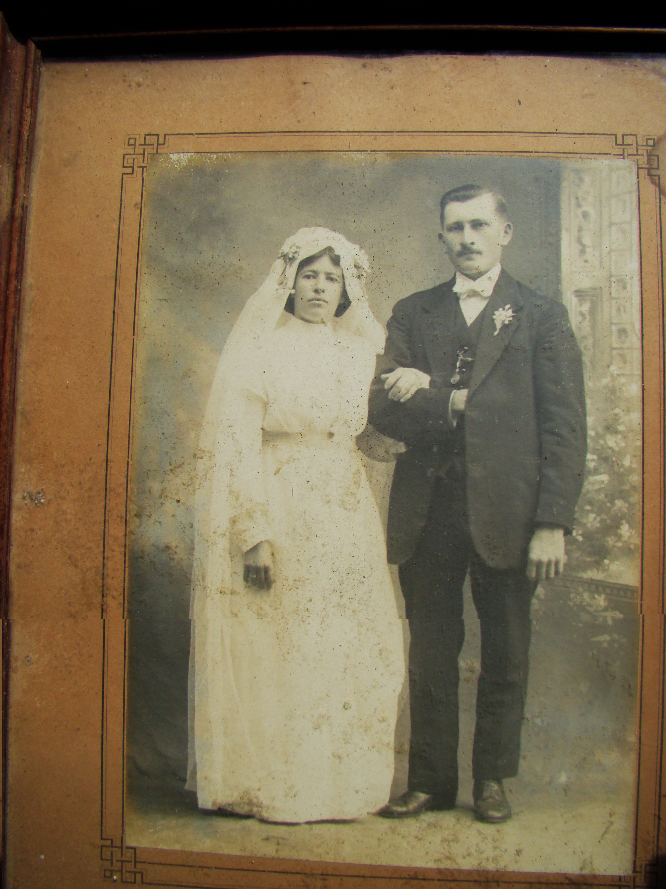
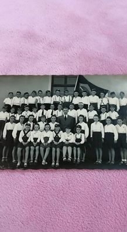
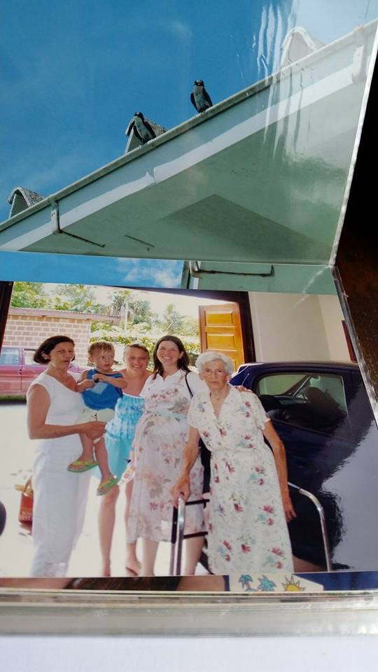
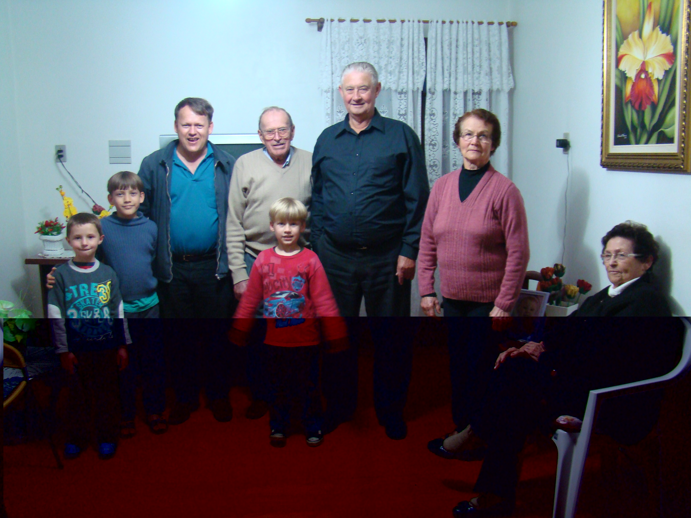
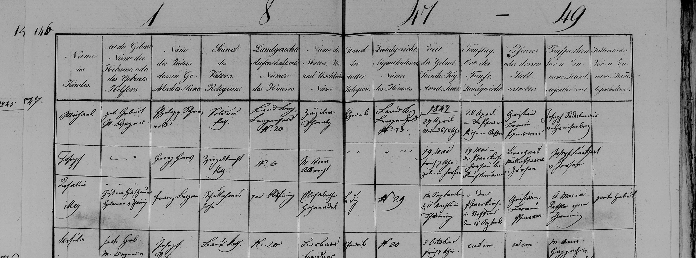
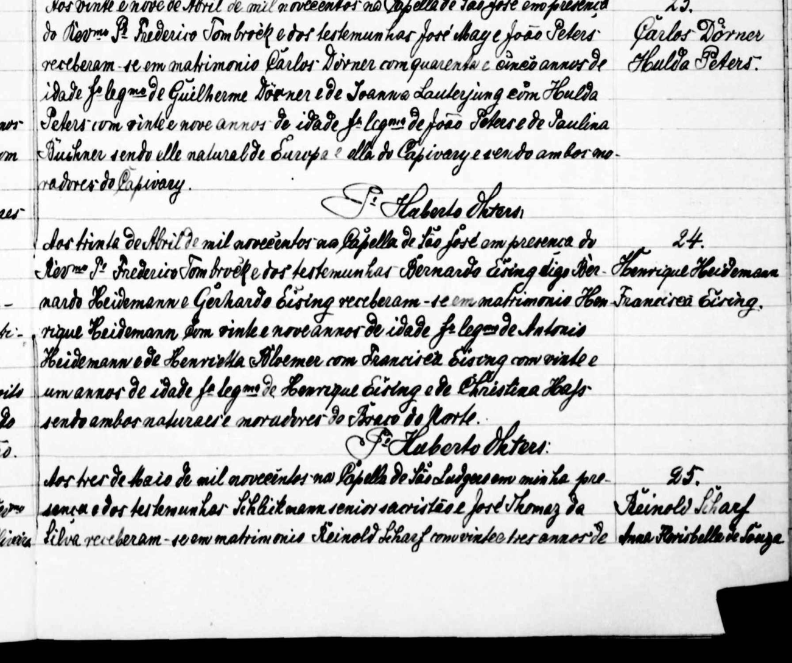
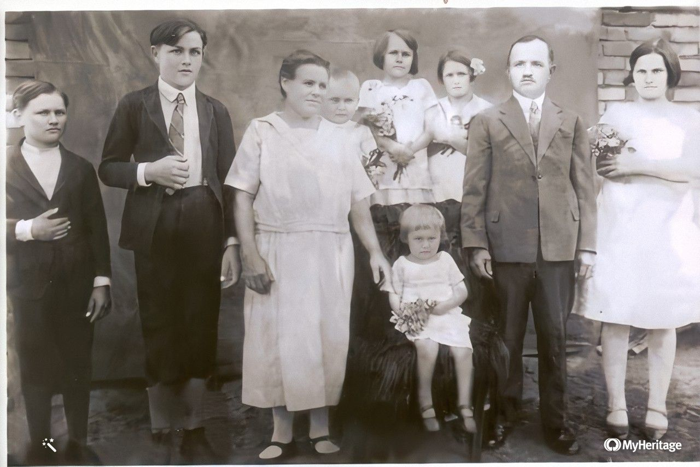

# 🌳 Árvore Genealógica — Famílias Haas, Meier, Voit, Doerner, Preiss, Michels, Arend, Funke, Hoeveler, Lohmann, Endres & Schnack

Repositório dedicado à preservação histórica, documentação comprobatória, pesquisa em cemitérios, extração automatizada em Python e roteiro literário da saga genealógica das famílias **Haas**, **Meier (Meyer)**, **Voit**, **Doerner (Dörner)**, **Eller**, **Peters (Petersen)**, **Preiss (Preis)**, **Michels**, **Arend (Arns)**, **Loch**, **Funke**, **Hoeveler**, **Lohmann**, **Endres**, **Schnack** e **Wingert**, unindo as raízes paternas e maternas de **Matheus Funke Haas** (* 20/06/2002) e **Lucas Funke Haas** (* 10/03/2005) — dos arquivos civis e paroquiais da Alemanha (Baviera, Renânia-Palatinado, Vestfália, Prússia Renana, Baixa Saxônia/Braunschweig e Schleswig-Holstein) às colônias pioneiras de Santa Catarina e do Rio Grande do Sul.

---

## 📌 Árvore Genealógica Unificada (8 Gerações — Alto Contraste)

> **Referencial de Gerações:** Tomando como base os filhos **Matheus Funke Haas** e **Lucas Funke Haas** (**G1**), cada nível ascendente representa exatamente Pais (**G2**), Avós (**G3**), Bisavós (**G4**), Trisavós (**G5**), Tetravós (**G6**), Pentavós (**G7**) e Hexavós (**G8**).

```mermaid
graph TD
    classDef default fill:#1e293b,stroke:#64748b,stroke-width:2px,color:#ffffff;
    classDef hexavos fill:#050811,stroke:#1e293b,stroke-width:2px,color:#e2e8f0;
    classDef pentavos fill:#090d16,stroke:#334155,stroke-width:2px,color:#ffffff;
    classDef tetravos fill:#0f172a,stroke:#475669,stroke-width:2px,color:#ffffff;
    classDef trisavos fill:#1e293b,stroke:#94a3b8,stroke-width:2px,color:#ffffff;
    classDef bisavos fill:#0f3f6e,stroke:#38bdf8,stroke-width:2px,color:#ffffff;
    classDef avos fill:#1e1b4b,stroke:#818cf8,stroke-width:2px,color:#ffffff;
    classDef pais fill:#701a75,stroke:#f472b6,stroke-width:3px,color:#ffffff;
    classDef filhos fill:#14532d,stroke:#4ade80,stroke-width:3px,color:#ffffff;
    classDef casamento fill:#334155,stroke:#cbd5e1,stroke-width:1px,color:#ffffff;

    %% --- RAMO PATERNO-PATERNO: HAAS (Stoffen / Landsberg am Lech -> Sandberg / Leonberg, Baviera) ---
    GH_T["<b>Georg Haas</b><br/><i>Ziegelknecht (Oleiro) | Stoffen, Landsberg am Lech</i>"]:::tetravos --- M_GHA["Casamento"]:::casamento
    MAA_T["<b>Maria Anna Albrecht</b><br/><i>Stoffen, Landsberg am Lech, Baviera</i>"]:::tetravos --- M_GHA
    M_GHA --> JH_P["<b>Joseph (Josef) Haas</b><br/><i>* 19.05.1847 (Stoffen, Baviera)<br/>Fabrikarbeiter em Sandberg/Leonberg</i>"]:::trisavos

    JH_P --- M_JH["Casamento"]:::casamento
    FD_P["<b>Franziska Dengler</b><br/><i>Sandberg/Leonberg (Maxhütte-Haidhof), Baviera</i>"]:::trisavos --- M_JH
    M_JH --> B_JH["<b>Johann Haas (João / 'Fata')</b><br/><i>* 11.07.1884 (Sandberg, Leonberg, Baviera)<br/>† 19.03.1969 (Aurora, SC)</i>"]:::bisavos

    %% --- RAMO PATERNO-MATERNO: MEIER & VOIT (Heumaden / Moosbach, Baviera) ---
    MM_P["<b>Michael Meier</b><br/><i>* 1820 (Heumaden) | Wagner</i>"]:::tetravos --- M_MM["Casamento"]:::casamento
    MP_P["<b>Margaretha Pfannenstein</b><br/><i>* 1825 (Rückersrieth)</i>"]:::tetravos --- M_MM
    M_MM --> B_GAM["<b>Georg Adam Meier</b><br/><i>* 09.03.1859 (Rückersrieth/Heumaden)</i>"]:::trisavos

    JV_P["<b>Johann Voit</b><br/><i>* 1820 (Burgtreswitz) | Bauer</i>"]:::tetravos --- M_JV["Casamento"]:::casamento
    BW_P["<b>Barbara Woppmann</b><br/><i>* 1825 (Burgtreswitz)</i>"]:::tetravos --- M_JV
    M_JV --> B_FV["<b>Franziska Voit</b><br/><i>* 29.06.1861 (Burgtreswitz)</i>"]:::trisavos

    B_GAM --- M_MV["💍 <b>Casamento: 23.11.1884</b><br/><i>St. Peter u. Paul, Moosbach</i>"]:::casamento
    B_FV --- M_MV
    M_MV --> B_MM["<b>Maria Katharina Meier ('Mota')</b><br/><i>* 07.04.1888 (Heumaden, Baviera)<br/>† 08.11.1973 (Aurora, SC)</i>"]:::bisavos

    %% BISAVÓS HAAS x MEIER
    B_JH --- CasalHaasMeier["💍 <b>Casamento: 03.08.1907 (Eibenstock)</b><br/><i>Imigração: Março/1913 (Vapor Formosa)</i>"]:::casamento
    B_MM --- CasalHaasMeier
    CasalHaasMeier --> A_BH["<b>Baldoíno Haas</b><br/><i>* 20.04.1924 (Rio Novo, Ituporanga, SC)<br/>† 18.12.2013 (Ituporanga, SC)</i>"]:::avos

    %% --- RAMO MATERNO DE REINALDO: DÖRNER, ELLER & PETERS (Solingen / Vestfália -> Capivari / São Martinho, SC) ---
    GD_T["<b>Guilherme (Wilhelm) Dorner</b><br/><i>* Alemanha</i>"]:::tetravos --- M_GD["Casamento"]:::casamento
    JL_T["<b>Joanna Lauterjung</b><br/><i>* Solingen, Prússia</i>"]:::tetravos --- M_GD
    M_GD --> T_CD["<b>Carl Reinhard (Carlos) Doerner</b><br/><i>* 20.11.1854 (Solingen, Prússia)<br/>2º Casamento (29.04.1900): Hulda Peters (* 1870)</i>"]:::trisavos

    FE_T["<b>Franz Adam Eller</b><br/><i>~ 03.03.1832 (Westfalen, Alemanha)</i>"]:::tetravos --- M_FE["Casamento"]:::casamento
    AK_T["<b>Anna Maria Knopker</b><br/><i>* Alemanha</i>"]:::tetravos --- M_FE
    M_FE --> T_AE["<b>Anna Eller</b><br/><i>* 1858 (RS) | † ~1898 (São Martinho, SC)</i>"]:::trisavos

    T_CD --- M_CDE["💍 <b>1º Casamento (~1879)</b><br/><i>10 filhos (+5 no 2º cas. c/ Hulda Peters)</i>"]:::casamento
    T_AE --- M_CDE
    M_CDE --> B_FD["<b>Fernando Dörner</b><br/><i>* 24.08.1897 (São Martinho, SC)<br/>† 21.05.1981 (Brusque, SC)</i>"]:::bisavos

    %% --- RAMO PREISS, LOCH, MICHELS & AREND (Trier / Mosela -> SC 1828 & 1847) ---
    BP_T["<b>Bernard Preis</b><br/><i>* 1827 (Schweich, Trier)<br/>† 11.10.1893 (Alto São Martinho, SC)</i>"]:::tetravos --- M_BP["Casamento"]:::casamento
    IL_T["<b>Ignazia Loch</b><br/><i>* 1828 (São Pedro de Alcântara, SC)</i>"]:::tetravos --- M_BP
    M_BP --> T_EP["<b>Emanuel Preis (Manoel)</b><br/><i>* 31.03.1864 (Águas Mornas, SC)<br/>† 27.03.1927 (São Martinho, SC)</i>"]:::trisavos

    NA_P["<b>Nikolaus Arend (Arns)</b><br/><i>Imigração: 05.01.1847 (Brigue Eridano)<br/>Colônia Santa Isabel, Lote 38</i>"]:::pentavos --> CA_T

    AM_T["<b>Anton Michels</b><br/><i>* 11.05.1822 (Hermeskeil, Trier)<br/>Imigração: 12.11.1828 | † 1874 (SC)</i>"]:::tetravos --- M_AM["Casamento"]:::casamento
    CA_T["<b>Angela Catharina Arend</b><br/><i>* 05.12.1827 (Pünderich, Mosela)<br/>† 15.09.1924 (Vargem do Cedro, SC - 96 anos)</i>"]:::tetravos --- M_AM
    M_AM --> T_HM["<b>Helena Michels</b><br/><i>* 01.01.1864 (Vargem do Cedro, SC)<br/>† 08.06.1945 (São Martinho, SC)</i>"]:::trisavos

    T_EP --- M_EPH["💍 <b>Casamento</b>"]:::casamento
    T_HM --- M_EPH
    M_EPH --> B_GP["<b>Gertrudes Preuss (Preiss)</b><br/><i>* 05.03.1896 (São Martinho, SC)<br/>† 09.04.1970 (Brusque, SC)</i>"]:::bisavos

    %% BISAVÓS DÖRNER x PREISS
    B_FD --- CasalDoernerPreiss["💍 <b>Casamento</b>"]:::casamento
    B_GP --- CasalDoernerPreiss
    CasalDoernerPreiss --> A_AD["<b>Adelina Doerner</b><br/><i>* 30.10.1926 (São Martinho, SC)<br/>† 22.02.2019 (Vidal Ramos, SC)</i>"]:::avos

    %% AVÓS PATERNOS: BALDOÍNO x ADELINA
    A_BH --- CasalBaldoinoAdelina["💍 <b>Casamento: 1947</b><br/><i>Bodas de 65 anos em 2012 (Vidal Ramos)</i>"]:::casamento
    A_AD --- CasalBaldoinoAdelina
    CasalBaldoinoAdelina --> P_RH["⭐ <b>Reinaldo Haas</b><br/><i>* 20.06.1965</i>"]:::pais

    %% --- RAMO MATERNO DOS FILHOS (BÁRBARA FUNKE HAAS): LOHMANN, SCHNACK, ENDRES, HOEVELER & FUNKE ---
    JFCL_H["<b>Johann Friedrich Christian Lohmann</b> (* 1788 † 1853)<br/>& <b>Sophie Dorothee Schrader</b> (* 1796 † 1868)<br/><i>Harderode / Braunschweig, Alemanha</i>"]:::hexavos --> GKML_P
    PFLS_H["<b>Peter Friedrich Ludwig Schnack</b> (* 1781 † 1860)<br/>& <b>Regine Marie Wacker</b> (* 1802 † 1847)<br/><i>Schleswig-Holstein, Alemanha</i>"]:::hexavos --> JGS_P

    GKML_P["<b>Georg Karl Maximilian Lohmann</b><br/><i>* 12.07.1821 (Harderode, Alemanha) | Navio Hiran (1846)<br/>† 28.07.1899 (Cemitério Linha Winck/Lenz, Estrela, RS)</i>"]:::pentavos --- M_GKML["💍 <b>06.05.1849</b>"]:::casamento
    BW_L["<b>Bárbara Wingert</b><br/><i>* 05.07.1828 | † 24.11.1915<br/>(Cemitério Linha Winck/Lenz, Estrela, RS)</i>"]:::pentavos --- M_GKML
    M_GKML --> FL_T["<b>Friedrich Lohmann</b><br/><i>* 18.02.1853 (Estrela, RS)<br/>† 31.01.1937 (Arroio do Meio, RS)</i>"]:::tetravos

    JGS_P["<b>Julius Georg Schnack</b><br/><i>* 16.02.1830 (Schleswig-Holstein, Alemanha)<br/>† 19.03.1924 (Arroio do Meio, RS)</i>"]:::pentavos --- M_JGS["💍 <b>08.03.1857</b>"]:::casamento
    SCK_P["<b>Susanna Charlotte Köhnlein</b><br/><i>* 07.06.1835 | † 10.12.1926 (Arroio do Meio, RS)</i>"]:::pentavos --- M_JGS
    M_JGS --> SRS_T["<b>Suzana Regina Schnack</b><br/><i>* 09.07.1858 (Estrela, RS)<br/>† 16.12.1889 (Arroio do Meio, RS)</i>"]:::tetravos

    FL_T --- M_FLS["💍 <b>Casamento</b>"]:::casamento
    SRS_T --- M_FLS
    M_FLS --> FJL_TR["<b>Francisco Jacob Lohmann</b><br/><i>* 20.11.1889 (RS) | † 24.01.1975 (Arroio do Meio, RS)</i>"]:::trisavos

    FJL_TR --- M_FJLE["💍 <b>Casamento: 05.09.1914</b><br/><i>12 filhos em Arroio do Meio / Estrela, RS</i>"]:::casamento
    MLE_TR["<b>Miguelina Leocádia Endres</b><br/><i>* 09.12.1891 (Rio Grande do Sul)</i>"]:::trisavos --- M_FJLE
    M_FJLE --> RH_F["<b>Rosita Érica Lohmann Hoeveler ('Oma Rosita')</b><br/><i>* 1918 (Arroio do Meio/Estrela, RS)<br/>† 2014 (Joinville, SC)</i>"]:::bisavos

    EH_F["<b>Erno Hoeveler ('Vô Erno')</b><br/><i>Professor Luterano em Estrela e Nova Petrópolis, RS</i>"]:::bisavos --- M_EHF["💍 <b>Casamento</b>"]:::casamento
    RH_F --- M_EHF
    M_EHF --> M_ILH["<b>Dra. Ilusca Leocádia Hoeveler Funke</b><br/><i>* ~1943 (RS -> Joinville, SC) | Advogada</i>"]:::avos

    PF_F["<b>Família Funke & 'Oma Dora' Funke</b><br/><i>Blumenau / Joinville, SC (7 irmãos)</i>"]:::bisavos --> P_CHF["<b>Dr. Carlos Heinz (Heins) Funke</b><br/><i>* 10.08.1939 (Joinville, SC) | † 1989 (Joinville, SC)<br/>Médico e Patrono da Escola Agrícola de Pirabeiraba</i>"]:::avos

    P_CHF --- CasalFunkeHoeveler["💍 <b>Casamento</b>"]:::casamento
    M_ILH --- CasalFunkeHoeveler
    CasalFunkeHoeveler --> P_BFH["⭐ <b>Bárbara Funke Haas</b><br/><i>* 27.07.1972 (Joinville, SC)</i>"]:::pais

    %% UNIÃO REINALDO & BÁRBARA -> FILHOS MATHEUS & LUCAS
    P_RH --- CasalAtual["💑 <b>Casamento Civil</b><br/><i>Vidal Ramos / Florianópolis, SC</i>"]:::casamento
    P_BFH --- CasalAtual
    CasalAtual --> F_MH["🌟 <b>Matheus Funke Haas</b><br/><i>* 20.06.2002</i>"]:::filhos
    CasalAtual --> F_LH["🌟 <b>Lucas Funke Haas</b><br/><i>* 10.03.2005</i>"]:::filhos
```

---

## 📋 Quadro Sinótico Consolidado de Gerações (Referencial: Matheus & Lucas Funke Haas)

| Geração (Filhos / Reinaldo) | Linha / Ramo | Nome | Datas | Origem & Destino / Cemitério | Notas Históricas / Filiação |
| :--- | :--- | :--- | :--- | :--- | :--- |
| **G1 (Filhos)** | **Funke Haas** | **Matheus Funke Haas** & **Lucas Funke Haas** | * 20/06/2002   * 10/03/2005 | Florianópolis, SC | Filhos de Reinaldo Haas e Bárbara Funke Haas; ponto de convergência das 16 linhagens |
| **G2 (Pais / Autor)** | **Haas — Doerner** | **Reinaldo Haas** | * 20/06/1965 | Santa Catarina ➔ Florianópolis, SC | Filho de Baldoíno Haas e Adelina Doerner; Prof. Dr. Departamento de Física / UFSC |
| **G2 (Pais / Esposa)** | **Funke — Hoeveler — Lohmann** | **Bárbara Funke Haas** | * 27/07/1972 | Joinville ➔ Florianópolis, SC | Filha de Dr. Carlos Heinz Funke e Dra. Ilusca Leocádia Hoeveler Funke; irmã de Katherine, Alessandra e Paulo Jacques Funke |
| **G3 (Avós / Pais)** | **Haas** | **Baldoíno Haas** | * 20/04/1924   † 18/12/2013 | Rio Novo / Ituporanga, SC | 10º filho de Johann Haas e Maria Meier; casou-se em 1947 com Adelina Doerner |
| **G3 (Avós / Pais)** | **Doerner** | **Adelina Doerner Haas** | * 30/10/1926   † 22/02/2019 | São Martinho ➔ Vidal Ramos, SC | Filha de Fernando Dörner e Gertrudes Preuss; celebrou 65 anos de casada com Baldoíno em 2012 |
| **G3 (Avós / Sogros)** | **Funke** | **Dr. Carlos Heinz (Heins) Funke** | * 10/08/1939   † 1989 | Joinville, SC (*Cemitério Municipal de Joinville*) | Médico formado no RS; patrono da *Escola Agrícola Municipal Carlos Heins Funke* e da *UBSF Dr. Carlos Heinz Funke* em Pirabeiraba, Joinville |
| **G3 (Avós / Sogros)** | **Hoeveler — Lohmann** | **Dra. Ilusca Leocádia Hoeveler Funke** | * ~1943 | Estrela / Nova Petrópolis, RS ➔ Joinville, SC | Advogada (OAB/SC 5252); filha de Erno Hoeveler e Rosita Érica Lohmann Hoeveler; irmã de Walter Hoeveler (*"Tio Walter"*) |
| **G4 (Bisavós / Avós)** | **Haas** | **Johann Haas (João / "Fata")** | * 11/07/1884   † 19/03/1969 | Sandberg / Leonberg, Baviera ➔ Aurora, SC (*Cemitério de Aurora, SC*) | Mestre estucador/pedreiro. Casou em 03/08/1907 em Eibenstock; partiu no vapor *Formosa* (mar/1913) |
| **G4 (Bisavós / Avós)** | **Meier** | **Maria Katharina Meier (Meyer / "Mota")** | * 07/04/1888   † 08/11/1973 | Heumaden / Moosbach, Baviera ➔ Aurora, SC (*Cemitério de Aurora, SC*) | Filha de Georg Adam Meier e Franziska Voit; mãe de 11 filhos (2 † na Alemanha, 2 † crianças em Anitápolis, 7 adultos em SC) |
| **G4 (Bisavós / Avós)** | **Doerner** | **Fernando Dörner** | * 24/08/1897   † 21/05/1981 | São Martinho ➔ Brusque, SC (*Cemitério Municipal Parque da Saudade, Brusque*) | Filho caçula do 1º casamento de Carl Reinhard (Carlos) Doerner com Anna Eller |
| **G4 (Bisavós / Avós)** | **Preiss** | **Gertrudes Preuss (Preiss) Doerner** | * 05/03/1896   † 09/04/1970 | São Martinho ➔ Brusque, SC (*Cemitério Municipal Parque da Saudade, Brusque*) | Filha de Emanuel Preis e Helena Michels |
| **G4 (Bisavós Maternos)** | **Hoeveler — Lohmann** | **Erno Hoeveler ("Vô Erno")** & **Rosita Érica Lohmann Hoeveler ("Oma Rosita")** | Rosita: * 1918   † 2014 | Arroio do Meio / Estrela / Nova Petrópolis, RS ➔ Joinville, SC | Erno foi professor luterano em Estrela e Nova Petrópolis; Rosita (`G2MG-8VY`) era filha de Francisco Jacob Lohmann e Miguelina Leocádia Endres |
| **G4 (Bisavós Maternos)** | **Funke** | **"Oma Dora" Funke** & esposo | Século XX | Blumenau / Joinville, SC | Pais do Dr. Carlos Heinz Funke; fotografada com seus 7 irmãos em 22/01/1983 |
| **G5 (Trisavós / Bisavós)** | **Haas — Dengler** | **Joseph (Josef) Haas** & **Franziska Dengler** | Josef: * 19/05/1847 | Stoffen (Landsberg am Lech) ➔ Sandberg / Leonberg (Maxhütte-Haidhof), Baviera | Josef nasceu em Stoffen (batizado em 20/05/1847); *Fabrikarbeiter* na siderúrgica Maximilianshütte em Leonberg |
| **G5 (Trisavós / Bisavós)** | **Meier** | **Georg Adam Meier** | * 09/03/1859 | Rückersrieth / Heumaden, Baviera | *Wagner* & *Ökonom*; casou-se em 23/11/1884 em Moosbach com Franziska Voit |
| **G5 (Trisavós / Bisavós)** | **Voit** | **Franziska Voit Meier** | * 29/06/1861 | Burgtreswitz, Moosbach, Baviera | Filha de Johann Voit e Barbara Woppmann; teve 8 filhos em Heumaden |
| **G5 (Trisavós / Bisavós)** | **Doerner** | **Carl Reinhard (Carlos) Doerner** | * 20/11/1854 | Solingen, Prússia ➔ Capivari / São Martinho, SC | Viúvo recasado: 1º cas. (~1879) c/ **Anna Eller** (10 filhos); 2º cas. (29/04/1900 em Capivari) c/ **Hulda Peters** (* 1870, +5 filhos = 15 filhos) |
| **G5 (Trisavós / Bisavós)** | **Eller** | **Anna Eller Dörner** | * 1858   † ~1898 | Rio Grande do Sul ➔ Imaruí / São Martinho, SC | 1ª esposa de Carlos Doerner; filha de Franz Adam Eller e Anna Maria Knopker |
| **G5 (Trisavós / Bisavós)** | **Preis** | **Emanuel Preis (Manoel)** | * 31/03/1864   † 27/03/1927 | Águas Mornas ➔ São Martinho, SC (*Cemitério de São Martinho*) | Batizado em 26/04/1864; filho de Bernard Preis e Ignazia Loch |
| **G5 (Trisavós / Bisavós)** | **Michels** | **Helena Michels Preiss** | * 01/01/1864   † 08/06/1945 | Vargem do Cedro ➔ São Martinho, SC | Filha de Anton Michels e Angela Catharina Arend |
| **G5 (Trisavós Maternos)** | **Lohmann — Endres** | **Francisco Jacob Lohmann** & **Miguelina Leocádia Endres** | Francisco: * 20/11/1889 † 24/01/1975   Miguelina: * 09/12/1891 | Arroio do Meio / Estrela, RS (*Cemitério de Arroio do Meio / Estrela, RS*) | Casados em 05/09/1914 (`G2M8-ZQ3` & `G2ML-18M`); pais de 12 filhos (incluindo Oma Rosita, Tio Urbano, Tio Armando, Tia Sunta e Tio Arlindo) |
| **G6 (Tetravós / Tataravós)** | **Haas — Albrecht** | **Georg Haas** & **Maria Anna Albrecht** | ~1815–1820 | Stoffen, Landsberg am Lech, Alta Baviera, Alemanha | *Ziegelknecht* (oleiro/artesão de telhas e tijolos) em Stoffen; pais de Joseph Haas (* 19/05/1847) |
| **G6 (Tetravós / Tataravós)** | **Meier — Pfannenstein** | **Michael Meier** (* 1820) & **Margaretha Pfannenstein** (* 1825) | 1820 / 1825 | Heumaden & Rückersrieth, Moosbach, Baviera | *Wagner* (mestre construtor de rodas e carruagens) em Heumaden |
| **G6 (Tetravós / Tataravós)** | **Voit — Woppmann** | **Johann Voit** (* 1820) & **Barbara Woppmann** (* 1825) | 1820 / 1825 | Burgtreswitz, Moosbach, Baviera | *Bauer* (proprietário rural) em Burgtreswitz |
| **G6 (Tetravós / Tataravós)** | **Dorner — Lauterjung** | **Guilherme Dorner** & **Joanna Lauterjung** | ~1820–1830 | Solingen, Renânia / Prússia | Tradicional linhagem de mestres cuteleiros de Solingen (*Lauterjung*) |
| **G6 (Tetravós / Tataravós)** | **Eller — Knopker** | **Franz Adam Eller** (~ 03/03/1832) & **Anna Maria Knopker** | 1832 | St. Peter und Paul, Westfalen, Alemanha ➔ RS | Imigrantes alemães estabelecidos inicialmente no RS |
| **G6 (Tetravós / Tataravós)** | **Preis — Loch** | **Bernard Preis** (* 1827, † 11/10/1893) & **Ignazia Loch** (* 1828) | 1827 / 1828 | Schweich (Trier) ➔ Alto São Martinho, SC | Ignazia nasceu na 1ª colônia alemã de SC (São Pedro de Alcântara, 1828) |
| **G6 (Tetravós / Tataravós)** | **Michels — Arend** | **Anton Michels** (* 11/05/1822, † 1874) & **Angela Catharina Arend** (* 05/12/1827, † 15/09/1924) | 1822 / 1827 | Hermeskeil & Pünderich ➔ Vargem Grande / Vargem do Cedro, SC | Anton chegou em **12/11/1828**; Angela Catharina chegou em **05/01/1847** e viveu quase 97 anos |
| **G6 (Tetravós Maternos)** | **Lohmann — Schnack** | **Friedrich Lohmann** & **Suzana Regina Schnack** | Friedrich: * 18/02/1853 † 31/01/1937   Suzana: * 09/07/1858 † 16/12/1889 | Estrela ➔ Arroio do Meio, RS (`KNYK-4J3` & `LXMD-B4Y`) | Suzana faleceu em Arroio do Meio 26 dias após dar à luz o caçula Francisco Jacob Lohmann (* 20/11/1889) |
| **G7 (Pentavós Paternos)** | **Arend (Arns)** | **Nikolaus Arend (Arns)** | ~1800 | Pünderich (Cochem-Zell) ➔ Colônia Santa Isabel, SC | Chegou no brigue sardo *Eridano* / sumaca *14 de Novembro* (05/01/1847); Lote 38 em Loeffelscheidt |
| **G7 (Pentavós Maternos)** | **Lohmann — Wingert** | **Georg Karl Maximilian Lohmann** & **Bárbara Wingert** | Georg: * 12/07/1821 † 28/07/1899   Bárbara: * 05/07/1828 † 24/11/1915 | Harderode (Braunschweig, Alemanha) ➔ Linha Lenz / Linha Winck, Estrela, RS (**Cemitério da Linha Winck / Linha Lenz, Estrela, RS**) | Chegou em 05/12/1846 no navio *Hiran*; casou em 06/05/1849 (`27QQ-TM9`); fundador da **Fazenda Lohmann** (Roca Sales) e da casa enxaimel do **Museu da Família Lohmann** (Parque Histórico de Lajeado) |
| **G7 (Pentavós Maternos)** | **Schnack — Köhnlein** | **Julius Georg Schnack** & **Susanna Charlotte Köhnlein** | Julius: * 16/02/1830 † 19/03/1924   Susanna: * 07/06/1835 † 10/12/1926 | Schleswig-Holstein, Alemanha ➔ Arroio do Meio, RS (`LC5B-LF7` & `KGY4-W7D`) | Casados em 08/03/1857; pais de 7 filhos em Estrela / Arroio do Meio, RS |
| **G8 (Hexavós Maternos)** | **Lohmann — Schrader** | **Johann Friedrich Christian Lohmann** & **Sophie Dorothee Elizabeth Schrader** | Johann: * 23/10/1788 † 06/04/1853   Sophie: * 16/02/1796 † 14/02/1868 | Harderode, Coppenbrügge, Hameln-Pyrmont / Braunschweig, Alemanha (`KZHB-J8X` & `GZJQ-N34`) | Pais dos imigrantes pioneiros Georg Karl Maximilian Lohmann (* 1821) e Georg August Christian Lohmann (* 1827, sepultado no *Cemitério de Novo Paraíso, Estrela, RS*) |
| **G8 (Hexavós Maternos)** | **Schnack — Wacker** | **Peter Friedrich Ludwig Schnack** & **Regine Marie Wacker** | Peter: * 10/10/1781 † 06/02/1860   Regine: * 24/08/1802 † 19/01/1847 | Schleswig-Holstein, Prússia, Alemanha (`G3PZ-MX8` & `L5VM-J9C`) | Pais de 9 filhos em Schleswig-Holstein, incluindo o imigrante Julius Georg Schnack (* 1830) |

---

## 🏛️ Ramo Materno de Bárbara Funke Haas: A Saga Lohmann, Endres, Schnack, Hoeveler & Funke (e Pesquisa nos Cemitérios do RS e SC)

A reconstrução documental do lado da esposa **Bárbara Funke Haas** (* 27/07/1972) conecta três grandes polos da imigração alemã no Sul do Brasil (**Vale do Taquari / Estrela / Arroio do Meio, RS**, **Nova Petrópolis, RS** e **Joinville / Blumenau, SC**) até o século XVIII na Alemanha:

### 1. Dos Hexavós na Alemanha (`G8`) aos Pentavós Pioneiros em Estrela, RS (`G7`)
- **Origens em Braunschweig (Baixa Saxônia):** Em Harderode (Coppenbrügge, Hameln-Pyrmont, antigo Ducado de Braunschweig), viveram os hexavós **Johann Friedrich Christian Lohmann** (* 23/10/1788 – † 06/04/1853, `KZHB-J8X`) e **Sophie Dorothee Elizabeth Schrader** (* 16/02/1796 – † 14/02/1868, `GZJQ-N34`). Dois de seus filhos emigraram para o Rio Grande do Sul e tornaram-se patriarcas fundadores do município de **Estrela, RS**:
  1. **Georg Karl Maximilian Lohmann** (*Jorge Carlos Maximiliano Lohmann*, * 12/07/1821 em Harderode – † 28/07/1899 na Linha Lenz, Estrela, RS; `27QQ-TM9` — **Pentavô de Matheus e Lucas**): Partiu da Alemanha em 04/09/1846 a bordo do navio *Hiran*, desembarcando no Rio de Janeiro em 05/12/1846. Casou-se em **06/05/1849** (na região de Kaffeeschneis / Picada Café, São Leopoldo) com **Bárbara Wingert** (* 05/07/1828 – † 24/11/1915, `KN1Y-GMJ`). Adquiriu grande extensão de terras na Linha Lenz / Linha Winck (Estrela, atual área de Roca Sales), fundando a histórica **Fazenda Lohmann** e tendo **12 filhos**.
  2. **Georg August Christian Lohmann** (* 04/01/1827 em Braunschweig – † 25/07/1901 em Novo Paraíso, Estrela, RS; `K4GD-8NJ` — **Tio-pentavô**): Emigrou em 1848 e casou-se com **Katharina Ballus (Balus)** († 11/11/1905).
- **Origens em Schleswig-Holstein:** Os pentavós **Julius Georg Schnack** (* 16/02/1830 em Schleswig-Holstein, Alemanha – † 19/03/1924 em Arroio do Meio, RS; filho de **Peter Friedrich Ludwig Schnack** * 1781 † 1860 e **Regine Marie Wacker** * 1802 † 1847) e **Susanna Charlotte Köhnlein** (* 07/06/1835 – † 10/12/1926 em Arroio do Meio, RS) casaram-se em **08/03/1857** e tiveram 7 filhos em Estrela / Arroio do Meio. Duas de suas filhas (**Suzana Regina Schnack** e **Elisa Sophie Schnack**) casaram-se com dois irmãos Lohmann (**Friedrich Lohmann** e **August Georg Lohmann**).

### 2. Tetravós (`G6`) e Trisavós (`G5`) em Arroio do Meio e Estrela, RS
- **Tetravós (`G6`):** **Friedrich Lohmann** (* 18/02/1853 em Estrela, RS – † 31/01/1937 em Arroio do Meio, RS; 3º filho de Georg Karl Maximilian Lohmann e Bárbara Wingert) casou-se com **Suzana Regina Schnack** (* 09/07/1858 em Estrela – † 16/12/1889 em Arroio do Meio, RS). Tiveram 5 filhos: **Júlio Carlos** (* 1881), **Alberto Jorge** (* 1886), **Berta Guilhermina** (* 1888), **Adolfo André** (* 1889) e o caçula **Francisco Jacob Lohmann** (* 20/11/1889). Tragicamente, Suzana Regina faleceu em **16/12/1889**, apenas 26 dias após o nascimento de Francisco Jacob.
- **Trisavós (`G5`):** **Francisco Jacob Lohmann** (* 20/11/1889 no RS – † 24/01/1975 em Arroio do Meio, RS; `G2M8-ZQ3`) casou-se em **05/09/1914** com **Miguelina (Michelina) Leocádia Endres** (* 09/12/1891 no RS; `G2ML-18M` — de quem a neta **Ilusca Leocádia Hoeveler Funke** herdou o segundo nome *Leocádia*).
- **Os 12 Filhos de Francisco Jacob Lohmann & Miguelina Leocádia Endres (Oma Rosita e seus 11 irmãos):**
  1. **Walter Érico Lohmann** (* 1911, `G2MP-W4Q`)
  2. **Reinholdo Lohmann** (* 1912, `G2MG-RHN`)
  3. **Urbano Aldo Lohmann** (* 1914, `G2MG-WK6` — **"Tio Urbano"**, visitado por Reinaldo, Matheus e Lucas no RS em setembro de 2012)
  4. **Armando Ernesto Lohmann** (* 1916, `G2MG-KHZ` — **"Tio Armando"**, visitado por Reinaldo e Bárbara no RS em setembro de 2012)
  5. **Walter Erich Lohmann** (* 27/12/1916 – † 18/06/1992, `GVPW-61W`)
  6. **Blanca Erna Lohmann** (* 08/03/1918, `GQX7-MB7`)
  7. **Albano Paulo Lohmann** (* 1918, `G2MG-Q6S`)
  8. **Rosita Érica Lohmann Hoeveler** (* 1918 no RS – † 2014 em Joinville, SC, `G2MG-8VY` — **"Oma Rosita"**, bisavó de Matheus e Lucas)
  9. **Eldo Astor Lohmann** (* 1920 – † 07/07/2013, `G2MG-WK2`)
  10. **Asunda (Assunta) Erna Lohmann** (* 1921, `G2MG-2YM` — **"Tia Sunta"**, visitada por Bárbara, Matheus e Lucas no RS em setembro de 2012)
  11. **Dulsa Iria Lohmann** (* 1921, `G2MG-57R`)
  12. **Arlindo Erno Lohmann** (* 06/02/1924 em Arroio do Meio, RS – † 07/02/2018 em Estrela, RS; casou-se em 06/08/1949 com **Hilda Rahmeier**, * 15/04/1925 – † 04/08/2004; `G89F-N3L` — **"Tio Arlindo"**, visitado por Reinaldo, Matheus e Lucas no RS em setembro de 2012)

  
  

<i>À esquerda: Retrato de casamento dos trisavós <b>Francisco Jacob Lohmann (* 1889 – † 1975)</b> e <b>Miguelina (Michelina) Leocádia Endres (* 1891)</b> em 05/09/1914. À direita: O bisavô <b>Erno Hoeveler ("Vô Erno")</b>, professor luterano em Estrela e Nova Petrópolis (RS), com seus alunos.</i>

  
  

<i>À esquerda: Quatro gerações reunidas na casa de Joinville (início de 2005) — a bisavó <b>Oma Rosita Lohmann Hoeveler</b>, a avó <b>Dra. Ilusca Leocádia Hoeveler Funke</b> segurando <b>Matheus Funke Haas</b> no colo, e <b>Bárbara Funke Haas</b> grávida de <b>Lucas Funke Haas</b>. À direita: Expedição genealógica ao Vale do Taquari (setembro de 2012) — Reinaldo, Matheus e Lucas com o tio-avô <b>Arlindo Erno Lohmann (* 1924 – † 2018)</b>.</i>

### 3. Mapa de Cemitérios e Patrimônio Histórico da Família (RS, SC e Alemanha)

| Localidade / Município | Cemitério / Sítio Histórico | Ancestrais Sepultados / Preservados |
| :--- | :--- | :--- |
| **Estrela, RS** *(Linha Winck / Linha Lenz)* | **Cemitério Histórico da Linha Winck / Linha Lenz** | Túmulos preservados dos pentavós pioneiros **Georg Karl Maximilian Lohmann** (* 12/07/1821 – † 28/07/1899) e **Bárbara Wingert Lohmann** (* 05/07/1828 – † 24/11/1915) |
| **Estrela, RS** *(Novo Paraíso)* | **Cemitério de Novo Paraíso** | Túmulos preservados do tio-pentavô **Georg August Christian Lohmann** (* 04/01/1827 – † 25/07/1901) e **Katharina Ballus Lohmann** († 11/11/1905) |
| **Lajeado / Roca Sales, RS** | **Parque Histórico de Lajeado — Museu da Família Lohmann** & **Fazenda Lohmann** | Casa enxaimel original da família de Georg Karl Maximilian Lohmann transferida da Fazenda Lohmann (Roca Sales/Estrela) para a aldeia histórica de Lajeado |
| **Arroio do Meio / Estrela, RS** | **Cemitérios de Arroio do Meio e Estrela (IECLB / Católico / Municipal)** | Tetravós **Friedrich Lohmann** († 31/01/1937) e **Suzana Regina Schnack** († 16/12/1889); pentavós **Julius Georg Schnack** († 19/03/1924) e **Susanna Charlotte Köhnlein** († 10/12/1926); trisavós **Francisco Jacob Lohmann** († 24/01/1975) e **Miguelina Leocádia Endres**; tio-avô **Arlindo Erno Lohmann** († 07/02/2018) e **Hilda Rahmeier** († 04/08/2004) |
| **Joinville, SC** | **Cemitério Municipal de Joinville** & **Pirabeiraba** | Avô materno **Dr. Carlos Heinz Funke** (* 10/08/1939 – † 1989, patrono da *Escola Agrícola Municipal Carlos Heins Funke* e da *UBSF Dr. Carlos Heinz Funke* em Pirabeiraba) e bisavó **Rosita Érica Lohmann Hoeveler ("Oma Rosita", † 2014)** |
| **Aurora, SC** | **Cemitério Municipal / Paroquial de Aurora** | Bisavós paternos **Johann Haas ("Fata", * 11/07/1884 – † 19/03/1969)** e **Maria Katharina Meier Haas ("Mota", * 07/04/1888 – † 08/11/1973)** |
| **Ituporanga & Vidal Ramos, SC** | **Cemitérios de Ituporanga e Vidal Ramos** | Avós paternos **Baldoíno Haas** (* 20/04/1924 – † 18/12/2013) e **Adelina Doerner Haas** (* 30/10/1926 – † 22/02/2019); tio **Alexandre Haas** (* 23/05/1917 – † 16/11/1994), **Paula Klettenberg Haas** († 02/07/2007) e **Roni José Haas** († 27/02/1964) |
| **Anitápolis, SC** *(Rio do Ouro)* | **Cemitério de Rio do Ouro / Anitápolis** | Tios-avós **Lina Haas** e **Valter Haas** (filhos de Johann Haas e Maria Meier falecidos na infância entre 1913 e 1918) |
| **Brusque, SC** | **Cemitério Municipal Parque da Saudade** | Bisavós **Fernando Dörner** (* 24/08/1897 – † 21/05/1981) e **Gertrudes Preiss Dörner** (* 05/03/1896 – † 09/04/1970) |
| **São Martinho & Vargem do Cedro, SC** | **Cemitérios de São Martinho, Alto São Martinho e Vargem do Cedro** | Trisavós **Emanuel Preis** († 27/03/1927) e **Helena Michels** († 08/06/1945); tetravós **Bernard Preis** († 11/10/1893) e **Angela Catharina Arend Michels** († 15/09/1924, aos 96 anos) |

---

## 🇩🇪 Tataravós e Tios-Avós da Baviera: Stoffen, Leonberg (Maxhütte-Haidhof) e Heumaden (Moosbach)

### 1. Ramo Haas — De Stoffen (Landsberg am Lech) a Sandberg / Leonberg (Maxhütte-Haidhof)
- **Tataravós de Reinaldo (`G6 Tetravós` de Matheus e Lucas):** **Georg Haas** (*Ziegelknecht* — trabalhador de olaria/fábrica de telhas e tijolos em Stoffen) e **Maria Anna Albrecht**, residentes na aldeia de **Stoffen** (distrito de Landsberg am Lech, Alta Baviera, Diocese de Augsburg).
- **Bisavô de Reinaldo (`G5 Trisavô`):** No livro batismal de Stoffen (*Taufbuch*, p. 35), consta o batismo em **20/05/1847** de **Joseph (Josef) Haas**, nascido em **19/05/1847 às 22h00 em Stoffen** (*apud Stoffen*), filho legítimo de Georg Haas e Maria Anna Albrecht, tendo como padrinho *Josephus Widmann, Söldnerssohn von Pitzling*. Na juventude, Josef Haas migrou para o polo siderúrgico de **Sandberg / Leonberg** (atual **Maxhütte-Haidhof**, distrito de Schwandorf, Alto Palatinado), onde trabalhou como operário fabril (*Fabrikarbeiter* na *Eisenwerk-Gesellschaft Maximilianshütte*) e casou-se com **Franziska Dengler**.
- **Tios-avós de Reinaldo em Leonberg** (irmãos de **Johann Haas** * 11/07/1884, Reg. Civil nº 47/1884 do Standesamt Leonberg): **Josef Haas Jr.**, **Alois Haas**, **Georg Haas**, **Maria Haas**, **Franziska Haas** e **Therese Haas**. Além disso, antes de embarcar no vapor *Formosa* em março de 1913 com a primogênita sobrevivente **Gertrudes Haas** (* 22/10/1911), Johann Haas e Maria Meier perderam duas filhas pequenas na Alemanha: **Hildegart Haas** e **Frida Haas**.

  

<i>Registro paroquial original de batismo de <b>Joseph (Josef) Haas</b> (* 19/05/1847, batizado em 20/05/1847 em Stoffen, Landsberg am Lech, Baviera), filho dos tataravós <b>Georg Haas (Ziegelknecht)</b> e <b>Maria Anna Albrecht</b>.</i>

### 2. Ramo Meier & Voit — Heumaden, Rückersrieth e Burgtreswitz (Paróquia de Moosbach, Alto Palatinado)
- **Tataravós de Reinaldo (`G6 Tetravós` de Matheus e Lucas):**
  1. **Michael Meier** (* 1820 em Heumaden, *Wagner* — mestre construtor de rodas e carruagens) & **Margaretha Pfannenstein** (* 1825 em Rückersrieth);
  2. **Johann Voit** (* 1820 em Burgtreswitz, *Bauer* — proprietário rural) & **Barbara Woppmann** (* 1825 em Burgtreswitz).
- **Bisavós de Reinaldo (`G5 Trisavós`):** **Georg Adam Meier** (* 09/03/1859 em Rückersrieth nº 7, batizado em 10/03/1859 em Moosbach, padrinho *Georg Balk, Bauer in Rückersrieth*) e **Franziska Voit** (* 29/06/1861 em Burgtreswitz nº 25, batizada em 30/06/1861 em Moosbach, madrinha *Franziska Woppmann von Burgtreswitz*), casados em **23/11/1884** na Igreja Paroquial de *St. Peter und Paul* em Moosbach (celebrante *Josephus Bogner, Pfarrer*; testemunhas *Johann Puff, Gastwirth in Moosbach* e *Josephus Hammerl, Schuhmacher in Burgtreswitz*).
- **Tios-avós de Reinaldo em Heumaden** (irmãos de **Maria Katharina Meier** * 07/04/1888 em Heumaden nº 3, batizada em 08/04/1888 tendo como madrinha sua tia *Katharina Meier, Bäuerin von Heumaden*): **Johann Baptist Meier** (* 1885), **Barbara Meier** (* 1886), **Margaretha Meier** (* 1890), **Josef Meier** (* 1892), **Georg Meier** (* 1895) e **Anna Meier** (* 1898).

---

## 📜 O Caso Carlos Reinhard Dörner (* 1854) e o Manuscrito de Casamento com Hulda Peters (29/04/1900)

A investigação documental esclareceu em definitivo a dúvida familiar sobre se o bisavô **Carl Reinhard (Carlos) Dörner** (* 20/11/1854 em Solingen, Prússia) teria sido bígamo ou trígamo: **ele jamais foi bígamo ou trígamo, mas sim viúvo que contraiu segundas núpcias legítimas e teve 15 filhos ao todo!**
- **1º Casamento (~1879/1880):** Com **Anna Eller** (* 1858 no RS – † ~1897–1899 em São Martinho/Capivari, SC, logo após o nascimento do caçula **Fernando Dörner** em 24/08/1897), com quem teve **10 filhos** (*Carlos Filho, Guilhermina, Adolfo, Bertha, Maria, Guilherme, Augusto, Anna, Germano e Fernando*).
- **2º Casamento (29/04/1900 — Assento nº 23, Capela de São José em Capivari / São Ludgero, SC):** Com **Hulda Peters (Petersen)** (* 20/08/1870 em Capivari, batizada em 05/12/1870 em Teresópolis/Águas Mornas, filha de **João Peters / Johann Heinrich Theodor Peters** e **Paulina Büchner**), com quem teve mais **5 filhos** (*Laura, Clara, Carlos Jr., Ida e Ricardo Dörner*).

  

> **Transcrição Paleográfica do Assento nº 23 (29/04/1900):**  
> *"23. Carlos Dörner com Hulda Peters — Aos vinte e nove de Abril de mil novecentos na Capella de S. José em Capivary depois de feitas as três denunciações canônicas sem se descobrir impedimento algum e depois de dispensados do impedimento de religião mista assisti ao recebimento matrimonial de Carlos Dörner de quarenta e cinco annos de idade nascido na Europa e morador no Braço do Norte, e de Hulda Peters de vinte e nove annos de idade nascida em Capivary e moradora no Braço do Norte filha legítima de João Peters e de Paulina Peters. Testemunhas Augusto Peters e Henrique Hömke. E para constar fiz este assento que assigno. — Padre Francisco Auling, Vigário."*

---

## 📊 Planilha Completa de Agenor Haas (`Arvore genealógica.xls`) — 291 Linhas e 55 Notas Biográficas

Foi integrada ao repositório a planilha histórica compilada pelo primo-irmão **Eng. Civil Agenor Haas** (`agenorhaas@hotmail.com`, * 18/07/1943 em Ituporanga, SC, filho de Alexandre Haas e Paula Klettenberg Haas):
- **📄 Documento Markdown Completo (com todas as 55 notas biográficas e as 291 linhas da árvore):** [`docs/arvore_agenor_haas_completa.md`](docs/arvore_agenor_haas_completa.md)
- **📁 Planilha Excel Original (`.xls`):** [`dados/Arvore_genealogica_Agenor_Haas.xls`](dados/Arvore_genealogica_Agenor_Haas.xls)
- **Abrangência:** Mapeia os **11 filhos**, **63 netos**, **194 bisnetos** e **109 trinetos** de **Johann Haas & Maria Meyer Haas**, incluindo a biografia detalhada de cada ramo e o registro dos filhos falecidos na infância na Alemanha (**Hildegart** e **Frida**) e em Anitápolis, SC (**Lina** e **Valter**).

---

## 📖 Roteiro do Livro & Ferramentas em Python

- **📚 Roteiro Literário Completo do Livro:** [`docs/roteiro_livro.md`](docs/roteiro_livro.md) — *"O Mapa dos Ventos e do Sangue: Em Busca dos Parentes dos Meus Filhos"*, estruturado em Prólogo, 5 Partes, 17 Capítulos e Epílogo.
- **📊 Compilação Integral de Agenor Haas (291 linhas + 55 biografias):** [`docs/arvore_agenor_haas_completa.md`](docs/arvore_agenor_haas_completa.md)
- **📧 Extrator Automatizado do Gmail (`agenorhaas@hotmail.com` e familiares):** [`scripts/importar_gmail_genealogia.py`](scripts/importar_gmail_genealogia.py)

---

## 📷 Fotografia Histórica — Johann Haas e Maria Meyer Haas com os Filhos

  

<i>Johann Haas ("Fata"), Maria Meyer Haas ("Mota") e os sete filhos criados em Santa Catarina (Gertrudes, Fernando, Alexandre, Agnes/Inês, Elza, Baldoíno e Maria).</i>

---

## 📜 Índice de Registros Documentais e Fotografias no Repositório

1. **Batismo Paroquial de Joseph (Josef) Haas (19/05/1847, Stoffen, Landsberg am Lech, Baviera):** [`imagens/batismo_joseph_haas_1847_stoffen.png`](imagens/batismo_joseph_haas_1847_stoffen.png)
2. **Certidão Civil de Nascimento de Johann Haas (11/07/1884, Standesamt Leonberg / Sandberg, Baviera — autenticada em Maxhütte-Haidhof em 06/02/2018):** [`imagens/doc_haas_nascimento_johann_1884.jpg`](imagens/doc_haas_nascimento_johann_1884.jpg)
3. **Lista Oficial de Bordo — Chegada no Vapor Formosa (26/03/1913):** [`imagens/doc_haas_navio_formosa_1913.jpg`](imagens/doc_haas_navio_formosa_1913.jpg)
4. **Casamento Paroquial Meier & Voit (23/11/1884, Moosbach, Baviera):** [`imagens/doc2_trauung_meier_voit_1884.jpg`](imagens/doc2_trauung_meier_voit_1884.jpg)
5. **Batismo Paroquial de Maria Meier (07/04/1888, Heumaden / Moosbach, Baviera):** [`imagens/doc1_maria_meier_1888.jpg`](imagens/doc1_maria_meier_1888.jpg)
6. **Batismo Paroquial de Adam Meier (09/03/1859, Rückersrieth / Heumaden, Baviera):** [`imagens/doc3_adam_meier_1859.jpg`](imagens/doc3_adam_meier_1859.jpg)
7. **Batismo Paroquial de Franziska Voit (29/06/1861, Burgtreswitz, Baviera):** [`imagens/doc4_franziska_voit_1861.jpg`](imagens/doc4_franziska_voit_1861.jpg)
8. **Assento Manuscrito de Casamento de Carlos Dörner & Hulda Peters (29/04/1900, Capivari, SC):** [`imagens/casamento_carlos_doerner_hulda_peters_1900.png`](imagens/casamento_carlos_doerner_hulda_peters_1900.png)
9. **Certidão de Óbito de Fernando Dörner (21/05/1981, Brusque, SC):** [`imagens/doc_doerner_obito_fernando_1981.jpg`](imagens/doc_doerner_obito_fernando_1981.jpg)
10. **Certidão de Óbito de Gertrudes Preiss Dörner (09/04/1970, Brusque, SC):** [`imagens/doc_doerner_obito_gertrudes_preiss_1970.jpg`](imagens/doc_doerner_obito_gertrudes_preiss_1970.jpg)
11. **Retrato de Casamento de Francisco Jacob Lohmann & Miguelina Leocádia Endres (05/09/1914, RS):** [`imagens/lohmann_bisavo_francisco_e_bisavo_michelina.jpg`](imagens/lohmann_bisavo_francisco_e_bisavo_michelina.jpg)
12. **Fotografia Escolar de Erno Hoeveler ("Vô Erno") no RS:** [`imagens/hoeveler_vo_erno_escola.jpg`](imagens/hoeveler_vo_erno_escola.jpg)
13. **Quatro Gerações: Oma Rosita Lohmann Hoeveler, Dra. Ilusca, Bárbara (grávida de Lucas) e Matheus (2005):** [`imagens/lohmann_4_geracoes_oma_rosita_ilusca_barbara_matheus.jpg`](imagens/lohmann_4_geracoes_oma_rosita_ilusca_barbara_matheus.jpg)
14. **Expedição Genealógica ao RS (25/09/2012) — Visitas aos irmãos de Oma Rosita (Tio Arlindo, Tio Armando, Tio Urbano e Tia Sunta Lohmann):** [`imagens/lohmann_visita_tio_arlindo_2012.jpg`](imagens/lohmann_visita_tio_arlindo_2012.jpg), [`imagens/lohmann_visita_tio_armando_2012.jpg`](imagens/lohmann_visita_tio_armando_2012.jpg), [`imagens/lohmann_visita_tio_urbano_2012.jpg`](imagens/lohmann_visita_tio_urbano_2012.jpg), [`imagens/lohmann_visita_tia_sunta_2012.jpg`](imagens/lohmann_visita_tia_sunta_2012.jpg)
15. **Fotografias Históricas da Família Funke ("Oma Dora" com seus 7 irmãos e família):** [`imagens/funke_oma_dora_7_irmaos_1983.jpg`](imagens/funke_oma_dora_7_irmaos_1983.jpg), [`imagens/funke_bisavo_e_familia_oma_dora.jpg`](imagens/funke_bisavo_e_familia_oma_dora.jpg)
16. **Planilha Original de Agenor Haas (`.xls`) e Transcrição Integral (`.md`):** [`dados/Arvore_genealogica_Agenor_Haas.xls`](dados/Arvore_genealogica_Agenor_Haas.xls) & [`docs/arvore_agenor_haas_completa.md`](docs/arvore_agenor_haas_completa.md)
17. **Arquivo GEDCOM Completo do FamilySearch:** [`arvore_familysearch.ged`](arvore_familysearch.ged)
