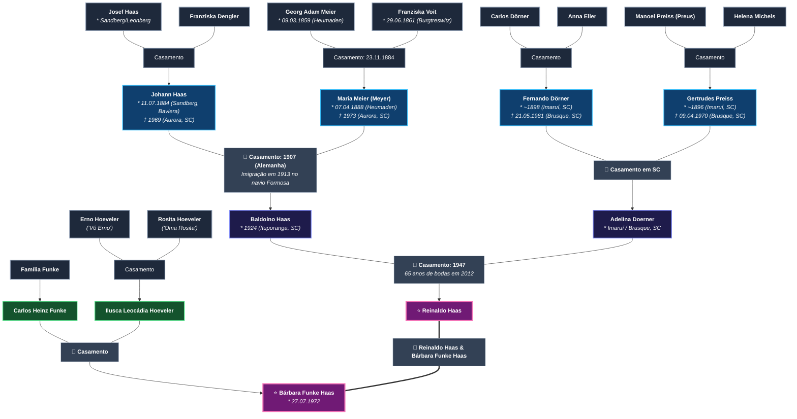
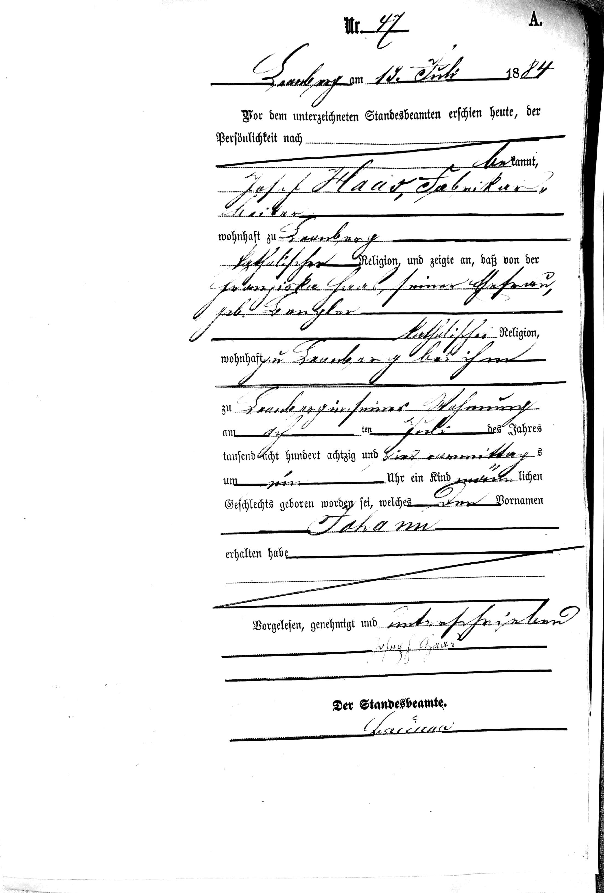
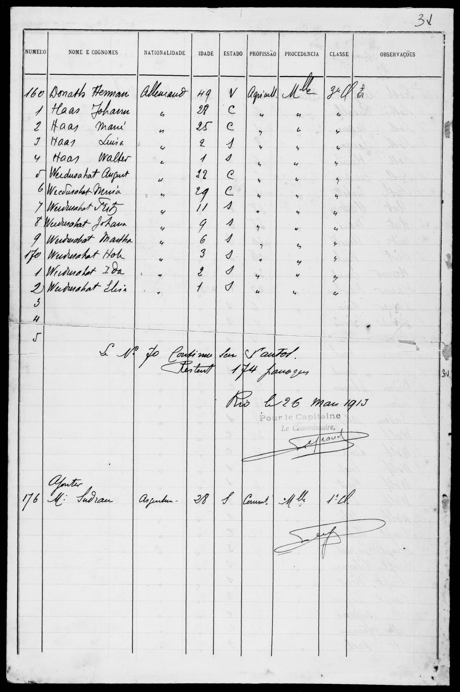
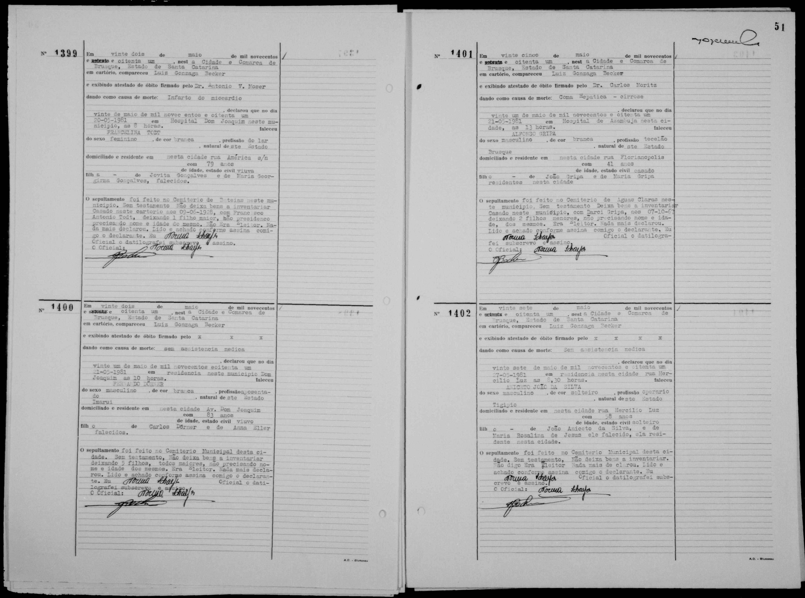
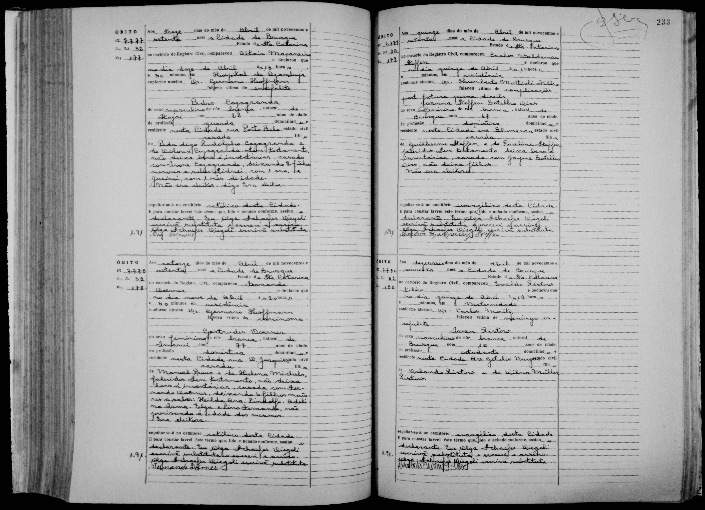

# 🌳 Árvore Genealógica — Famílias Haas, Meier, Doerner, Funke & Hoeveler

Repositório dedicado à preservação histórica, documentação comprobatória e transcrição de registros das famílias **Haas**, **Meier**, **Doerner**, **Funke** e **Hoeveler**, reunindo fontes dos arquivos civis e eclesiásticos da Alemanha (Baviera) e do Brasil (Santa Catarina).

---

## 📌 Árvore Genealógica Unificada (Alto Contraste)

---

## 📋 Quadro Sinótico das Gerações

| Geração | Linha / Ramo | Pessoa | Datas & Locais | Filiação / Cônjuge |
| :--- | :--- | :--- | :--- | :--- |
| **Geração Atual** | **Haas — Funke** | **Reinaldo Haas** | Santa Catarina | Filho de Baldoíno Haas e Adelina Doerner; casado com Bárbara Funke Haas |
| **Geração Atual** | **Funke — Hoeveler** | **Bárbara Funke Haas** | * 27/07/1972 | Filha de Carlos Heinz Funke e Ilusca Leocádia Hoeveler Funke; casada com Reinaldo Haas |
| **Avós (Pat.)** | **Haas** | **Baldoíno Haas** | * 1924 em Ituporanga, SC | Filho de Johann Haas e Maria Meier; casou-se em 1947 com Adelina Doerner |
| **Avós (Pat.)** | **Doerner** | **Adelina Doerner Haas** | Imaruí / Vidal Ramos / Brusque, SC | Filha de Fernando Dörner e Gertrudes Preiss; casou-se com Baldoíno Haas |
| **Pais (Esposa)** | **Funke** | **Carlos Heinz Funke** | Santa Catarina | Pai de Bárbara Funke Haas; casado com Ilusca Leocádia Hoeveler |
| **Pais (Esposa)** | **Hoeveler** | **Ilusca Leocádia Hoeveler Funke** | Santa Catarina | Filha de Erno Hoeveler e Rosita Hoeveler; mãe de Bárbara Funke Haas |
| **Bisavós** | **Haas** | **Johann Haas** | * 11/07/1884 (Sandberg/Leonberg, Baviera)   † 1969 (Aurora, SC) | Filho de Josef Haas e Franziska Dengler; casou-se em 1907 na Alemanha com Maria Meier |
| **Bisavós** | **Meier (Meyer)** | **Maria Meier Haas** | * 07/04/1888 (Heumaden, Baviera)   † 1973 (Aurora, SC) | Filha de Georg Adam Meier e Franziska Voit; casou-se em 1907 com Johann Haas |
| **Bisavós** | **Doerner** | **Fernando Dörner** | * ~1898 em Imaruí, SC   † 21/05/1981 em Brusque, SC | Filho de Carlos Dörner e Anna Eller; casou-se com Gertrudes Preiss |
| **Bisavós** | **Preiss** | **Gertrudes Preiss Doerner** | * ~1896 em Imaruí, SC   † 09/04/1970 em Brusque, SC | Filha de Manoel Preiss e Helena Michels; casou-se com Fernando Dörner |
| **Trisavós** | **Meier** | **Georg Adam Meier** | * 09/03/1859 (Rückersrieth / Heumaden, Baviera) | Filho de Michael Meier e Margaretha Pfannenstein; casou-se em 23/11/1884 com Franziska Voit |
| **Trisavós** | **Voit** | **Franziska Voit Meier** | * 29/06/1861 (Burgtreswitz, Baviera) | Filha de Johann Voit e Barbara Woppmann; casou-se em 23/11/1884 com Georg Adam Meier |
| **Trisavós** | **Haas** | **Josef Haas** | Sandberg / Leonberg, Baviera | *Fabrikarbeiter* (operário / pedreiro); casado com Franziska Dengler |
| **Trisavós** | **Dengler** | **Franziska Dengler Haas** | Sandberg / Leonberg, Baviera | Mãe de Johann Haas |
| **Trisavós** | **Doerner** | **Carlos Dörner** | Santa Catarina | Casado com Anna Eller; pais de Fernando Dörner |
| **Trisavós** | **Eller** | **Anna Eller Dörner** | Santa Catarina | Mãe de Fernando Dörner |
| **Trisavós** | **Preiss** | **Manoel Preiss** | Imaruí, SC | Casado com Helena Michels; pais de Gertrudes Preiss |
| **Trisavós** | **Michels** | **Helena Michels Preiss** | Imaruí, SC | Mãe de Gertrudes Preiss |

---

## 📷 Fotografia Histórica — Johann Haas e Maria Meyer Haas

  

<i>Johann Haas, Maria Meyer Haas e filhos (Fernando, Alexandre, Gertrudes, Agnes, Elza, Baldoíno e Maria).</i>

---

## 📜 Registros Documentais Comprobatórios

### 1. Certidão Civil de Nascimento de Johann Haas (1884, Baviera)
* **Ofício:** *Standesamt Leonberg* (atualmente Maxhütte-Haidhof, Baviera), Registro nº 47/1884
* **Nascimento:** 11 de julho de 1884 em Sandberg
* **Pai:** Josef Haas (*Fabrikarbeiter*) | **Mãe:** Franziska Haas, nascida Dengler

---

### 2. Lista Oficial de Bordo — Chegada ao Brasil no Navio *Formosa* (1913)
* **Data de Desembarque:** 26 de março de 1913 (Vapor *Formosa*, procedência Marselha)
* **Entradas:** 
  * Nº 161: **Haas, Johann** (28 anos, agricultor)
  * Nº 162: **Haas, Maria** (25 anos, agricultora)
  * Nº 163: **Haas, Luisa** (2 anos)
  * Nº 164: **Haas, Walter** (1 ano)

---

### 3. Casamento dos Trisavós Georg Adam Meier & Franziska Voit (1884, Moosbach)
* **Data:** 23 de novembro de 1884
* **Livro:** *Trauungen 1853–1935* (`Moosbach_Leuchtenberg013`), Página 93, Registro nº 20
* **Paróquia:** St. Peter und Paul, Markt Moosbach, Diocese de Regensburg

---

### 4. Batismo da Bisavó Maria Meier (1888, Moosbach / Heumaden)
* **Nascimento:** 07 de abril de 1888, às 2:00 da madrugada em Heumaden
* **Livro:** *Taufen 1847–1904* (`Moosbach_Leuchtenberg005`), Página 441, Reg. nº 36

---

### 5. Certidão de Óbito de Fernando Dörner (1981, Brusque, SC)
* **Ofício:** Registro Civil de Brusque, SC (Livro C-32, Fls. 51, Termo nº 1400)
* **Falecimento:** 21 de maio de 1981 (83 anos, viúvo de Gertrudes Preiss)
* **Filiação:** Carlos Dörner e Anna Eller

---

### 6. Certidão de Óbito de Gertrudes Preiss Dörner (1970, Brusque, SC)
* **Ofício:** Registro Civil de Brusque, SC (Livro 32, Fls. 178, Termo nº 7778)
* **Falecimento:** 09 de abril de 1970 (74 anos, casada com Fernando Dörner)
* **Filiação:** Manoel Preiss e Helena Michels
* **Filhos Registrados:** Hilda, Ana, Lindolfo, **Adelina**, Irma, Olga, Lino Fernando

