# 🌳 Árvore Genealógica — Famílias Haas, Meier, Doerner, Preiss, Funke & Hoeveler

Repositório dedicado à preservação histórica, documentação comprobatória e transcrição de registros das famílias **Haas**, **Meier**, **Doerner**, **Preiss (Preis)**, **Funke** e **Hoeveler**, reunindo fontes dos arquivos civis e eclesiásticos da Alemanha (Baviera e Renânia-Palatinado) e do Brasil (Santa Catarina e Rio Grande do Sul).

---

## 📌 Árvore Genealógica Completa (6 Gerações — Alto Contraste)

```mermaid
graph TD
    classDef default fill:#1e293b,stroke:#64748b,stroke-width:2px,color:#ffffff;
    classDef tetravos fill:#0f172a,stroke:#475569,stroke-width:2px,color:#ffffff;
    classDef trisavos fill:#1e293b,stroke:#94a3b8,stroke-width:2px,color:#ffffff;
    classDef bisavos fill:#0f3f6e,stroke:#38bdf8,stroke-width:2px,color:#ffffff;
    classDef avos fill:#1e1b4b,stroke:#818cf8,stroke-width:2px,color:#ffffff;
    classDef pais fill:#14532d,stroke:#4ade80,stroke-width:2px,color:#ffffff;
    classDef casamento fill:#334155,stroke:#cbd5e1,stroke-width:1px,color:#ffffff;
    classDef casal fill:#701a75,stroke:#f472b6,stroke-width:3px,color:#ffffff;

    %% --- RAMO PATERNO-PATERNO: HAAS (Baviera) ---
    JH_P["<b>Josef Haas</b><br/><i>* Sandberg/Leonberg, Baviera</i>"]:::trisavos --- M_JH["Casamento"]
    FD_P["<b>Franziska Dengler</b><br/><i>* Sandberg/Leonberg, Baviera</i>"]:::trisavos --- M_JH
    M_JH --> B_JH["<b>Johann Haas (João)</b><br/><i>* 11.07.1884 (Sandberg, Baviera)<br/>† 19.03.1969 (Aurora, SC)</i>"]:::bisavos

    %% --- RAMO PATERNO-MATERNO: MEIER & VOIT (Heumaden, Baviera) ---
    MM_P["<b>Michael Meier</b><br/><i>* 1820 (Heumaden)</i>"]:::trisavos --- M_MM["Casamento"]
    MP_P["<b>Margaretha Pfannenstein</b><br/><i>* 1825 (Rückersrieth)</i>"]:::trisavos --- M_MM
    M_MM --> B_GAM["<b>Georg Adam Meier</b><br/><i>* 09.03.1859 (Heumaden)</i>"]:::trisavos

    JV_P["<b>Johann Voit</b><br/><i>* 1820 (Burgtreswitz)</i>"]:::trisavos --- M_JV["Casamento"]
    BW_P["<b>Barbara Woppmann</b><br/><i>* 1825 (Burgtreswitz)</i>"]:::trisavos --- M_JV
    M_JV --> B_FV["<b>Franziska Voit</b><br/><i>* 29.06.1861 (Burgtreswitz)</i>"]:::trisavos

    B_GAM --- M_MV["💍 <b>Casamento: 23.11.1884</b><br/><i>Moosbach, Baviera</i>"]:::casamento
    B_FV --- M_MV
    M_MV --> B_MM["<b>Maria Meier (Meyer)</b><br/><i>* 07.04.1888 (Heumaden, Baviera)<br/>† 08.11.1973 (Aurora, SC)</i>"]:::bisavos

    %% BISAVÓS HAAS x MEIER
    B_JH --- CasalHaasMeier["💍 <b>Casamento: 1907 (Alemanha)</b><br/><i>Imigração em 1913 (Vapor Formosa)</i>"]:::casamento
    B_MM --- CasalHaasMeier
    CasalHaasMeier --> A_BH["<b>Baldoíno Haas</b><br/><i>* 20.04.1924 (Ituporanga, SC)<br/>† 18.12.2013 (Ituporanga, SC)</i>"]:::avos

    %% --- RAMO MATERNO-PATERNO: DÖRNER & ELLER (Solingen / Prússia) ---
    GD_T["<b>Guilherme Dorner</b><br/><i>* Alemanha</i>"]:::tetravos --- M_GD["Casamento"]
    JL_T["<b>Joanna Lauterjung</b><br/><i>* Solingen, Alemanha</i>"]:::tetravos --- M_GD
    M_GD --> T_CD["<b>Carlos Doerner</b><br/><i>* 20.11.1854 (Solingen, Prússia)</i>"]:::trisavos

    FE_T["<b>Franz Adam Eller</b><br/><i>* 1832 (Alemanha)</i>"]:::tetravos --- M_FE["Casamento"]
    AK_T["<b>Anna Maria Knopker</b><br/><i>* Alemanha</i>"]:::tetravos --- M_FE
    M_FE --> T_AE["<b>Anna Eller</b><br/><i>* 1858 (RS) | † Imaruí, SC</i>"]:::trisavos

    T_CD --- M_CDE["💍 <b>Casamento</b>"]:::casamento
    T_AE --- M_CDE
    M_CDE --> B_FD["<b>Fernando Dörner</b><br/><i>* 24.08.1897 (São Martinho, SC)<br/>† 21.05.1981 (Brusque, SC)</i>"]:::bisavos

    %% --- RAMO MATERNO-MATERNO: PREISS & MICHELS (Renânia-Palatinado) ---
    BP_T["<b>Bernard Preis</b><br/><i>* 1827 (Schweich, Trier, Prússia)<br/>† 1893 (Alto São Martinho, SC)</i>"]:::tetravos --- M_BP["Casamento"]
    IL_T["<b>Ignazia Loch</b><br/><i>* 1828 (São Pedro de Alcântara, SC)</i>"]:::tetravos --- M_BP
    M_BP --> T_EP["<b>Emanuel Preis (Manoel)</b><br/><i>* 31.03.1864 (Águas Mornas, SC)<br/>† 27.03.1927 (São Martinho, SC)</i>"]:::trisavos

    AM_T["<b>Anton Michels</b><br/><i>* 11.05.1822 (Hermeskeil, Trier)<br/>† 1874 (Vargem Grande, SC)</i>"]:::tetravos --- M_AM["Casamento"]
    CA_T["<b>Angela Catharina Arend</b><br/><i>* 05.12.1827 (Pünderich)<br/>† 15.09.1924 (São Martinho, SC)</i>"]:::tetravos --- M_AM
    M_AM --> T_HM["<b>Helena Michels</b><br/><i>* 01.01.1864 (Vargem do Cedro, SC)<br/>† 08.06.1945 (São Martinho, SC)</i>"]:::trisavos

    T_EP --- M_EPH["💍 <b>Casamento</b>"]:::casamento
    T_HM --- M_EPH
    M_EPH --> B_GP["<b>Gertrudes Preuss (Preiss)</b><br/><i>* 05.03.1896 (São Martinho, SC)<br/>† 09.04.1970 (Brusque, SC)</i>"]:::bisavos

    %% BISAVÓS DÖRNER x PREISS
    B_FD --- CasalDoernerPreiss["💍 <b>Casamento</b>"]:::casamento
    B_GP --- CasalDoernerPreiss
    CasalDoernerPreiss --> A_AD["<b>Adelina Doerner</b><br/><i>* 30.10.1926 (São Martinho, SC)<br/>† 22.02.2019 (Vidal Ramos, SC)</i>"]:::avos

    %% AVÓS BALDOÍNO x ADELINA
    A_BH --- CasalBaldoinoAdelina["💍 <b>Casamento: 1947</b><br/><i>Bodas de 65 anos em 2012</i>"]:::casamento
    A_AD --- CasalBaldoinoAdelina
    CasalBaldoinoAdelina --> P_RH["⭐ <b>Reinaldo Haas</b><br/><i>* 20.06.1965</i>"]:::casal

    %% --- RAMO DA ESPOSA: BÁRBARA FUNKE HAAS ---
    EH_F["<b>Erno Hoeveler</b><br/><i>('Vô Erno')</i>"]:::trisavos --- M_EHF["Casamento"]
    RH_F["<b>Rosita Hoeveler</b><br/><i>('Oma Rosita')</i>"]:::trisavos --- M_EHF
    M_EHF --> M_ILH["<b>Ilusca Leocádia Hoeveler</b>"]:::pais

    PF_F["<b>Família Funke</b>"]:::trisavos --> P_CHF["<b>Carlos Heinz Funke</b>"]:::pais

    P_CHF --- CasalFunkeHoeveler["💍 <b>Casamento</b>"]:::casamento
    M_ILH --- CasalFunkeHoeveler
    CasalFunkeHoeveler --> P_BFH["⭐ <b>Bárbara Funke Haas</b><br/><i>* 27.07.1972</i>"]:::casal

    %% UNIÃO ATUAL
    P_RH === CasalAtual["💑 <b>Reinaldo Haas & Bárbara Funke Haas</b>"]:::casamento === P_BFH
```

---

## 📋 Quadro Sinótico Consolidado de Gerações

| Geração | Linha / Ramo | Nome | Datas | Origem Geográfica | Notas Históricas / Filiação |
| :--- | :--- | :--- | :--- | :--- | :--- |
| **G1 (Atual)** | **Haas** | **Reinaldo Haas** | * 20/06/1965 | Santa Catarina | Filho de Baldoíno Haas e Adelina Doerner; casado com Bárbara Funke Haas |
| **G1 (Atual)** | **Funke — Hoeveler** | **Bárbara Funke Haas** | * 27/07/1972 | Santa Catarina | Filha de Carlos Heinz Funke e Ilusca Leocádia Hoeveler Funke |
| **G2 (Pais)** | **Haas** | **Baldoíno Haas** | * 20/04/1924   † 18/12/2013 | Ituporanga, SC | Filho de Johann Haas e Maria Meier; casou-se em 1947 com Adelina Doerner |
| **G2 (Pais)** | **Doerner** | **Adelina Doerner Haas** | * 30/10/1926   † 22/02/2019 | São Martinho / Vidal Ramos, SC | Filha de Fernando Dörner e Gertrudes Preuss |
| **G2 (Pais)** | **Funke** | **Carlos Heinz Funke** | — | Santa Catarina | Pai de Bárbara Funke Haas; casado com Ilusca Leocádia Hoeveler |
| **G2 (Pais)** | **Hoeveler** | **Ilusca Leocádia Hoeveler Funke** | — | Santa Catarina | Filha de Erno Hoeveler e Rosita Hoeveler |
| **G3 (Bisavós)** | **Haas** | **Johann Haas (João)** | * 11/07/1884   † 19/03/1969 | Sandberg / Leonberg, Baviera (Alemanha) ➔ Aurora, SC | Imigrante em 1913 no navio *Formosa*. Filho de Josef Haas e Franziska Dengler |
| **G3 (Bisavós)** | **Meier** | **Maria Meier (Meyer) Haas** | * 07/04/1888   † 08/11/1973 | Heumaden / Moosbach, Baviera (Alemanha) ➔ Aurora, SC | Filha de Georg Adam Meier e Franziska Voit; casou em 1907 na Baviera |
| **G3 (Bisavós)** | **Doerner** | **Fernando Dörner** | * 24/08/1897   † 21/05/1981 | São Martinho ➔ Brusque, SC | Filho de Carlos Doerner e Anna Eller; casou com Gertrudes Preuss |
| **G3 (Bisavós)** | **Preiss** | **Gertrudes Preuss (Preiss) Doerner** | * 05/03/1896   † 09/04/1970 | São Martinho ➔ Brusque, SC | Filha de Emanuel Preis e Helena Michels |
| **G3 (Bisavós)** | **Hoeveler** | **Erno Hoeveler** | — | Santa Catarina | *"Vô Erno"*, avô materno de Bárbara Funke Haas |
| **G3 (Bisavós)** | **Hoeveler** | **Rosita Hoeveler** | — | Santa Catarina | *"Oma Rosita"*, avó materna de Bárbara Funke Haas |
| **G4 (Trisavós)** | **Haas** | **Josef Haas** | ~1850 | Sandberg / Leonberg, Baviera | *Fabrikarbeiter* (operário / pedreiro); casado com Franziska Dengler |
| **G4 (Trisavós)** | **Dengler** | **Franziska Dengler Haas** | ~1855 | Sandberg / Leonberg, Baviera | Mãe de Johann Haas |
| **G4 (Trisavós)** | **Meier** | **Georg Adam Meier** | * 09/03/1859 | Rückersrieth / Heumaden, Baviera | *Wagner* & *Ökonom*; casou-se em 23/11/1884 com Franziska Voit |
| **G4 (Trisavós)** | **Voit** | **Franziska Voit Meier** | * 29/06/1861 | Burgtreswitz, Moosbach, Baviera | Filha de Johann Voit e Barbara Woppmann |
| **G4 (Trisavós)** | **Doerner** | **Carlos Doerner** | * 20/11/1854 | Solingen, Renânia / Prússia (Alemanha) | Filho de Guilherme Dorner e Joanna Lauterjung |
| **G4 (Trisavós)** | **Eller** | **Anna Eller Dörner** | * 1858 | Rio Grande do Sul ➔ Imaruí, SC | Filha de Franz Adam Eller e Anna Maria Knopker |
| **G4 (Trisavós)** | **Preis** | **Emanuel Preis (Manoel)** | * 31/03/1864   † 27/03/1927 | Vargem Grande / Águas Mornas ➔ São Martinho, SC | Filho de Bernard Preis e Ignazia Loch |
| **G4 (Trisavós)** | **Michels** | **Helena Michels Preiss** | * 01/01/1864   † 08/06/1945 | Vargem do Cedro, São Martinho, SC | Filha de Anton Michels e Angela Catharina Arend |
| **G5 (Tetravós)** | **Meier** | **Michael Meier** | * 1820 | Heumaden, Moosbach, Baviera | *Wagner* (carpinteiro de carroças); pai de Georg Adam Meier |
| **G5 (Tetravós)** | **Pfannenstein** | **Margaretha Pfannenstein** | * 1825 | Rückersrieth, Moosbach, Baviera | Mãe de Georg Adam Meier |
| **G5 (Tetravós)** | **Voit** | **Johann Voit** | * 1820 | Burgtreswitz, Moosbach, Baviera | *Bauer* (agricultor); pai de Franziska Voit |
| **G5 (Tetravós)** | **Woppmann** | **Barbara Woppmann** | * 1825 | Burgtreswitz, Moosbach, Baviera | Mãe de Franziska Voit |
| **G5 (Tetravós)** | **Dorner** | **Guilherme Dorner (Wilhelm)** | ~1820–1830 | Alemanha | Pai de Carlos Doerner |
| **G5 (Tetravós)** | **Lauterjung** | **Joanna Lauterjung** | ~1825–1830 | Solingen, Alemanha | Mãe de Carlos Doerner |
| **G5 (Tetravós)** | **Eller** | **Franz Adam Eller** | * 1832 | Alemanha | Pai de Anna Eller |
| **G5 (Tetravós)** | **Knopker** | **Anna Maria Knopker** | ~1835 | Alemanha | Mãe de Anna Eller |
| **G5 (Tetravós)** | **Preis** | **Bernard Preis** | * 1827   † 11/10/1893 | Schweich, Trier, Renânia / Prússia | Imigrante renano pioneiro em Alto São Martinho, SC |
| **G5 (Tetravós)** | **Loch** | **Ignazia Loch Preis** | * 1828   † ~1872/1914 | São Pedro de Alcântara, SC | Nascida na primeira colônia alemã de Santa Catarina (fundada em 1829) |
| **G5 (Tetravós)** | **Michels** | **Anton Michels** | * 11/05/1822   † 1874 | Hermeskeil, Trier-Saarburg, Renânia / Prússia | Imigrante prussiano pioneiro em Vargem Grande, SC |
| **G5 (Tetravós)** | **Arend** | **Angela Catharina Arend Michels** | * 05/12/1827   † 15/09/1924 | Pünderich, Cochem-Zell, Renânia-Palatinado | Imigrante renana em Vargem do Cedro, São Martinho, SC (faleceu aos 96 anos) |

---

## 📷 Fotografia Histórica — Johann Haas e Maria Meyer Haas com os Filhos

  

<i>Johann Haas, Maria Meyer Haas e filhos (Fernando, Alexandre, Gertrudes, Agnes, Elza, Baldoíno e Maria).</i>

---

## 📜 Registros Documentais Comprobatórios

1. **Certidão Civil de Nascimento de Johann Haas (1884, Standesamt Leonberg / Sandberg, Baviera):** [`imagens/doc_haas_nascimento_johann_1884.jpg`](imagens/doc_haas_nascimento_johann_1884.jpg)
2. **Lista Oficial de Bordo — Chegada no Vapor Formosa (26/03/1913):** [`imagens/doc_haas_navio_formosa_1913.jpg`](imagens/doc_haas_navio_formosa_1913.jpg)
3. **Casamento Paroquial Meier & Voit (23/11/1884, Moosbach, Baviera):** [`imagens/doc2_trauung_meier_voit_1884.jpg`](imagens/doc2_trauung_meier_voit_1884.jpg)
4. **Batismo Paroquial de Maria Meier (07/04/1888, Heumaden / Moosbach, Baviera):** [`imagens/doc1_maria_meier_1888.jpg`](imagens/doc1_maria_meier_1888.jpg)
5. **Certidão de Óbito de Fernando Dörner (1981, Brusque, SC):** [`imagens/doc_doerner_obito_fernando_1981.jpg`](imagens/doc_doerner_obito_fernando_1981.jpg)
6. **Certidão de Óbito de Gertrudes Preiss Dörner (1970, Brusque, SC):** [`imagens/doc_doerner_obito_gertrudes_preiss_1970.jpg`](imagens/doc_doerner_obito_gertrudes_preiss_1970.jpg)
7. **Arquivo GEDCOM Completo do FamilySearch:** [`arvore_familysearch.ged`](arvore_familysearch.ged)
