# 🌳 Árvore Genealógica — Famílias Haas, Meier, Voit, Doerner, Preiss, Michels, Arend, Funke & Hoeveler

Repositório dedicado à preservação histórica, documentação comprobatória, extração automatizada em Python e roteiro literário da saga genealógica das famílias **Haas**, **Meier**, **Voit**, **Doerner (Dörner)**, **Preiss (Preis)**, **Michels**, **Arend (Arns)**, **Loch**, **Funke** e **Hoeveler**, unindo as raízes paternas e maternas de **Matheus Haas** e **Lucas Haas** — dos arquivos civis e paroquiais da Alemanha (Baviera, Renânia-Palatinado, Vestfália e Prússia Renana) às colônias pioneiras de Santa Catarina e Rio Grande do Sul.

---

## 📌 Árvore Genealógica Unificada (7 Gerações — Alto Contraste)

> **Referencial de Gerações:** Tomando como base os filhos **Matheus Haas** e **Lucas Haas** (**G1**), cada nível ascendente representa exatamente Pais (**G2**), Avós (**G3**), Bisavós (**G4**), Trisavós (**G5**), Tetravós (**G6**) e Pentavós (**G7**).

```mermaid
graph TD
    classDef default fill:#1e293b,stroke:#64748b,stroke-width:2px,color:#ffffff;
    classDef pentavos fill:#090d16,stroke:#334155,stroke-width:2px,color:#ffffff;
    classDef tetravos fill:#0f172a,stroke:#475569,stroke-width:2px,color:#ffffff;
    classDef trisavos fill:#1e293b,stroke:#94a3b8,stroke-width:2px,color:#ffffff;
    classDef bisavos fill:#0f3f6e,stroke:#38bdf8,stroke-width:2px,color:#ffffff;
    classDef avos fill:#1e1b4b,stroke:#818cf8,stroke-width:2px,color:#ffffff;
    classDef pais fill:#701a75,stroke:#f472b6,stroke-width:3px,color:#ffffff;
    classDef filhos fill:#14532d,stroke:#4ade80,stroke-width:3px,color:#ffffff;
    classDef casamento fill:#334155,stroke:#cbd5e1,stroke-width:1px,color:#ffffff;

    %% --- RAMO PATERNO-PATERNO: HAAS (Sandberg / Leonberg / Maxhütte-Haidhof, Baviera) ---
    JH_P["<b>Josef Haas</b><br/><i>Fabrikarbeiter | Sandberg/Leonberg, Baviera</i>"]:::trisavos --- M_JH["Casamento"]:::casamento
    FD_P["<b>Franziska Dengler</b><br/><i>Sandberg/Leonberg, Baviera</i>"]:::trisavos --- M_JH
    M_JH --> B_JH["<b>Johann Haas (João / 'Fata')</b><br/><i>* 11.07.1884 (Sandberg, Leonberg, Baviera)<br/>† 19.03.1969 (Aurora, SC)</i>"]:::bisavos

    %% --- RAMO PATERNO-MATERNO: MEIER & VOIT (Heumaden / Moosbach, Baviera) ---
    MM_P["<b>Michael Meier</b><br/><i>* 1820 (Heumaden) | Wagner</i>"]:::tetravos --- M_MM["Casamento"]:::casamento
    MP_P["<b>Margaretha Pfannenstein</b><br/><i>* 1825 (Rückersrieth)</i>"]:::tetravos --- M_MM
    M_MM --> B_GAM["<b>Georg Adam Meier</b><br/><i>* 09.03.1859 (Rückersrieth/Heumaden)</i>"]:::trisavos

    JV_P["<b>Johann Voit</b><br/><i>* 1820 (Burgtreswitz) | Bauer</i>"]:::tetravos --- M_JV["Casamento"]:::casamento
    BW_P["<b>Barbara Woppmann</b><br/><i>* 1825 (Burgtreswitz)</i>"]:::tetravos --- M_JV
    M_JV --> B_FV["<b>Franziska Voit</b><br/><i>* 29.06.1861 (Burgtreswitz)</i>"]:::trisavos

    B_GAM --- M_MV["💍 <b>Casamento: 23.11.1884</b><br/><i>St. Peter u. Paul, Moosbach</i>"]:::casamento
    B_FV --- M_MV
    M_MV --> B_MM["<b>Maria Meier ('Mota')</b><br/><i>* 07.04.1888 (Heumaden, Baviera)<br/>† 08.11.1973 (Aurora, SC)</i>"]:::bisavos

    %% BISAVÓS HAAS x MEIER
    B_JH --- CasalHaasMeier["💍 <b>Casamento: 1907 (Alemanha)</b><br/><i>Imigração: Março/1913 (Vapor Formosa)</i>"]:::casamento
    B_MM --- CasalHaasMeier
    CasalHaasMeier --> A_BH["<b>Baldoíno Haas</b><br/><i>* 20.04.1924 (Rio Novo, Ituporanga, SC)<br/>† 18.12.2013 (Ituporanga, SC)</i>"]:::avos

    %% --- RAMO MATERNO DE REINALDO: DÖRNER & ELLER (Solingen / Vestfália) ---
    GD_T["<b>Guilherme (Wilhelm) Dorner</b><br/><i>* Alemanha</i>"]:::tetravos --- M_GD["Casamento"]:::casamento
    JL_T["<b>Joanna Lauterjung</b><br/><i>* Solingen, Prússia</i>"]:::tetravos --- M_GD
    M_GD --> T_CD["<b>Carl Reinhard (Carlos) Doerner</b><br/><i>* 20.11.1854 (Solingen, Prússia)</i>"]:::trisavos

    FE_T["<b>Franz Adam Eller</b><br/><i>~ 03.03.1832 (Westfalen, Alemanha)</i>"]:::tetravos --- M_FE["Casamento"]:::casamento
    AK_T["<b>Anna Maria Knopker</b><br/><i>* Alemanha</i>"]:::tetravos --- M_FE
    M_FE --> T_AE["<b>Anna Eller</b><br/><i>* 1858 (RS) | † Imaruí, SC</i>"]:::trisavos

    T_CD --- M_CDE["💍 <b>Casamento</b>"]:::casamento
    T_AE --- M_CDE
    M_CDE --> B_FD["<b>Fernando Dörner</b><br/><i>* 24.08.1897 (São Martinho, SC)<br/>† 21.05.1981 (Brusque, SC)</i>"]:::bisavos

    %% --- RAMO PREISS, LOCH, MICHELS & AREND (Trier / Mosela -> SC 1828 & 1847) ---
    BP_T["<b>Bernard Preis</b><br/><i>* 1827 (Schweich, Trier)<br/>† 11.10.1893 (Alto São Martinho, SC)</i>"]:::tetravos --- M_BP["Casamento"]:::casamento
    IL_T["<b>Ignazia Loch</b><br/><i>* 1828 (São Pedro de Alcântara, SC)</i>"]:::tetravos --- M_BP
    M_BP --> T_EP["<b>Emanuel Preis (Manoel)</b><br/><i>* 31.03.1864 (Águas Mornas, SC)<br/>† 27.03.1927 (São Martinho, SC)</i>"]:::trisavos

    NA_P["<b>Nikolaus Arend (Arns)</b><br/><i>Imigração: 05.01.1847 (Brigue Eridano)<br/>Colônia Santa Isabel, Lote 38</i>"]:::pentavos --> CA_T

    AM_T["<b>Anton Michels</b><br/><i>* 11.05.1822 (Hermeskeil, Trier)<br/>Imigração: 12.11.1828 | † 1874 (SC)</i>"]:::tetravos --- M_AM["Casamento"]:::casamento
    CA_T["<b>Angela Catharina Arend</b><br/><i>* 05.12.1827 (Pünderich, Mosela)<br/>† 15.09.1924 (Vargem do Cedro, SC - 96 anos)</i>"]:::tetravos --- M_AM
    M_AM --> T_HM["<b>Helena Michels</b><br/><i>* 01.01.1864 (Vargem do Cedro, SC)<br/>† 08.06.1945 (São Martinho, SC)</i>"]:::trisavos

    T_EP --- M_EPH["💍 <b>Casamento</b>"]:::casamento
    T_HM --- M_EPH
    M_EPH --> B_GP["<b>Gertrudes Preuss (Preiss)</b><br/><i>* 05.03.1896 (São Martinho, SC)<br/>† 09.04.1970 (Brusque, SC)</i>"]:::bisavos

    %% BISAVÓS DÖRNER x PREISS
    B_FD --- CasalDoernerPreiss["💍 <b>Casamento</b>"]:::casamento
    B_GP --- CasalDoernerPreiss
    CasalDoernerPreiss --> A_AD["<b>Adelina Doerner</b><br/><i>* 30.10.1926 (São Martinho, SC)<br/>† 22.02.2019 (Vidal Ramos, SC)</i>"]:::avos

    %% AVÓS PATERNOS: BALDOÍNO x ADELINA
    A_BH --- CasalBaldoinoAdelina["💍 <b>Casamento: 1947</b><br/><i>Bodas de 65 anos em 2012 (Vidal Ramos)</i>"]:::casamento
    A_AD --- CasalBaldoinoAdelina
    CasalBaldoinoAdelina --> P_RH["⭐ <b>Reinaldo Haas</b><br/><i>* 20.06.1965</i>"]:::pais

    %% --- RAMO MATERNO DOS FILHOS: FUNKE & HOEVELER ---
    EH_F["<b>Erno Hoeveler</b><br/><i>('Vô Erno')</i>"]:::bisavos --- M_EHF["Casamento"]:::casamento
    RH_F["<b>Rosita Hoeveler</b><br/><i>('Oma Rosita')</i>"]:::bisavos --- M_EHF
    M_EHF --> M_ILH["<b>Ilusca Leocádia Hoeveler Funke</b>"]:::avos

    PF_F["<b>Linhagem Funke</b><br/><i>('Oma Dora' / Família Funke)</i>"]:::bisavos --> P_CHF["<b>Carlos Heinz Funke</b>"]:::avos

    P_CHF --- CasalFunkeHoeveler["💍 <b>Casamento</b>"]:::casamento
    M_ILH --- CasalFunkeHoeveler
    CasalFunkeHoeveler --> P_BFH["⭐ <b>Bárbara Funke Haas</b><br/><i>* 27.07.1972</i>"]:::pais

    %% UNIÃO REINALDO & BÁRBARA -> FILHOS MATHEUS & LUCAS
    P_RH --- CasalAtual["💑 <b>Casamento Civil</b><br/><i>Vidal Ramos, SC</i>"]:::casamento
    P_BFH --- CasalAtual
    CasalAtual --> F_MH["🌟 <b>Matheus Funke Haas</b>"]:::filhos
    CasalAtual --> F_LH["🌟 <b>Lucas Funke Haas</b>"]:::filhos
```

---

## 📋 Quadro Sinótico Consolidado de Gerações (Referencial: Matheus & Lucas Haas)

| Geração (Filhos / Reinaldo) | Linha / Ramo | Nome | Datas | Origem & Destino | Notas Históricas / Filiação |
| :--- | :--- | :--- | :--- | :--- | :--- |
| **G1 (Filhos)** | **Funke Haas** | **Matheus Haas** & **Lucas Haas** | Séc. XXI | Florianópolis, SC | Filhos de Reinaldo Haas e Bárbara Funke Haas; ponto de convergência de todas as linhagens |
| **G2 (Pais / Autor)** | **Haas — Doerner** | **Reinaldo Haas** | * 20/06/1965 | Santa Catarina | Filho de Baldoíno Haas e Adelina Doerner; Prof. Dr. Departamento de Física / UFSC |
| **G2 (Pais / Esposa)** | **Funke — Hoeveler** | **Bárbara Funke Haas** | * 27/07/1972 | Santa Catarina | Filha de Carlos Heinz Funke e Ilusca Leocádia Hoeveler Funke |
| **G3 (Avós / Pais)** | **Haas** | **Baldoíno Haas** | * 20/04/1924   † 18/12/2013 | Rio Novo / Ituporanga, SC | Filho de Johann Haas e Maria Meier; casou-se em 1947 com Adelina Doerner |
| **G3 (Avós / Pais)** | **Doerner** | **Adelina Doerner Haas** | * 30/10/1926   † 22/02/2019 | São Martinho ➔ Vidal Ramos, SC | Filha de Fernando Dörner e Gertrudes Preuss; 65 anos de casada com Baldoíno em 2012 |
| **G3 (Avós / Sogros)** | **Funke** | **Carlos Heinz Funke** | — | Santa Catarina | Pai de Bárbara e Katherine Funke; casado com Ilusca Leocádia Hoeveler |
| **G3 (Avós / Sogros)** | **Hoeveler** | **Ilusca Leocádia Hoeveler Funke** | — | Santa Catarina | Filha de Erno Hoeveler e Rosita Hoeveler |
| **G4 (Bisavós / Avós)** | **Haas** | **Johann Haas (João / "Fata")** | * 11/07/1884   † 19/03/1969 | Sandberg / Leonberg, Baviera ➔ Aurora, SC | Mestre estucador/pedreiro e intérprete. Partiu no vapor *Formosa* (07–26/03/1913) |
| **G4 (Bisavós / Avós)** | **Meier** | **Maria Meier (Meyer / "Mota")** | * 07/04/1888   † 08/11/1973 | Heumaden / Moosbach, Baviera ➔ Aurora, SC | Filha de Georg Adam Meier e Franziska Voit; casou em 1907 na Alemanha |
| **G4 (Bisavós / Avós)** | **Doerner** | **Fernando Dörner** | * 24/08/1897   † 21/05/1981 | São Martinho ➔ Brusque, SC | Filho de Carl Reinhard (Carlos) Doerner e Anna Eller |
| **G4 (Bisavós / Avós)** | **Preiss** | **Gertrudes Preuss (Preiss) Doerner** | * 05/03/1896   † 09/04/1970 | São Martinho ➔ Brusque, SC | Filha de Emanuel Preis e Helena Michels |
| **G4 (Bisavós)** | **Hoeveler** | **Erno Hoeveler** & **Rosita Hoeveler** | — | Santa Catarina | *"Vô Erno"* e *"Oma Rosita"*, avós maternos de Bárbara Funke Haas |
| **G5 (Trisavós / Bisavós)** | **Haas — Dengler** | **Josef Haas** & **Franziska Dengler** | ~1850–1855 | Sandberg / Leonberg (hoje Maxhütte-Haidhof), Baviera | *Fabrikarbeiter*; pais de Johann Haas (Reg. nº 47/1884, Standesamt Leonberg) |
| **G5 (Trisavós / Bisavós)** | **Meier** | **Georg Adam Meier** | * 09/03/1859 | Rückersrieth / Heumaden, Baviera | *Wagner* & *Ökonom*; casou-se em 23/11/1884 em Moosbach com Franziska Voit |
| **G5 (Trisavós / Bisavós)** | **Voit** | **Franziska Voit Meier** | * 29/06/1861 | Burgtreswitz, Moosbach, Baviera | Filha de Johann Voit e Barbara Woppmann |
| **G5 (Trisavós / Bisavós)** | **Doerner** | **Carl Reinhard (Carlos) Doerner** | * 20/11/1854 | Solingen, Província do Reno, Prússia | Filho de Guilherme (Wilhelm) Dorner e Joanna Lauterjung |
| **G5 (Trisavós / Bisavós)** | **Eller** | **Anna Eller Dörner** | * 1858 | Rio Grande do Sul ➔ Imaruí, SC | Filha de Franz Adam Eller e Anna Maria Knopker |
| **G5 (Trisavós / Bisavós)** | **Preis** | **Emanuel Preis (Manoel)** | * 31/03/1864   † 27/03/1927 | Vargem Grande / Águas Mornas ➔ São Martinho, SC | Batizado em 26/04/1864 (São João Batista); filho de Bernard Preis e Ignazia Loch |
| **G5 (Trisavós / Bisavós)** | **Michels** | **Helena Michels Preiss** | * 01/01/1864   † 08/06/1945 | Vargem do Cedro, São Martinho, SC | Filha de Anton Michels e Angela Catharina Arend |
| **G6 (Tetravós / Trisavós)** | **Meier — Pfannenstein** | **Michael Meier** (* 1820) & **Margaretha Pfannenstein** (* 1825) | 1820 / 1825 | Heumaden & Rückersrieth, Baviera | *Wagner* (carpinteiro de rodas/carroças) em Heumaden |
| **G6 (Tetravós / Trisavós)** | **Voit — Woppmann** | **Johann Voit** (* 1820) & **Barbara Woppmann** (* 1825) | 1820 / 1825 | Burgtreswitz, Moosbach, Baviera | *Bauer* (proprietário rural) em Burgtreswitz |
| **G6 (Tetravós / Trisavós)** | **Dorner — Lauterjung** | **Guilherme Dorner** & **Joanna Lauterjung** | ~1820–1830 | Solingen, Renânia / Prússia | Tradicional sobrenome cuteleiro de Solingen (*Lauterjung*) |
| **G6 (Tetravós / Trisavós)** | **Eller — Knopker** | **Franz Adam Eller** (~ 03/03/1832) & **Anna Maria Knopker** | 1832 | St. Peter und Paul, Westfalen, Alemanha | Imigrantes alemães estabelecidos inicialmente no RS |
| **G6 (Tetravós / Trisavós)** | **Preis — Loch** | **Bernard Preis** (* 1827, † 11/10/1893) & **Ignazia Loch** (* 1828) | 1827 / 1828 | Schweich (Trier) & São Pedro de Alcântara, SC | Ignazia nasceu na 1ª colônia alemã de Santa Catarina |
| **G6 (Tetravós / Trisavós)** | **Michels** | **Anton Michels** | * 11/05/1822   † 1874 | Hermeskeil (Trier-Saarburg) ➔ Vargem Grande, SC | Chegou a Desterro aos 6 anos em **12/11/1828** (leva fundadora de São Pedro de Alcântara) |
| **G6 (Tetravós / Trisavós)** | **Arend** | **Angela Catharina Arend Michels** | * 05/12/1827   † 15/09/1924 | Pünderich (Mosela) ➔ Vargem do Cedro, SC | Chegou em **05/01/1847**; viveu quase 97 anos em SC |
| **G7 (Pentavós / Tetravós)** | **Arend (Arns)** | **Nikolaus Arend (Arns)** | ~1800 | Pünderich (Cochem-Zell) ➔ Colônia Santa Isabel, SC | Veio no brigue sardo *Eridano* / sumaca *14 de Novembro* (05/01/1847); Lote 38 em Loeffelscheidt |

---

## 📖 Roteiro do Livro & Ferramentas em Python

- **📚 Roteiro Literário Completo do Livro:** [`docs/roteiro_livro.md`](docs/roteiro_livro.md) — *"O Mapa dos Ventos e do Sangue: Em Busca dos Parentes dos Meus Filhos"*, estruturado em Prólogo, 5 Partes, 16 Capítulos e Epílogo.
- **📧 Extrator Automatizado do Gmail (`agenorhaas@hotmail.com` e familiares):** [`scripts/importar_gmail_genealogia.py`](scripts/importar_gmail_genealogia.py) — conecta via IMAP SSL usando `GMAIL_APP_PASSWORD` em `~/.env`, baixa mensagens e anexos para `docs/contribuicoes_gmail.md` e `anexos_gmail/`.

---

## 📷 Fotografia Histórica — Johann Haas e Maria Meyer Haas com os Filhos

  

<i>Johann Haas ("Fata"), Maria Meyer Haas ("Mota") e os sete filhos criados em Santa Catarina (Gertrudes, Fernando, Alexandre, Agnes/Inês, Elza, Baldoíno e Maria).</i>

---

## 📜 Registros Documentais Comprobatórios

1. **Certidão Civil de Nascimento de Johann Haas (11/07/1884, Standesamt Leonberg / Sandberg, Baviera — autenticada em Maxhütte-Haidhof em 06/02/2018):** [`imagens/doc_haas_nascimento_johann_1884.jpg`](imagens/doc_haas_nascimento_johann_1884.jpg)
2. **Lista Oficial de Bordo — Chegada no Vapor Formosa (26/03/1913):** [`imagens/doc_haas_navio_formosa_1913.jpg`](imagens/doc_haas_navio_formosa_1913.jpg)
3. **Casamento Paroquial Meier & Voit (23/11/1884, Moosbach, Baviera):** [`imagens/doc2_trauung_meier_voit_1884.jpg`](imagens/doc2_trauung_meier_voit_1884.jpg)
4. **Batismo Paroquial de Maria Meier (07/04/1888, Heumaden / Moosbach, Baviera):** [`imagens/doc1_maria_meier_1888.jpg`](imagens/doc1_maria_meier_1888.jpg)
5. **Batismo Paroquial de Adam Meier (09/03/1859, Rückersrieth / Heumaden, Baviera):** [`imagens/doc3_adam_meier_1859.jpg`](imagens/doc3_adam_meier_1859.jpg)
6. **Batismo Paroquial de Franziska Voit (29/06/1861, Burgtreswitz, Baviera):** [`imagens/doc4_franziska_voit_1861.jpg`](imagens/doc4_franziska_voit_1861.jpg)
7. **Certidão de Óbito de Fernando Dörner (21/05/1981, Brusque, SC):** [`imagens/doc_doerner_obito_fernando_1981.jpg`](imagens/doc_doerner_obito_fernando_1981.jpg)
8. **Certidão de Óbito de Gertrudes Preiss Dörner (09/04/1970, Brusque, SC):** [`imagens/doc_doerner_obito_gertrudes_preiss_1970.jpg`](imagens/doc_doerner_obito_gertrudes_preiss_1970.jpg)
9. **Arquivo GEDCOM Completo do FamilySearch (27 indivíduos, 232 fontes):** [`arvore_familysearch.ged`](arvore_familysearch.ged)
