# 🌳 Árvore Genealógica — Família Meier & Voit (Heumaden / Moosbach, Baviera)

Repositório dedicado à preservação, transcrição e comprovação documental da linhagem genealógica da família **Meier** e **Voit**, com raízes históricas no vilarejo de **Heumaden** e na paróquia católica de **St. Peter und Paul, Markt Moosbach** (Landkreis Neustadt an der Waldnaab, Oberpfalz, Baviera, Alemanha).

---

## 📌 Resumo Genealógico

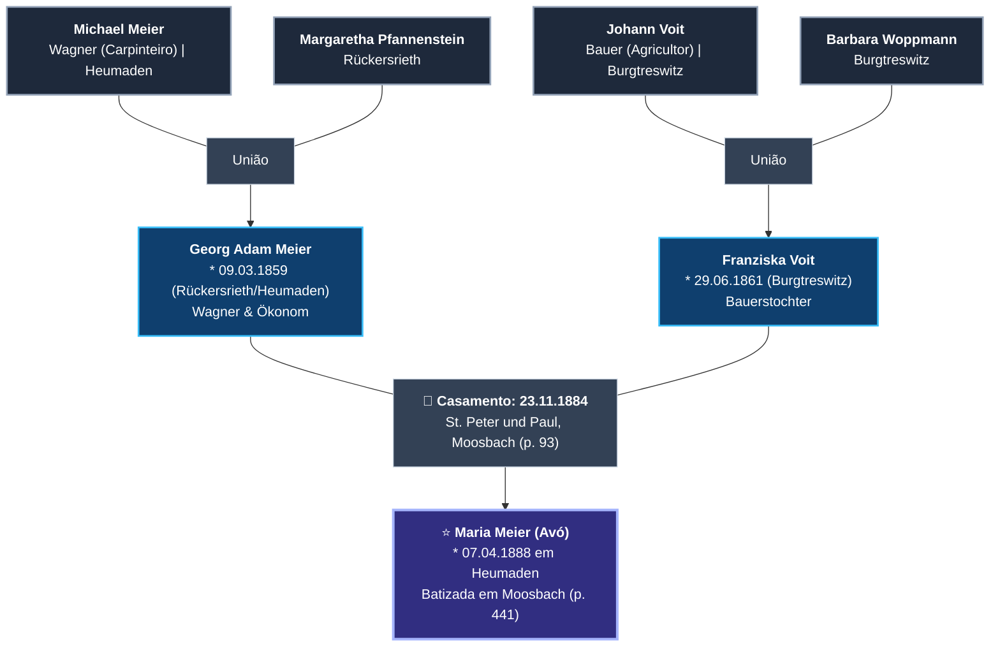

---

## 📋 Tabela Estruturada de Antepassados

| Geração | Nome | Nascimento / Batismo | Local de Origem | Profissão / Condição | Filiação / Cônjuge |
| :--- | :--- | :--- | :--- | :--- | :--- |
| **Avó** | **Maria Meier** | 07/04/1888 (2h da manhã) | Heumaden | — | Filha de Georg Adam Meier e Franziska Voit |
| **Bisavô** | **Georg Adam Meier** | 09/03/1859 (3h da manhã) | Rückersrieth / Heumaden | *Wagner* (Carpinteiro) & *Ökonom* | Filho de Michael Meier e Margaretha Pfannenstein; casou em 23/11/1884 com Franziska Voit |
| **Bisavó** | **Franziska Voit** | 29/06/1861 (manhã) | Burgtreswitz | *Bauerstochter* (filha de agricultor) | Filha de Johann Voit e Barbara Woppmann; casou em 23/11/1884 com Georg Adam Meier |
| **Trisavô (pat.)** | **Michael Meier** | ~1820–1835 | Heumaden | *Wagner* (carpinteiro de carroças) | Pai de Georg Adam Meier |
| **Trisavó (pat.)** | **Margaretha Pfannenstein** | ~1825–1835 | Rückersrieth | *Bauerstochter* | Mãe de Georg Adam Meier |
| **Trisavô (mat.)** | **Johann Voit** | ~1820–1835 | Burgtreswitz | *Bauer* (agricultor proprietário) | Pai de Franziska Voit |
| **Trisavó (mat.)** | **Barbara Woppmann** | ~1825–1835 | Burgtreswitz | *Bauersehefrau* | Mãe de Franziska Voit |

---

## 📜 Registros Paroquiais Históricos

### 1. Certidão de Casamento dos Bisavós (1884)
* **Pessoas:** **Georg Adam Meier & Franziska Voit**
* **Data:** 23 de novembro de 1884
* **Livro:** *Trauungen 1853–1935* (`Moosbach_Leuchtenberg013`), Página 93, Registro nº 20
* **Paróquia:** St. Peter und Paul, Markt Moosbach

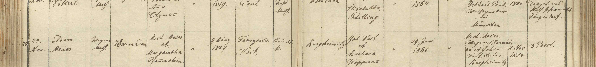

  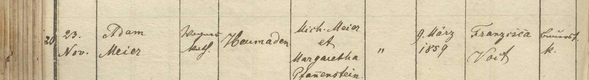
  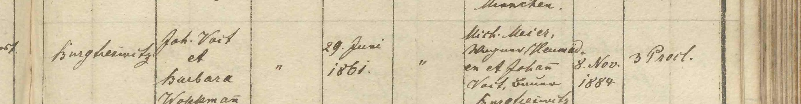

* **Noivo:** Adam Meier (*Wagner* em Heumaden, católico, solteiro, nascido em 09.03.1859). Pais: Michael Meier e Margaretha Pfannenstein.
* **Noiva:** Franziska Voit (de Burgtreswitz, católica, solteira, nascida em 29.06.1861). Pais: Johann Voit e Barbara Woppmann.
* **Testemunhas:** Michael Meier (*Wagner* em Heumaden) e Johann Voit (*Bauer* em Burgtreswitz) — os pais de ambos.
* **Licença Civil / Proclamas:** Licença civil emitida em 08.11.1884; 3 proclamações canônicas sem impedimento (*3 Procl.*).

---

### 2. Certidão de Batismo do Bisavô (1859)
* **Pessoa:** **Adam Meier** (Georg Adam Meier)
* **Nascimento:** 09 de março de 1859, às 3:00 da madrugada
* **Batismo:** 09 de março de 1859 em Moosbach
* **Livro:** *Taufen 1847–1904* (`Moosbach_Leuchtenberg005`), Página 96, Scan 98

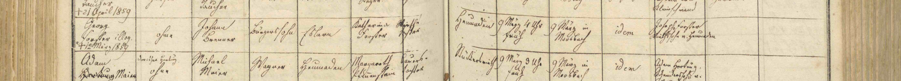

  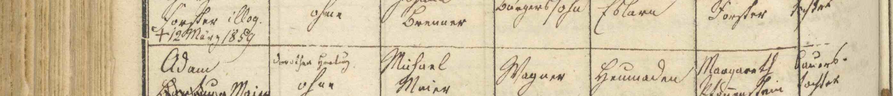
  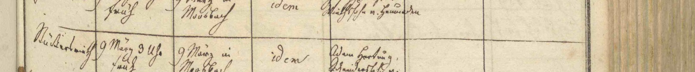

* **Pai:** Michael Meier (*Wagner* em Heumaden).
* **Mãe:** Margareth Pfannenstein (*Bauerstochter*).
* **Observação:** Legitimação por matrimônio subsequente dos pais (*Brautleut Meier, daneben freiwillig anerkannt*).
* **Padrinho:** Adam Harting (*Schmiedssohn* de Heumaden).

---

### 3. Certidão de Batismo da Bisavó (1861)
* **Pessoa:** **Franziska Voit**
* **Nascimento:** 29 de junho de 1861, pela manhã
* **Batismo:** 29 de junho de 1861 em Moosbach
* **Local:** Burgtreswitz (*Treswitz*)
* **Livro:** *Taufen 1847–1904* (`Moosbach_Leuchtenberg005`), Página 115, Scan 117

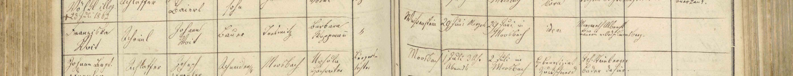

  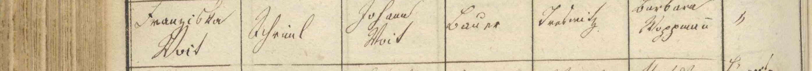
  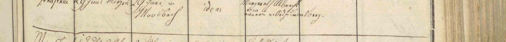

* **Pai:** Johann Voit (*Bauer in Treswitz*).
* **Mãe:** Barbara Woppmann (*Bauerstochter*).
* **Madrinha:** Margareth Albrecht (*Bäuerin*).

---

### 4. Certidão de Batismo da Avó (1888)
* **Pessoa:** **Maria Meier**
* **Nascimento:** 07 de abril de 1888, às 2:00 da madrugada em Heumaden
* **Batismo:** 07 de abril de 1888 na paróquia de Moosbach
* **Livro:** *Taufen 1847–1904* (`Moosbach_Leuchtenberg005`), Página 441, Registro nº 36

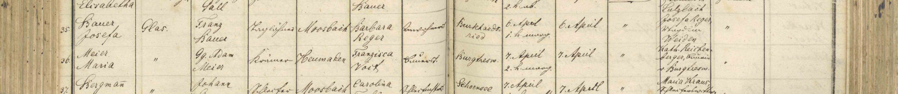

  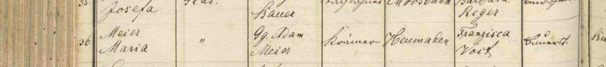
  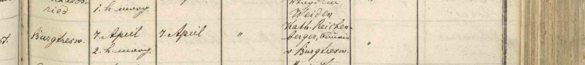

* **Pai:** Georg Adam Meier (*Gg. Adam Meier*), *Ökonom in Heumaden*.
* **Mãe:** Franziska Voit (*Ökonomsehefrau*).
* **Madrinha:** Katharina Reichenberger (*Bäuerin von Burgtreswitz*).

---

## 🏛️ Repositório Digital de Consulta Oficial

Os microfilmes digitais originais estão custodiados pela Diocese de Regensburg (*Bischöfliches Zentralarchiv Regensburg*) e acessíveis no portal eclesiástico [Matricula Online](https://data.matricula-online.eu/de/deutschland/regensburg/moosbach-dek-leuchtenberg/):

* **Casamentos (1853–1935):** `Moosbach_Leuchtenberg013` (Img. 97, Pág. 93)
* **Batismos (1847–1904):** `Moosbach_Leuchtenberg005` (Img. 98, Img. 117 e Img. 443)
