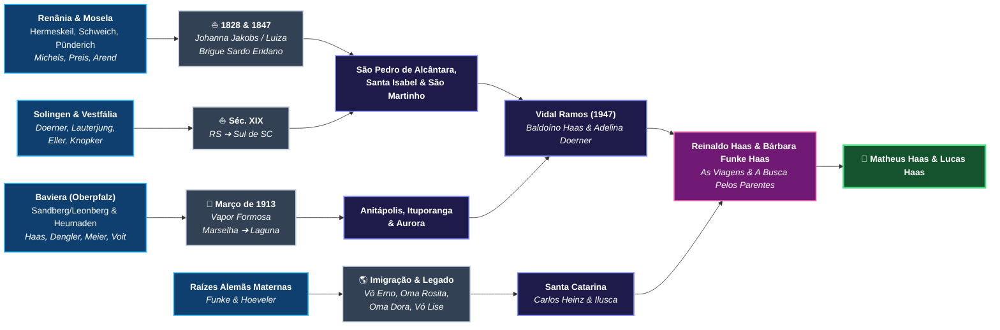

# 📖 Roteiro Literário do Livro

## Título Provisório
**O Mapa dos Ventos e do Sangue: A Saga de um Pai pelas Estradas do Brasil e da Europa em Busca dos Parentes de Seus Filhos**
*(Subtítulos alternativos: "De Heumaden e do Mosela a Santa Catarina: Uma Investigação Genealógica para Matheus e Lucas" | "As Coordenadas da Memória: Viagens Atrás das Raízes dos Meus Filhos")*

- **Autor:** Prof. Dr. Reinaldo Haas
- **Dedicatória:** *Para Matheus e Lucas — ponto de encontro de todos os navios, serras e sonhos que nos trouxeram até aqui — e para Bárbara, companheira de todas as travessias.*
- **Gênero:** Não-ficção narrativa / Memórias de viagem, investigação histórica e saga familiar (estilo híbrido entre *crônica de viagem*, *investigação documental de arquivo* e *épico de imigração*).

---

## 🧭 Visão Geral e Fio Condutor da Obra

Um físico e meteorologista da Universidade Federal de Santa Catarina (UFSC), habituado a rastrear massas de ar, frentes frias e trajetórias invisíveis na atmosfera terrestre, decide aplicar a mesma curiosidade científica e paixão humana a um mistério íntimo: **mapear todas as correntes de sangue, migrações e parentes vivos que convergem em seus dois filhos, Matheus e Lucas**.

O livro alterna **dois tempos narrativos entrelaçados** a cada capítulo:
1. **O Tempo Presente (A Investigação & As Viagens):** As estradas percorridas por Reinaldo e Bárbara pelo interior de Santa Catarina, Rio Grande do Sul e Europa (culminando na expedição de inverno à Baviera em fevereiro de 2018), os diálogos gravados com os mais velhos, as festas de família, a rede colaborativa de e-mails com primos-detetives (como **Agenor Haas**, **Marise Haas Lourenço** e parentes na Alemanha) e a decifração de manuscritos góticos do século XIX.
2. **O Tempo Histórico (A Saga dos Antepassados — 1820 a 1973):** A reconstituição vívida da vida nas aldeias da Baviera, do Vale do Mosela, de Solingen e da Vestfália; as travessias oceânicas de **1828**, **1847** e **1913**; a abertura da mata virgem catarinense; os silêncios das duas Guerras Mundiais e a construção de comunidades inteiras com as próprias mãos.

---

## 📑 Estrutura Detalhada capítulo a capítulo

---

### PRÓLOGO — As Coordenadas de Duas Vidas
- **Cena de abertura:** Em Florianópolis, observando cartas sinóticas de ventos no laboratório da UFSC e depois olhando os filhos **Matheus** e **Lucas** em casa. Na física da atmosfera, nenhuma rajada de vento nasce do nada: toda corrente traz a memória térmica dos oceanos e montanhas por onde passou.
- **A pergunta fundadora:** De quantas aldeias, portos, ofícios e milagres de sobrevivência são feitos dois meninos catarinenses do século XXI?
- **O pacto da jornada:** A decisão de não deixar que o tempo apague as vozes dos avós — transformando lembranças soltas de mesa de domingo, pastas de fotografias amareladas, e-mails de primos distantes e viagens de férias em uma grande expedição pelas raízes paternas (**Haas, Meier, Voit, Doerner, Eller, Preiss, Loch, Michels, Arend**) e maternas (**Funke, Hoeveler**).

---

### PARTE I — Ecos na Serra Catarinense: Os Guardiões da Memória Oral
*Onde a investigação começa dentro de casa, ouvindo os últimos guardiões vivos da primeira geração brasileira.*

#### Capítulo 1: A Casa de Vidal Ramos e as Bodas de 65 Anos
- As viagens constantes a **Vidal Ramos**: o cheiro da madeira, a mesa farta, a serenidade de **Seu Baldoíno Haas** (1924–2013) e a lucidez afetuosa de **Dona Adelina Doerner Haas** (1926–2019).
- **Maio de 2012:** A celebração histórica dos **65 anos de casamento** de Baldoíno e Adelina (casados em 1947) — o encontro de duas grandes correntes da imigração alemã em Santa Catarina.
- A câmera ligada: a gravação em vídeo com Dona Adelina (`Dona_Adelina_Doerner_Haas.mp4`), salvando inflexões de voz, nomes de tios, localidades como *São Martinho*, *Vargem do Cedro*, *Brusque*, *Rio Novo* e *Aurora*.
- A partida de Seu Baldoíno em dezembro de 2013 e de Dona Adelina em fevereiro de 2019: a urgência emocional que transforma a pesquisa genealógica em missão de vida.

#### Capítulo 2: Duas Palavras num Sotaque Bávaro — *"Fata"*, *"Mota"* e o Enigma de *Heumaden*
- As memórias que os netos guardavam dos avós imigrantes em Ribeirão das Pacas (**Aurora, SC**):
  - **"Fata" (Johann/João Haas):** O artesão brincalhão e piadista, mestre das molduras e anjos de gesso, construtor de igrejas, leitor ávido de jornais de Blumenau e livros trazidos da Europa, contador de histórias depois de umas cervejas.
  - **"Mota" (Maria Meier Haas):** A avó de olhos azuis infinitamente meigos que nunca aprendeu o português, apoiada em suas muletas rústicas de madeira caminhando pela roça, comunicando-se com os netos brasileiros pelo abraço demorado.
- **As duas pistas geográficas deixadas como migalhas de pão na floresta:** um povoado chamado **Heumaden** e um registro em **Leonberg / Sandberg**. Onde ficavam exatamente esses lugares num mapa da Alemanha redesenhado por duas guerras?

#### Capítulo 3: A Irmandade dos Primos-Detetives (O Centenário de 2013 e as Cartas Digitais)
- **Março de 2013 — Cem anos da chegada:** O grande encontro dos descendentes de João e Maria Meyer Haas (mais de **600 descendentes diretos** espalhados pelo Brasil e pelo mundo!) e o texto-marco redigido por **Marise Haas Lourenço**, reconhecendo todos os troncos aliados (*Meyer, Doerner, Sebold, da Rosa, Klettenberg, Boeing, Nagel, Sautner*).
- **A garimpagem digital no Gmail:** O papel fundamental das trocas de e-mails com **Agenor Haas** (`agenorhaas@hotmail.com`) e outros primos e colaboradores — cada mensagem trazendo uma data corrigida, um recorte de lista de navio, um nome de padrinho, uma foto restaurada das Bodas de Ouro do *Fata* e da *Mota*.
- Como a ciência de dados, scripts em Python e a árvore colaborativa do *FamilySearch* começaram a conectar peças separadas por um oceano.

---

### PARTE II — O Vapor *Formosa* e a Floresta: A Odisseia de Johann Haas e Maria Meier (1884–1973)
*A reconstituição dramática da travessia de 1913 e da conquista da sobrevivência entre o litoral e o Alto Vale do Itajaí.*

#### Capítulo 4: Antes da Partida — Os Carpinteiros de Heumaden e os Pedreiros de Sandberg
- O mundo rural e artesanal do **Alto Palatinado bávaro (*Oberpfalz*)** no final do século XIX:
  - Em **Heumaden, Rückersrieth e Burgtreswitz** (Paróquia de *St. Peter und Paul* de **Moosbach**, a poucos quilômetros da Boêmia): a dinastia dos *Wagner* (construtores de rodas e carroças de madeira) **Michael Meier** (*1820) e **Georg Adam Meier** (*1859), unidos à família camponesa de **Johann Voit**, **Barbara Woppmann** e **Franziska Voit** (*1861), casados em 23 de novembro de 1884. O nascimento de **Maria Meier** às 2 horas da madrugada de **7 de abril de 1888**.
  - Em **Sandberg / Leonberg** (ao norte de Regensburg): o operário **Josef Haas** e **Franziska Dengler**, e o nascimento de **Johann Haas** em **11 de julho de 1884**. O jovem Johann aprendendo a arte fina do estuque em gesso e o ouvido apurado para traduzir dialetos germânicos.
- O casamento jovem em **1907**, a sombra da crise europeia, a dor silenciosa do sepultamento das duas primeiras filhinhas (**Hildegard** e **Frida**) ainda em solo alemão, e a decisão dilacerante de partir em março de 1913 para salvar os pequenos **Luisa** (2 anos), **Walter** (1 ano) e o bebê que Maria trazia no ventre.

#### Capítulo 5: Março de 1913 — Da Doca de Marselha à Quarentena de Laguna
- **07 de março de 1913:** O adeus definitivo na Alemanha e o embarque em **Marselha (França)** no vapor **SS *Formosa***. As linhas 161 a 164 do manifesto de passageiros: quatro nomes num papel que mudaria o destino de seiscentas vidas.
- **26 de março de 1913:** A chegada à Baía de Guanabara e a recusa do desembarque no Rio de Janeiro. A angústia da quarentena costeira num navio superlotado, sem higiene nem alimento suficiente, vagando de porto em porto até **Laguna, SC**.
- **O Barracão dos Imigrantes em Laguna:** Em **5 de maio de 1913**, seis dias após pisar em terra firme, nasce **Gertrudes**. Mas o preço da travessia cobra sua dor mais cruel: fragilizados pela viagem, os pequenos **Luisa** e **Walter** falecem em Laguna.
- **Viagem no presente (Fevereiro de 2012):** Reinaldo, Bárbara e os meninos viajando a **Laguna** e à região de Tubarão (visitando o acervo histórico e cultural de Willy Zumblick), olhando o mar e o canal por onde os bisavós de Matheus e Lucas desembarcaram cem anos antes, transformando luto antigo em reverência.

#### Capítulo 6: Os Anjos de Gesso de Rio do Ouro e as Clareiras de Ituporanga
- A carta da irmã de Maria vinda da Alemanha: *a Grande Guerra começou, não tentem voltar*.
- **O Lote 17 em Rio do Ouro (Anitápolis, 1913–1918):** As promessas quebradas de subsídios e ferramentas, o solo ácido que negava colheita, e a engenhosidade salvadora de *Fata*: moldar túmulos em granilite e **anjos de gesso** nos cemitérios coloniais para comprar o pão da família, enquanto nasciam **Fernando** (1915) e **Alexandre** (1917).
- **A subida para Ituporanga (1918):** A mata fechada de **Rio Novo** derrubada a machado. Um olhar honesto e humano sobre o drama histórico da fronteira: o choque com os indígenas Xokleng legitimamente revoltados com a invasão de seu território e a violência brutal dos *bugreiros* financiados pelo Estado.
- A coragem solitária de *Mota* na cabana da floresta — onde nasceram **Agnes/Inês** (1920), **Elza** (1922), **Baldoíno** (1924) e **Maria** (1926) — e a mudança para **Águas Negras** para que as crianças, que só falavam alemão, pudessem frequentar a escola (e a dor pela perda precoce do caçula **João**, nascido em 1932).
- **Os construtores de uma cidade:** O mestre Johann e seus filhos pequenos aprendendo a prumo e colher de pedreiro até erguerem os marcos de Ituporanga — a **Igreja Matriz**, a **Casa Paroquial**, o **Seminário Franciscano** e o **Hospital das Irmãs**.

#### Capítulo 7: O Rádio no Porão e as Caixas da Paz (1939–1973)
- O mistério de **1939**: o desejo frustrado de Johann Haas de visitar ou retornar à Alemanha às vésperas da 2ª Guerra Mundial.
- **Os anos de chumbo da Campanha de Nacionalização (1941–1945):** O medo nas colônias catarinenses, as notícias de humilhações e óleo de rícino nas praças públicas, a espingarda que *Fata* mantinha ao alcance da mão para defender a dignidade da casa, e a cena inesquecível do **rádio ouvido baixinho no porão**, com um neto postado de vigia na estrada.
- O trauma geracional da língua silenciada — amar o Brasil, pagar impostos, erguer suas igrejas e escolas, e ainda assim ser tratado como estrangeiro.
- **1945:** A grandeza moral após a destruição da Alemanha — mesmo sem saber se algum parente sobrevivera na Baviera, João e Maria reúnem roupas e mantimentos com os vizinhos para enviar ajuda humanitária à terra natal arrasada.
- Os últimos anos em **Ribeirão das Pacas (Aurora)**: as Bodas de Ouro, a partida serena de João (19 de março de 1969) e de Maria (8 de novembro de 1973), ambos aos 85 anos, sepultados no cemitério da Igreja Nossa Senhora das Dores, cercados pelos túmulos esculpidos pelas próprias mãos do *Fata*.

---

### PARTE III — Os Pioneiros de 1828, os Vales do Mosela e as Lâminas de Solingen (O Ramo Materno de Reinaldo)
*Recuando quase duzentos anos até os primeiros veleiros germânicos de Santa Catarina: Doerner, Eller, Preiss, Loch, Michels e Arend.*

#### Capítulo 8: 12 de Novembro de 1828 — Os Primeiros Barcos de Desterro (Michels, Loch e Preis)
- Muito antes do vapor *Formosa*, outra metade do sangue paterno de Matheus e Lucas já desbravava as serras ao redor de Desterro (Florianópolis):
  - **Anton Michels** (*11/05/1822 em **Hermeskeil, Trier-Saarburg**): embarcado aos **6 anos de idade** em Bremen (junho/julho de 1828 nos veleiros *Johanna Jakobs* / *Charlotte & Louise*) e chegado a Desterro nos históricos brigues ***Luiza*** e ***Marquês de Viana*** em **novembro de 1828**, na leva fundadora de **São Pedro de Alcântara** — a primeira colônia alemã de Santa Catarina!
  - **Ignazia Loch** (*1828), nascida no próprio berço pioneiro de **São Pedro de Alcântara**, que se casaria com o renano **Bernard Preis** (*1827 em **Schweich, Trier** — †1893 em Alto São Martinho).

#### Capítulo 9: A Matriarca de 96 Anos — De Pünderich ao Lote 38 de Loeffelscheidt (1847–1924)
- A curva encantada do rio Mosela em **Pünderich (Cochem-Zell)**: ali nasce, em 5 de dezembro de 1827, **Angela Catharina Arend**.
- **05 de janeiro de 1847:** A travessia de seu pai, **Nikolaus Arend (Arns)**, a bordo do brigue sardo ***Eridano*** e da sumaca ***14 de Novembro*** até Desterro, recebendo o **Lote nº 38** na Primeira Linha Velha (**Loeffelscheidt**, Rio dos Bugres, **Colônia Santa Isabel / Águas Mornas**).
- O casamento de Angela Catharina com Anton Michels; a viuvez precoce em **1874** em Vargem Grande e sua marcha corajosa com os filhos para **Vargem do Cedro (São Martinho)**, onde viveu até **15 de setembro de 1924**, falecendo a menos de três meses de completar **97 anos** — quando o pequeno Baldoíno Haas já havia nascido!
- O enlace de sua filha **Helena Michels** (1864–1945) com **Emanuel (Manoel) Preis** (1864–1927), dando origem a **Gertrudes Preiss** (*1896).

#### Capítulo 10: Das Forjas de Solingen às Serras Gaúchas e Brusque (Doerner & Eller)
- **Solingen, Província do Reno (Prússia):** A cidade mundial das espadas e tesouras, terra de **Guilherme (Wilhelm) Dorner** e **Joanna Lauterjung** — sobrenome ligado há séculos às guildas de cuteleiros de Solingen — e berço de **Carl Reinhard (Carlos) Doerner** (*20/11/1854).
- **Da Vestfália ao Rio Grande do Sul:** O batismo de **Franz Adam Eller** em *Sankt Peter und Paul* (Vestfália, 03/03/1832), sua vinda com **Anna Maria Knopker** para o **Rio Grande do Sul** (onde nasce **Anna Eller** em 1858) e a migração para o sul catarinense (Imaruí e São Martinho).
- **Viagens de reencontro:** A viagem da família ao **Rio Grande do Sul** (setembro de 2012), a vibrante **Festa da Família Doerner** (mais de uma centena de registros fotográficos de primos reunidos) e o resgate das certidões em **Brusque**, onde viveram e partiram os bisavós **Gertrudes Preiss Doerner** (†1970) e **Fernando Dörner** (†1981) — pais de Dona Adelina.

---

### PARTE IV — Os Horizontes de Bárbara: A Saga Funke e Hoeveler
*A outra metade da alma de Matheus e Lucas: memórias urbanas e afetivas, retratos guardados e pontes vivas com a Alemanha.*

#### Capítulo 11: Na Garagem da Oma Rosita e nos Retratos do Vô Erno
- Como o casamento de Reinaldo e **Bárbara Funke Haas** (celebrado em Vidal Ramos) entrelaçou duas novas constelações germano-catarinenses à árvore dos filhos: os **Funke** e os **Hoeveler**.
- Os pais de Bárbara — **Carlos Heinz Funke** e **Ilusca Leocádia Hoeveler Funke** — e o universo afetivo dos avós maternos: o porte distinto do **Vô Erno Hoeveler** e o sorriso acolhedor da **Oma Rosita**.
- A arqueologia dos álbuns de família de Bárbara: a fotografia histórica da **Oma Dora com seus sete irmãos**, as lembranças da **Vó Lise**, os Natais, corais, violinos e a sensibilidade artística e literária que marca a família (presente também nos livros da tia **Katherine Funke**).

#### Capítulo 12: *"Grüße aus Bernau"* — Os Fios Alemães que Nunca se Romperam
- Diferente do ramo Haas de 1913 — cujo contato com a Baviera fora cortado pelas duas Grandes Guerras —, os laços e correspondências com amigos e parentes na Alemanha (como **Joachim**, em **Bernau**, com seus álbuns e mensagens de Páscoa e felicitações — *Frohe Ostern*, *Grüße aus Bernau*) mostraram que o Atlântico podia ser atravessado no sentido inverso.
- A preparação intelectual e emocional para a grande viagem: cruzar o oceano não como turistas, mas como emissários de quatro gerações.

---

### PARTE V — Inverno na Baviera: A Expedição Europeia em Busca dos Parentes Vivos
*O clímax narrativo do livro: a viagem real à Europa em janeiro e fevereiro de 2018 e a decifração final dos arquivos.*

#### Capítulo 13: Atravessando os Alpes no Inverno (Janeiro–Fevereiro de 2018)
- **Janeiro de 2018:** O desembarque na Europa em pleno inverno boreal. A subida pelo Velho Mundo — das pedras milenares de **Roma** (24/01) e **Florença** (28/01) às brumas dos canais de **Veneza** (29/01) — sentindo a mudança de latitude, língua e paisagem à medida que o caminho aponta para o norte, rumo aos Alpes e à **Baviera**.
- O contraste emocionante: em março de 1913, Johann (28 anos) e Maria (25 anos) desceram da Baviera até o Mediterrâneo (Marselha) para nunca mais ver a neve de sua terra; cento e cinco anos depois, em fevereiro de 2018, o neto faz exatamente o vetor inverso, subindo do Mediterrâneo para a Baviera com os nomes deles na mochila.

#### Capítulo 14: 6 de Fevereiro de 2018 — A Porta do *Standesamt* de Maxhütte-Haidhof
- **O dia decisivo:** Chegada a **Maxhütte-Haidhof** (distrito de Schwandorf, a poucos quilômetros ao norte de Regensburg), município que incorporou a antiga localidade de **Leonberg** e o pequeno vilarejo de **Sandberg**.
- Entrando na *Regensburger Straße 18*, sede do **Standesamt Maxhütte-Haidhof**. O encontro com o oficial de registro civil **Peter Henn**.
- **A revelação do Livro de 1884:** Diante dos olhos de Reinaldo, abre-se o assento original **nº 47, de 13 de julho de 1884**, declarando que o operário **Josef Haas**, morador de **Sandberg**, comunicou o nascimento de seu filho **Johann Haas** com **Franziska Dengler**, ocorrido em **11 de julho de 1884, às cinco horas da tarde**. O carimbo oficial batido na folha: *Maxhütte-Haidhof, 06.02.2018*.
- **O coração dispara — um parente vivo na mesma terra:** No balcão do registro municipal, surge uma segunda folha impressa pelo sistema da cidade. Ainda existe um **Haas** nascido na própria **Leonberg** antes do fim da guerra (**Johann Bernhard Haas**, nascido em 10/03/1941), vivendo a poucos quarteirões dali, na *Sonnwendstraße*! A emoção indescritível de caminhar pelas mesmas ruas geladas onde o sangue do *Fata* permaneceu vivo por mais de um século.

#### Capítulo 15: A Estrada para Heumaden e o Segredo da Letra Gótica em Moosbach
- A apenas cinquenta quilômetros a nordeste de Maxhütte-Haidhof, nas colinas verdes e silenciosas próximas à fronteira da República Tcheca, o nome que *Mota* repetia em Aurora deixa de ser lenda e vira placa de estrada: **Heumaden**, ao lado de **Moosbach**, **Rückersrieth** e **Burgtreswitz**.
- O mergulho nos livros paroquiais seculares da igreja católica de **St. Peter und Paul, Markt Moosbach** (Diocese de Regensburg):
  - O desafio paleográfico de decifrar a caligrafia gótica alemã (*Kurrentschrift*) página por página.
  - O instante mágico em que a **Página 441, Registro nº 36** de 1888 revela: *"Maria Meier, nascida em 7 de abril às 2h da manhã em Heumaden"*, filha do *Ökonom* Georg Adam Meier e de Franziska Voit, aparada pela parteira Sra. Glas!
  - E logo atrás, no livro de casamentos de 1884 (Página 93) e nos batismos de 1859 e 1861, surgem os pais e os avós: o carpinteiro de carroças Michael Meier, Margaretha Pfannenstein, o lavrador Johann Voit e Barbara Woppmann. O quebra-cabeça bávaro estava completo.

#### Capítulo 16: Com os Pés no Meridiano Zero — De Greenwich às Fronteiras dos Andes
- **16 de fevereiro de 2018 (`51.4762° N, 0.0000° E`):** No encerramento da expedição europeia, no Observatório Real de **Greenwich**, em Londres, o professor de Física pisa exatamente sobre a linha de **Longitude Zero**.
- Reflexão literária e científica: das 58 coordenadas de latitude e longitude gravadas no arquivo genealógico da família — de Pünderich, Hermeskeil, Schweich, Solingen, Leonberg e Heumaden até Laguna, São Pedro de Alcântara, Anitápolis, São Martinho, Ituporanga, Vidal Ramos, Aurora e Florianópolis —, e das viagens com Bárbara, Matheus e Lucas pela Cordilheira dos Andes (Valparaíso, Santiago, Valle Nevado), todas as linhas do globo agora fazem sentido.

---

### EPÍLOGO — A Bússola Entregue a Matheus e Lucas
- De volta a Florianópolis e ao Sítio das Andorinhas: o código em Python, os documentos escaneados e o repositório digital aberto como uma cápsula do tempo viva.
- **Carta final aos filhos Matheus e Lucas:**
  - *"Vocês carregam nas mãos o prumo de pedreiro e a arte em gesso de Johann Haas; a doçura silenciosa de Maria Meier; as rodas de madeira de Heumaden; o aço das forjas de Solingen dos Doerner e Lauterjung; a coragem de um menino de seis anos chamado Anton Michels desembarcando em Desterro em 1828; a longevidade de quase um século de Angela Catharina Arend; e a luz, a música e o afeto dos Funke e dos Hoeveler."*
  - A árvore nunca termina: ela apenas muda de mãos. Agora a bússola é deles.

---

## 🗂️ Caderno de Apêndices Planejados para a Edição Impressa / Digital

1. **Apêndice A — Árvore Genealógica Ilustrada de 7 Gerações** (Diagramas completos paternos e maternos de Matheus e Lucas).
2. **Apêndice B — Galeria Documental Comentada & Transcrições Paleográficas:**
   - Assento de nascimento nº 47/1884 de Johann Haas (*Standesamt Leonberg / Maxhütte-Haidhof, 06/02/2018*).
   - Manifesto original do vapor *SS Formosa* (Marselha ➔ Rio de Janeiro, 26/03/1913).
   - Os quatro assentos paroquiais em *Kurrentschrift* de *St. Peter und Paul, Moosbach* (1859, 1861, 1884 e 1888) com tradução linha a linha.
   - Certidões de Fernando Dörner (1981) e Gertrudes Preiss Dörner (1970) e registros de imigração de 1828 e 1847.
3. **Apêndice C — Mapa das Travessias e Roteiro Geográfico** (Guia das cidades na Baviera, Renânia-Palatinado, Renânia do Norte-Vestfália e Santa Catarina para futuras viagens de Matheus, Lucas e dos mais de 600 primos).
4. **Apêndice D — Vozes da Família (Memorial Colaborativo do Gmail & Encontros):** Espaço dedicado às cartas, e-mails e relatos enviados por **Agenor Haas**, **Marise Haas Lourenço**, **Dona Adelina Doerner Haas** e demais familiares.

---

## ✍️ Sugestão de Cronograma Prático de Escrita

| Etapa | Escopo | Fontes Já Prontas no Repositório |
| :--- | :--- | :--- |
| **Fase 1** | Escrita da **Parte II** (Caps. 4 a 7) e **Parte V** (Caps. 13 a 15) | Texto do centenário (2013), lista do *Formosa*, certidão de Maxhütte-Haidhof (06/02/2018), 4 certidões de Moosbach e 518 fotos da `Europa_gopro` |
| **Fase 2** | Integração dos e-mails do Gmail (**Parte I, Cap. 3** + **Apêndice D**) | Execução de `scripts/importar_gmail_genealogia.py` (`agenorhaas@hotmail.com` e primos) + transcrição do vídeo `Dona_Adelina_Doerner_Haas.mp4` |
| **Fase 3** | Escrita da **Parte III** (Caps. 8 a 10 — 1828/1847 e Solingen) | `arvore_familysearch.ged` (232 fontes, notas históricas de 1828 e 1847), certidões de Brusque e fotos da Festa da Família Doerner |
| **Fase 4** | Escrita da **Parte IV** (Caps. 11 e 12 — Funke & Hoeveler), **Prólogo** e **Epílogo** | Entrevistas familiares com Bárbara, Carlos Heinz e Ilusca; acervo fotográfico de Vô Erno, Oma Rosita, Oma Dora, Vó Lise e Joachim (Bernau) |
