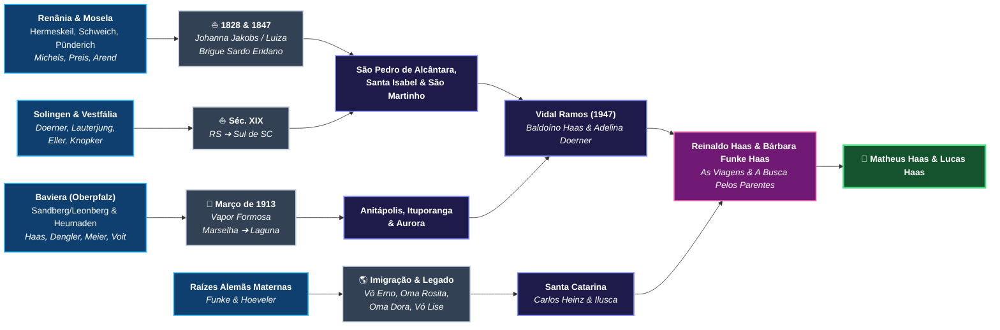

# 📖 Roteiro Literário do Livro

## Título Provisório
**O Mapa dos Ventos e do Sangue: A Saga de um Pai pelas Estradas do Brasil e da Europa em Busca dos Parentes de Seus Filhos**
*(Subtítulos alternativos: "De Heumaden e do Mosela a Santa Catarina: Uma Investigação Genealógica para Matheus e Lucas" | "As Coordenadas da Memória: Viagens Atrás das Raízes dos Meus Filhos")*

- **Autor:** Prof. Dr. Reinaldo Haas
- **Dedicatória:** *Para Matheus e Lucas — ponto de encontro de todos os navios, serras e sonhos que nos trouxeram até aqui — e para Bárbara, companheira de todas as travessias.*
- **Gênero:** Não-ficção narrativa / Memórias de viagem, investigação histórica e saga familiar (estilo híbrido entre *crônica de viagem*, *investigação documental de arquivo* e *épico de imigração*).
- **Extensão-alvo:** 90 a 100 mil palavras (≈ 320–360 páginas em 14×21 cm), 16 capítulos + Prólogo + Epílogo + Apêndices.
- **Público:** Em primeiro lugar, Matheus, Lucas e os mais de 600 descendentes de Johann e Maria; em segundo, leitores de história da imigração alemã no Sul do Brasil e de memórias de investigação genealógica.

---

## 🎯 Premissa (em uma frase)

> Um meteorologista que passou a vida rastreando a origem de massas de ar decide rastrear a origem de seus próprios filhos — e descobre que cada antepassado é uma frente que atravessou um oceano, deixou um rastro de perdas e chegou a Santa Catarina carregando o clima de outra terra.

**A pergunta dramática do livro:** *Conseguirá o pai encontrar, antes que as últimas vozes se calem, o lugar exato de onde cada corrente partiu — e algum parente vivo do outro lado?*

**A resposta (clímax):** Sim — no balcão gelado de um cartório bávaro, em 6 de fevereiro de 2018, diante do registro de nascimento do bisavô e do nome de um Haas ainda vivo na mesma aldeia.

---

## 🧭 Visão Geral e Fio Condutor da Obra

Um físico e meteorologista da Universidade Federal de Santa Catarina (UFSC), habituado a rastrear massas de ar, frentes frias e trajetórias invisíveis na atmosfera terrestre, decide aplicar a mesma curiosidade científica e paixão humana a um mistério íntimo: **mapear todas as correntes de sangue, migrações e parentes vivos que convergem em seus dois filhos, Matheus e Lucas**.

O livro alterna **dois tempos narrativos entrelaçados** a cada capítulo:
1. **O Tempo Presente (A Investigação & As Viagens):** As estradas percorridas por Reinaldo e Bárbara pelo interior de Santa Catarina, Rio Grande do Sul e Europa (culminando na expedição de inverno à Baviera em fevereiro de 2018), os diálogos gravados com os mais velhos, as festas de família, a rede colaborativa de e-mails com primos-detetives (como **Agenor Haas**, **Marise Haas Lourenço** e parentes na Alemanha) e a decifração de manuscritos góticos do século XIX.
2. **O Tempo Histórico (A Saga dos Antepassados — 1820 a 1973):** A reconstituição vívida da vida nas aldeias da Baviera, do Vale do Mosela, de Solingen e da Vestfália; as travessias oceânicas de **1828**, **1847** e **1913**; a abertura da mata virgem catarinense; os silêncios das duas Guerras Mundiais e a construção de comunidades inteiras com as próprias mãos.

---

## 🏛️ Arquitetura Narrativa

### Os três movimentos (estrutura em atos)

| Movimento | Partes | Função dramática | Pergunta que move o leitor |
| :--- | :--- | :--- | :--- |
| **I — Escuta** (≈ 25%) | Prólogo + Parte I | O chamado: as vozes dos velhos, as pistas soltas, a morte que impõe urgência | *De onde, exatamente, eles vieram?* |
| **II — Travessias** (≈ 50%) | Partes II, III e IV | O mergulho no passado: quatro correntes migratórias reconstruídas, cada uma com sua perda e sua conquista | *O que custou chegar até aqui?* |
| **III — Retorno** (≈ 25%) | Parte V + Epílogo | A expedição inversa: o descendente sobe do Mediterrâneo à Baviera, abre os livros e encontra os vivos | *Ainda há alguém do outro lado?* |

> **Nota de ordem:** A Parte II (Haas/Meier, 1913) vem antes da Parte III (1828/1847), embora seja cronologicamente posterior. É deliberado: o leitor se prende primeiro à história mais próxima e mais documentada (o *Fata* e a *Mota*, que os netos ainda conheceram) e só depois recua aos pioneiros mais antigos. A Parte V retoma justamente o fio da Parte II, fechando o arco principal.

### Convenções de voz e tipografia

| Camada | Voz | Tempo verbal | Tratamento gráfico |
| :--- | :--- | :--- | :--- |
| **Presente da investigação** | 1ª pessoa (Reinaldo) | Pretérito, tom de crônica | Texto corrido normal |
| **Passado reconstituído** | 3ª pessoa próxima do antepassado | Presente histórico nas cenas-chave, pretérito no resumo | Abertura de seção com local e data em versalete: *HEUMADEN, OBERPFALZ — ABRIL DE 1888* |
| **Documento** | O próprio arquivo | — | Caixa **"Ficha do Arquivo"**: transcrição, tradução, fonte e localização no repositório |
| **Boletim** | Voz do meteorologista | Presente | Uma página curta abrindo cada Parte (ver abaixo) |

**Regra de honestidade narrativa:** tudo o que for *reconstituição* (diálogos, pensamentos, clima de um dia específico) deve ser sinalizado com marcadores como *"imagino"*, *"é provável que"*, *"conta-se na família que"*. O que vier de documento é afirmado sem ressalva e remetido à Ficha do Arquivo ou aos Apêndices.

### O dispositivo do "Boletim Meteorológico"

Cada Parte abre com uma página no formato de um boletim de previsão — o leitmotiv que justifica o título *O Mapa dos Ventos*:

- **Parte I:** *"Situação sinótica: frente fria estacionária sobre o Vale do Itajaí. Tendência: perda gradual das vozes antigas."*
- **Parte II:** *"Ciclone extratropical no Atlântico Norte, março de 1913. Deslocamento previsto: Marselha → Laguna."*
- **Parte III:** *"Alísios de nordeste, 1828. Veleiros em calmaria equatorial. Visibilidade: dois séculos."*
- **Parte IV:** *"Massa de ar continental estável. Correntes contínuas Alemanha ↔ Brasil."*
- **Parte V:** *"Anticiclone siberiano sobre a Baviera, fevereiro de 2018. Temperaturas negativas. Céu limpo para leitura de arquivos."*

> Os boletins podem trazer, quando houver dado, a reanálise real do tempo na data (ex.: reanálise 20CR para março de 1913; ERA5 para fevereiro de 2018) — um gesto de assinatura do autor-meteorologista.

### Motivos recorrentes (fios que costuram o livro)

1. **Mãos que constroem** — o prumo e a colher de pedreiro de Johann, as rodas de Heumaden, as lâminas de Solingen, o machado da mata. Retorna no Epílogo como herança.
2. **A língua silenciada** — a *Mota* que nunca aprendeu português; o alemão proibido em 1941; o neto que precisa de dicionário para ler a *Kurrentschrift* dos próprios bisavós.
3. **Os túmulos de gesso** — os anjos que o *Fata* moldou para sobreviver acabam velando o seu próprio túmulo em Aurora. Aparece nos Caps. 6, 7 e no Epílogo.
4. **Coordenadas** — cada capítulo pode trazer, sob o título, a latitude/longitude do lugar principal (há 58 coordenadas no `arvore_familysearch.ged`). Culmina no Meridiano Zero (Cap. 16).
5. **Crianças que não chegaram** — Hildegard, Frida, Luisa, Walter, o pequeno João. Os filhos perdidos ecoam nos filhos que leem o livro.
6. **O vetor inverso** — 1913: Baviera → Mediterrâneo → Brasil. 2018: Brasil → Mediterrâneo → Baviera.

---

## 👥 Dramatis Personae

> Gerações contadas a partir de Matheus e Lucas (G1), seguindo o README.

**Presente**
- **Reinaldo Haas** (G2) — narrador; físico e meteorologista da UFSC.
- **Bárbara Funke Haas** (G2) — esposa, companheira de todas as viagens; o olhar sensível que contrabalança o rigor do cientista.
- **Matheus e Lucas Haas** (G1) — destinatários do livro; presentes nas viagens a Laguna, ao RS e aos Andes.
- **Agenor Haas** e **Marise Haas Lourenço** — os "primos-detetives"; Marise é a autora do texto do centenário de 2013.
- **Peter Henn** — oficial do *Standesamt* de Maxhütte-Haidhof (Cap. 14).

**Ramo Haas–Meier (Baviera → 1913)**
- **Josef Haas** e **Franziska Dengler** (G5) — operário e esposa em Sandberg/Leonberg.
- **Michael Meier** (*1820) e **Margaretha Pfannenstein** (*1825); **Johann Voit** (*1820) e **Barbara Woppmann** (*1825) (G6).
- **Georg Adam Meier** (*1859) e **Franziska Voit** (*1861) (G5) — casados em Moosbach em 23/11/1884.
- **Johann "Fata" Haas** (1884–1969) e **Maria "Mota" Meier Haas** (1888–1973) (G4) — os protagonistas históricos.
- Filhos: Hildegard e Frida (†Alemanha), Luisa e Walter (†Laguna, 1913), Gertrudes (1913), Fernando (1915), Alexandre (1917), Agnes/Inês (1920), Elza (1922), **Baldoíno** (1924), Maria (1926), João (1932, falecido criança).

**Ramo Doerner–Preiss–Michels–Arend (Renânia/Vestfália → 1828/1847)**
- **Nikolaus Arend (Arns)** (G7) — imigrante de 1847, Lote 38 de Santa Isabel.
- **Anton Michels** (1822–1874) e **Angela Catharina Arend** (1827–1924) (G6).
- **Bernard Preis** (1827–1893) e **Ignazia Loch** (*1828) (G6).
- **Guilherme Dorner** e **Joanna Lauterjung**; **Franz Adam Eller** e **Anna Maria Knopker** (G6).
- **Emanuel Preis** (1864–1927) e **Helena Michels** (1864–1945); **Carlos Doerner** (*1854) e **Anna Eller** (*1858) (G5).
- **Fernando Dörner** (1897–1981) e **Gertrudes Preiss** (1896–1970) (G4).
- **Baldoíno Haas** (1924–2013) e **Adelina Doerner Haas** (1926–2019) (G3) — os avós paternos; casados em 1947.

**Ramo Funke–Hoeveler**
- **Carlos Heinz Funke** e **Ilusca Leocádia Hoeveler Funke** (G3) — pais de Bárbara.
- **Vô Erno Hoeveler**, **Oma Rosita**, **Oma Dora**, **Vó Lise** (G4) — *parentescos exatos a confirmar com Bárbara (ver Pendências)*.
- **Katherine Funke**; **Joachim** (Bernau) — *grau de parentesco/amizade a confirmar*.

---

## 🗓️ Linha do Tempo Mestra

| Ano | Tempo Histórico | Tempo Presente | Cap. |
| :--- | :--- | :--- | :---: |
| 1822 | Nasce Anton Michels em Hermeskeil | | 8 |
| 1827 | Nascem Angela C. Arend (Pünderich) e Bernard Preis (Schweich) | | 8–9 |
| **1828** | Anton Michels (6 anos) chega a Desterro; fundação de São Pedro de Alcântara (1829) | | 8 |
| 1832 | Batismo de Franz Adam Eller na Vestfália | | 10 |
| **1847** | Nikolaus Arend chega no brigue *Eridano*; Lote 38 em Santa Isabel | | 9 |
| 1854 | Nasce Carlos Doerner em Solingen | | 10 |
| 1859 / 1861 | Nascem Georg Adam Meier e Franziska Voit | | 4, 15 |
| 1864 | Nascem Emanuel Preis e Helena Michels | | 9 |
| 1874 | Morre Anton Michels; Angela marcha para Vargem do Cedro | | 9 |
| **1884** | Nasce Johann Haas (11/07); casamento Meier–Voit (23/11) | | 4, 14 |
| **1888** | Nasce Maria Meier em Heumaden (07/04) | | 4, 15 |
| 1896 / 1897 | Nascem Gertrudes Preiss e Fernando Dörner | | 10 |
| 1907 | Casamento de Johann e Maria | | 4 |
| **1913** | Vapor *Formosa*; Laguna; nasce Gertrudes; morrem Luisa e Walter | Viagem a Laguna (2012) | 5 |
| 1913–1918 | Lote 17, Rio do Ouro (Anitápolis) | | 6 |
| 1918 | Subida para Rio Novo (Ituporanga) | | 6 |
| 1924 | Nasce Baldoíno; morre Angela Catharina aos 96 | | 6, 9 |
| 1926 | Nasce Adelina Doerner | | 1 |
| 1939 | Viagem frustrada de Johann à Alemanha | | 7 |
| 1941–1945 | Campanha de Nacionalização; o rádio no porão | | 7 |
| 1947 | Casamento de Baldoíno e Adelina | | 1 |
| 1969 / 1973 | Morrem Johann (19/03) e Maria (08/11) em Aurora | | 7 |
| | | **2012** — Laguna (fev.); Bodas de 65 anos (maio); RS e Festa Doerner (set.) | 1, 5, 10 |
| | | **2013** — Centenário (março); morte de Baldoíno (dez.) | 1, 3 |
| | | **2018** — Roma, Florença, Veneza (jan.); Maxhütte-Haidhof (06/02); Moosbach; Greenwich (16/02) | 13–16 |
| | | **2019** — Morte de Dona Adelina (fev.) | 1 |

> **Observação estrutural:** a morte de Dona Adelina (2019) acontece *depois* da viagem à Baviera. Isso permite uma cena poderosa a ser confirmada: **o filho mostrando à mãe, em Vidal Ramos, as certidões trazidas da Alemanha** — possivelmente o fecho da Parte V ou a abertura do Epílogo.

---

## 📑 Estrutura Detalhada Capítulo a Capítulo

> Cada capítulo traz: **Tempo/Voz** · **Abertura** · **Beats** (sequência de cenas) · **Imagem atmosférica** · **Âncora documental** · **Gancho de saída** · **Pendências**. A meta de extensão está entre colchetes.

---

### PRÓLOGO — As Coordenadas de Duas Vidas  `[3.000 palavras]`
- **Tempo/Voz:** Presente, 1ª pessoa.
- **Abertura:** Em Florianópolis, observando cartas sinóticas de ventos no laboratório da UFSC e depois olhando os filhos **Matheus** e **Lucas** em casa. Na física da atmosfera, nenhuma rajada de vento nasce do nada: toda corrente traz a memória térmica dos oceanos e montanhas por onde passou.
- **Beats:**
  1. O laboratório: a animação de satélite de uma frente fria subindo do Prata; o hábito profissional de perguntar *"de onde veio esta massa de ar?"*.
  2. A casa: os dois meninos à mesa; um traço de rosto que lembra o avô Baldoíno, outro que lembra os Funke.
  3. **A pergunta fundadora:** De quantas aldeias, portos, ofícios e milagres de sobrevivência são feitos dois meninos catarinenses do século XXI?
  4. **O pacto da jornada:** não deixar que o tempo apague as vozes dos avós — transformar lembranças soltas de mesa de domingo, pastas de fotografias amareladas, e-mails de primos distantes e viagens de férias numa grande expedição pelas raízes paternas (**Haas, Meier, Voit, Doerner, Eller, Preiss, Loch, Michels, Arend**) e maternas (**Funke, Hoeveler**).
  5. *Flash-forward* breve (um parágrafo): um cartório coberto de neve na Baviera, um livro de 1884 se abrindo — sem revelar o que há dentro.
- **Imagem atmosférica:** a retrotrajetória (*back-trajectory*) — o cálculo que, a partir de uma parcela de ar, refaz o caminho dela para trás no tempo. O livro inteiro é uma retrotrajetória.
- **Gancho:** *"Comecei, como todo meteorologista, pela estação mais próxima: a casa dos meus pais, em Vidal Ramos."*

---

### PARTE I — Ecos na Serra Catarinense: Os Guardiões da Memória Oral
*Onde a investigação começa dentro de casa, ouvindo os últimos guardiões vivos da primeira geração brasileira.*

#### Capítulo 1: A Casa de Vidal Ramos e as Bodas de 65 Anos  `[5.500 palavras]`
- **Tempo/Voz:** Presente (2012–2019), 1ª pessoa, com memórias de infância.
- **Abertura:** O carro descendo a estrada para **Vidal Ramos** em maio de 2012; a lista de perguntas no bolso.
- **Beats:**
  1. As viagens constantes a Vidal Ramos: o cheiro da madeira, a mesa farta, a serenidade de **Seu Baldoíno Haas** (1924–2013) e a lucidez afetuosa de **Dona Adelina Doerner Haas** (1926–2019).
  2. **Maio de 2012:** a celebração dos **65 anos de casamento** (casados em 1947) — o encontro de duas grandes correntes da imigração alemã em Santa Catarina: a de 1913 (Haas) e a de 1828/1847 (Doerner–Preiss–Michels).
  3. A câmera ligada: a gravação com Dona Adelina (`Dona_Adelina_Doerner_Haas.mp4`), salvando inflexões de voz, nomes de tios, localidades como *São Martinho*, *Vargem do Cedro*, *Brusque*, *Rio Novo* e *Aurora*. Transcrever trechos literais da fala dela.
  4. O que Baldoíno não contava: o silêncio dos homens daquela geração sobre a guerra e a língua (semente do Cap. 7).
  5. A partida de Seu Baldoíno em dezembro de 2013: a urgência emocional que transforma a pesquisa genealógica em missão de vida.
- **Imagem atmosférica:** a inversão térmica nos vales do Itajaí — a neblina da manhã que guarda o ar frio da noite, como a memória guarda o passado até o sol dissipá-la.
- **Âncora documental:** fotografias das Bodas de 65 anos; o vídeo de Dona Adelina.
- **Gancho:** Baldoíno, numa das últimas conversas, repete duas palavras que ouvia da mãe: *Heumaden* e *Sandberg*.
- **Pendências:** decupar o vídeo de Dona Adelina; reunir datas e local exato do casamento de 1947; definir onde narrar a morte de Dona Adelina (aqui, em antecipação, ou no Epílogo — recomenda-se o Epílogo).

#### Capítulo 2: Duas Palavras num Sotaque Bávaro — *"Fata"*, *"Mota"* e o Enigma de *Heumaden*  `[5.000 palavras]`
- **Tempo/Voz:** Memória oral (anos 1950–1973) filtrada pelos netos; 1ª pessoa no presente da investigação.
- **Abertura:** A fotografia `foto_familia_johann_haas_e_maria_meyer.jpg` sobre a mesa; o narrador descreve cada rosto antes de nomeá-los.
- **Beats:**
  1. **"Fata" (Johann/João Haas):** o artesão brincalhão, mestre das molduras e anjos de gesso, construtor de igrejas, leitor de jornais de Blumenau e de livros trazidos da Europa, contador de histórias depois de umas cervejas.
  2. **"Mota" (Maria Meier Haas):** a avó de olhos azuis meigos que nunca aprendeu o português, apoiada em muletas rústicas de madeira caminhando pela roça, comunicando-se com os netos brasileiros pelo abraço demorado.
  3. Os depoimentos dos netos (primos de Reinaldo) colhidos por telefone, e-mail e visitas: cada um guarda um fragmento diferente.
  4. **As duas pistas geográficas:** um povoado chamado **Heumaden** e um registro em **Leonberg / Sandberg**.
  5. **A falsa trilha (sugestão — confirmar se ocorreu):** a primeira busca no mapa leva a **Leonberg** e **Heumaden** perto de *Stuttgart*, em Württemberg — homônimos famosos, a centenas de quilômetros do lugar certo. A descoberta de que o sotaque do *Fata* era bávaro, não suábio, desloca a busca para o **Alto Palatinado**. Se a falsa pista não aconteceu de fato, ela pode entrar como reflexão sobre o perigo dos homônimos.
- **Imagem atmosférica:** o erro de posicionamento de uma estação meteorológica — um dado correto atribuído ao lugar errado contamina todo o mapa.
- **Gancho:** *"Eu tinha dois nomes. Precisava de mais gente procurando."*
- **Pendências:** confirmar se houve a confusão com Stuttgart; identificar quais netos deram cada depoimento (e pedir autorização para citá-los).

#### Capítulo 3: A Irmandade dos Primos-Detetives (O Centenário de 2013 e as Cartas Digitais)  `[5.000 palavras]`
- **Tempo/Voz:** Presente (2012–2017), 1ª pessoa; mosaico de mensagens.
- **Abertura:** Março de 2013, um salão cheio de sobrenomes; crachás, mesas por tronco familiar.
- **Beats:**
  1. **Cem anos da chegada:** o encontro dos descendentes de João e Maria Meyer Haas (mais de **600 descendentes diretos**) e o texto-marco redigido por **Marise Haas Lourenço**, reconhecendo os troncos aliados (*Meyer, Doerner, Sebold, da Rosa, Klettenberg, Boeing, Nagel, Sautner*).
  2. **A garimpagem digital e a grande planilha de Agenor Haas:** as trocas de e-mails com o primo-irmão **Eng. Civil Agenor Haas** (*18/07/1943, filho de Alexandre Haas e Paula Klettenberg Haas) e sua monumental planilha `Arvore genealógica.xls` (arquivo privado da família, não publicado), mapeando **291 linhas** de descendentes (11 filhos, 63 netos, 194 bisnetos e 109 trinetos) e **55 notas biográficas** manuscritas, inclusive revelando o casamento de Johann e Maria em **03/08/1907 em Eibenstock** e o destino das crianças falecidas na Alemanha (**Hildegart** e **Frida**) e em Rio do Ouro / Anitápolis (**Lina** e **Valter**).
  3. A descoberta do manifesto do *Formosa* (`doc_haas_navio_formosa_1913.jpg`) — o primeiro documento "de fora" que confirma a memória oral.
  4. Como a ciência de dados, scripts em Python (`scripts/importar_gmail_genealogia.py`) e a árvore colaborativa do *FamilySearch* começaram a conectar peças separadas por um oceano. Tom leve: o cientista confessando que tratou a família como um banco de dados — e que os dados insistiram em virar gente.
  5. A conclusão do grupo: *as respostas finais não estão em nenhum servidor; estão em livros paroquiais na Baviera.*
- **Imagem atmosférica:** a rede de estações de radiossondagem — nenhum observador isolado vê o sistema inteiro; só a rede vê.
- **Gancho:** a decisão — ainda distante — de um dia ir à Baviera. Corte para 1884.
- **Pendências:** rodar o importador do Gmail; selecionar e-mails-chave; **não publicar endereços de e-mail** (ver *Ética e Privacidade*).

---

### PARTE II — O Vapor *Formosa* e a Floresta: A Odisseia de Johann Haas e Maria Meier (1884–1973)
*A reconstituição dramática da travessia de 1913 e da conquista da sobrevivência entre o litoral e o Alto Vale do Itajaí.*

#### Capítulo 4: Antes da Partida — Os Carpinteiros de Heumaden e os Pedreiros de Sandberg  `[6.000 palavras]`
- **Tempo/Voz:** Histórico (1820–1913), 3ª pessoa próxima — alternando Maria (Heumaden) e Johann (Sandberg).
- **Abertura:** *HEUMADEN, OBERPFALZ — 7 DE ABRIL DE 1888, DUAS HORAS DA MADRUGADA.* A parteira Sra. Glas atravessa o escuro até a casa do *Ökonom* Georg Adam Meier.
- **Beats:**
  1. O mundo rural do **Alto Palatinado bávaro** no fim do século XIX: em **Heumaden, Rückersrieth e Burgtreswitz** (Paróquia de *St. Peter und Paul* de **Moosbach**, perto da Boêmia), a dinastia de *Wagner* (construtores de rodas e carroças) **Michael Meier** (*1820) e **Georg Adam Meier** (*1859), unida à família camponesa de **Johann Voit**, **Barbara Woppmann** e **Franziska Voit** (*1861), casados em 23/11/1884.
  2. O nascimento de **Maria Katharina Meier** em 7 de abril de 1888 (batizada em 08/04/1888 tendo como madrinha a tia *Katharina Meier, Bäuerin von Heumaden*) e seus irmãos em Heumaden (**Johann Baptist, Barbara, Margaretha, Josef, Georg e Anna Meier**).
  3. **Das olarias de Stoffen às forjas siderúrgicas de Sandberg / Leonberg:** a descoberta das raízes em **Stoffen (Landsberg am Lech, Alta Baviera)**, onde o tataravô **Georg Haas** (*Ziegelknecht* — oleiro) e **Maria Anna Albrecht** batizaram em **20/05/1847** o filho **Joseph (Josef) Haas** (*19/05/1847, `batismo_joseph_haas_1847_stoffen.png`). A migração de Josef para **Sandberg / Leonberg** (hoje **Maxhütte-Haidhof**) como operário da siderúrgica *Maximilianshütte*, seu casamento com **Franziska Dengler**, o nascimento de **Johann Haas** em **11 de julho de 1884** e seus irmãos (**Josef Jr., Alois, Georg, Maria, Franziska e Therese Haas**). O jovem Johann aprendendo a arte do estuque em gesso.
  4. O encontro de Johann e Maria e o casamento em **03 de agosto de 1907 em Eibenstock**.
  5. A dor silenciosa do sepultamento das duas primeiras filhas (**Hildegart** e **Frida**) ainda em solo alemão, e o nascimento de **Gertrudes** (*22/10/1911).
  6. A decisão de partir em março de 1913 com **Luisa** (2 anos), **Walter** (1 ano) e o bebê no ventre. O contexto: propaganda de emigração para o Brasil, crise, rumores de guerra.
- **Imagem atmosférica:** o inverno continental bávaro — ar seco e frio vindo do leste, a "Böhmischer Wind" que desce da Boêmia.
- **Âncora documental:** as quatro certidões de Moosbach (`doc1`–`doc4`) — aqui só mencionadas; serão "descobertas" em cena no Cap. 15. *Decisão de estrutura:* o Cap. 4 usa os fatos, mas sem mostrar os documentos, para preservar o momento da descoberta.
- **Gancho:** a família na plataforma de trem rumo ao sul, à França, ao mar.
- **Pendências:** pesquisar contexto local (Maxhütte e a siderurgia — origem do nome "Maxhütte" e possível emprego de Josef Haas como *Fabrikarbeiter*); local e paróquia do casamento de 1907; datas de Hildegard e Frida; motivo da escolha de Marselha (e não Bremen/Hamburgo).

#### Capítulo 5: Março de 1913 — Da Doca de Marselha à Quarentena de Laguna  `[6.000 palavras]`
- **Tempo/Voz:** Histórico (1913) em 3ª pessoa, intercalado com o presente (fev. 2012) em 1ª pessoa.
- **Abertura:** *MARSELHA — 7 DE MARÇO DE 1913.* O vapor **SS *Formosa*** no cais; a fila de emigrantes; linhas 161 a 164 do manifesto.
- **Beats:**
  1. O adeus definitivo e o embarque. Quatro nomes num papel que mudaria o destino de seiscentas vidas.
  2. A travessia: o Mediterrâneo, Gibraltar, o Atlântico; Maria grávida no porão de terceira classe.
  3. **26 de março de 1913:** a chegada à Baía de Guanabara e a recusa do desembarque no Rio de Janeiro. A angústia da quarentena costeira num navio superlotado, vagando de porto em porto até **Laguna**.
  4. **O Barracão dos Imigrantes em Laguna:** em **5 de maio de 1913**, seis dias após pisar em terra, nasce **Gertrudes**. E o preço mais cruel: fragilizados pela viagem, **Luisa** e **Walter** falecem em Laguna.
  5. **Presente (fev. 2012):** Reinaldo, Bárbara e os meninos em **Laguna** e Tubarão (acervo de Willy Zumblick), olhando o canal por onde os bisavós desembarcaram cem anos antes. Os filhos com a idade aproximada de quem não sobreviveu.
- **Imagem atmosférica:** o boletim de março de 1913 (reanálise) sobre o Atlântico Sul; o vento nordeste na barra de Laguna.
- **Âncora documental:** manifesto do *Formosa*; *buscar* registros de óbito de Luisa e Walter e de nascimento de Gertrudes (paróquia de Santo Antônio dos Anjos, Laguna).
- **Gancho:** a família, agora com uma recém-nascida e duas covas, segue para o interior, para um lote prometido.
- **Pendências:** confirmar a rota (Rio → Laguna: houve parada em Santos/Paranaguá/São Francisco?), o motivo da recusa no Rio (epidemia a bordo?), e as datas de morte das crianças. Atenção: o intervalo 26/03 → ~29/04 é longo e precisa de explicação documental.

#### Capítulo 6: Os Anjos de Gesso de Rio do Ouro e as Clareiras de Ituporanga  `[6.500 palavras]`
- **Tempo/Voz:** Histórico (1913–1932), 3ª pessoa; Maria como ponto de vista principal na segunda metade.
- **Abertura:** a carta da irmã de Maria vinda da Alemanha: *a Grande Guerra começou, não tentem voltar*.
- **Beats:**
  1. **O Lote 17 em Rio do Ouro (Anitápolis, 1913–1918):** as promessas quebradas de subsídios e ferramentas, o solo ácido que negava colheita.
  2. A engenhosidade de *Fata*: túmulos em granilite e **anjos de gesso** nos cemitérios coloniais para comprar o pão; nascem **Fernando** (1915) e **Alexandre** (1917).
  3. **A subida para Ituporanga (1918):** a mata de **Rio Novo** derrubada a machado.
  4. **Um olhar honesto sobre a fronteira:** o choque com os **Xokleng (Laklãnõ)**, legitimamente revoltados com a invasão de seu território, e a violência dos *bugreiros* financiados pelo poder público. *Recomendação:* tratar com fontes (ex.: Silvio Coelho dos Santos) e, se possível, ouvir a perspectiva Laklãnõ contemporânea (Terra Indígena Ibirama-La Klãnõ). O livro não deve romantizar a "conquista da mata".
  5. A coragem de *Mota* na cabana da floresta — onde nasceram **Agnes/Inês** (1920), **Elza** (1922), **Baldoíno** (1924) e **Maria** (1926).
  6. A mudança para **Águas Negras** para que as crianças, que só falavam alemão, frequentassem a escola; a perda precoce do caçula **João** (1932).
  7. **Os construtores de uma cidade:** Johann e os filhos erguendo a **Igreja Matriz**, a **Casa Paroquial**, o **Seminário Franciscano** e o **Hospital das Irmãs** de Ituporanga.
- **Imagem atmosférica:** as cheias do Itajaí; a chuva orográfica na serra — a mesma serra que o neto estuda profissionalmente.
- **Âncora documental:** registros de terra (Lote 17); livros de tombo da paróquia de Ituporanga; fotos das obras.
- **Gancho:** 1939 — Johann compra (ou tenta comprar) uma passagem de volta.
- **Pendências:** localizar a carta da irmã de Maria (existe? quem guarda?); verificar datas das obras em Ituporanga; nome e data do pequeno João.

#### Capítulo 7: O Rádio no Porão e as Caixas da Paz (1939–1973)  `[6.000 palavras]`
- **Tempo/Voz:** Histórico (1939–1973), 3ª pessoa; últimos beats já na memória dos netos.
- **Abertura:** a cena do **rádio ouvido baixinho no porão**, com um neto postado de vigia na estrada.
- **Beats:**
  1. O mistério de **1939**: o desejo frustrado de Johann de visitar ou retornar à Alemanha às vésperas da 2ª Guerra.
  2. **A Campanha de Nacionalização (1938–1945):** o medo nas colônias, a proibição do alemão em público, as notícias de humilhações, a espingarda que *Fata* mantinha ao alcance da mão para defender a dignidade da casa.
  3. O trauma da língua silenciada — amar o Brasil, pagar impostos, erguer igrejas e escolas, e ainda assim ser tratado como estrangeiro. Ponte com o Cap. 1: o silêncio de Baldoíno.
  4. **1945:** sem saber se algum parente sobrevivera, João e Maria reúnem roupas e mantimentos com os vizinhos para enviar à terra natal arrasada (as "Caixas da Paz").
  5. Os últimos anos em **Ribeirão das Pacas (Aurora)**: as Bodas de Ouro (1957), a partida de João (19/03/1969) e de Maria (08/11/1973), ambos aos 85 anos, sepultados no cemitério da Igreja Nossa Senhora das Dores, cercados pelos túmulos esculpidos pelo *Fata*.
- **Imagem atmosférica:** o silêncio de rádio — a estação meteorológica que para de transmitir e deixa um buraco no mapa.
- **Gancho:** *"Quando Maria morreu, ninguém na Baviera soube. O fio estava cortado. Cortado — mas não perdido."* Transição para a Parte III.
- **Pendências:** confirmar a história de 1939 e as "Caixas da Paz" (houve resposta da Alemanha?); fontes sobre episódios de violência em SC (cuidado com afirmações sobre "óleo de rícino" — citar depoimento ou bibliografia); confirmar o ano das Bodas de Ouro.

---

### PARTE III — Os Pioneiros de 1828, os Vales do Mosela e as Lâminas de Solingen (O Ramo Materno de Reinaldo)
*Recuando quase duzentos anos até os primeiros veleiros germânicos de Santa Catarina: Doerner, Eller, Preiss, Loch, Michels e Arend.*

> **Abertura de Parte (Presente):** Dona Adelina, ao final do vídeo de 2012, diz: *"A minha gente chegou muito antes da de teu pai."* É ela quem conduz o leitor para 1828.

#### Capítulo 8: 12 de Novembro de 1828 — Os Primeiros Barcos de Desterro (Michels, Loch e Preis)  `[5.500 palavras]`
- **Tempo/Voz:** Histórico (1828–1860), 3ª pessoa — o menino Anton como ponto de vista.
- **Abertura:** *BREMEN — VERÃO DE 1828.* Um menino de seis anos de Hermeskeil sobe a prancha de um veleiro.
- **Beats:**
  1. **Anton Michels** (*11/05/1822, **Hermeskeil, Trier-Saarburg**): embarcado aos 6 anos em Bremen (veleiros *Johanna Jakobs* / *Charlotte & Louise*) e chegado a Desterro nos brigues ***Luiza*** e ***Marquês de Viana*** em **novembro de 1828**.
  2. Desterro em 1828: uma vila açoriana que não esperava aqueles loiros de língua estranha; o inverno de espera até a fundação de **São Pedro de Alcântara** (1829) — a primeira colônia alemã de Santa Catarina.
  3. **Ignazia Loch** (*1828) e sua ligação com o núcleo pioneiro de São Pedro de Alcântara.
  4. **Bernard Preis** (*1827, **Schweich, Trier**; †1893, Alto São Martinho) — a chegada (quando? como?) e o casamento com Ignazia.
  5. **Presente:** Reinaldo visita São Pedro de Alcântara; a igreja, o cemitério, o marco de fundação.
- **Imagem atmosférica:** a calmaria equatorial (*doldrums*) que prendia os veleiros por semanas — o tempo que o vento decide.
- **Âncora documental:** listas de imigrantes de 1828; notas do `arvore_familysearch.ged`.
- **Gancho:** dezenove anos depois, outro brigue entra na baía trazendo uma moça do Mosela.
- **Pendências:** ⚠️ **Ignazia Loch** consta no GEDCOM como nascida em 1828 em São Pedro de Alcântara, mas a colônia só foi fundada em março de 1829 — verificar se nasceu na Europa, a bordo, em Desterro, ou se o ano está aproximado. Verificar também data e navio de Bernard Preis.

#### Capítulo 9: A Matriarca de 96 Anos — De Pünderich ao Lote 38 de Loeffelscheidt (1847–1924)  `[5.500 palavras]`
- **Tempo/Voz:** Histórico (1827–1924), 3ª pessoa — Angela Catharina como ponto de vista; é a heroína feminina da Parte III, espelho da *Mota*.
- **Abertura:** *PÜNDERICH, MOSELA — 5 DE DEZEMBRO DE 1827.* Vinhedos em encosta, o rio fazendo sua curva.
- **Beats:**
  1. A curva do Mosela em **Pünderich (Cochem-Zell)**: nasce **Angela Catharina Arend**.
  2. **05 de janeiro de 1847:** a travessia de seu pai, **Nikolaus Arend (Arns)**, no brigue sardo ***Eridano*** e na sumaca ***14 de Novembro*** até Desterro; o **Lote nº 38** na Primeira Linha Velha (**Loeffelscheidt**, Rio dos Bugres, **Colônia Santa Isabel / Águas Mornas**).
  3. O casamento com Anton Michels; os filhos; a vida na colônia.
  4. A viuvez em **1874** em Vargem Grande e sua marcha com os filhos para **Vargem do Cedro (São Martinho)**.
  5. O enlace de sua filha **Helena Michels** (1864–1945) com **Emanuel (Manoel) Preis** (1864–1927), origem de **Gertrudes Preiss** (*1896).
  6. Sua morte em **15 de setembro de 1924**, a menos de três meses de completar **97 anos** — quando o pequeno Baldoíno Haas já havia nascido. *A ponte invisível:* dois ramos que ainda não se conheciam coexistiram por cinco meses.
- **Imagem atmosférica:** a vinha e o clima — a uva do Mosela que precisa de encosta voltada ao sol; o milho da encosta catarinense.
- **Gancho:** a neta de Angela casará com o filho de um cuteleiro de Solingen.
- **Pendências:** confirmar a data exata de chegada do *Eridano* (o README usa 05/01/1847 como data de imigração); registros paroquiais de Pünderich.

#### Capítulo 10: Das Forjas de Solingen às Serras Gaúchas, Capivari e Brusque (Doerner, Eller & Peters)  `[6.000 palavras]`
- **Tempo/Voz:** Histórico (1832–1981) em 3ª pessoa; presente (2012) em 1ª pessoa.
- **Abertura:** o som de martelo em bigorna — **Solingen**, cidade das lâminas.
- **Beats:**
  1. **Solingen, Província do Reno (Prússia):** **Guilherme (Wilhelm) Dorner** e **Joanna Lauterjung** — sobrenome ligado às guildas de cuteleiros — e **Carl Reinhard (Carlos) Doerner** (*20/11/1854).
  2. **Da Vestfália ao Rio Grande do Sul:** o batismo de **Franz Adam Eller** (03/03/1832), a vinda com **Anna Maria Knopker** ao RS (nasce **Anna Eller**, 1858) e a migração para o sul catarinense (Imaruí, São Martinho).
  3. **O mito da bigamia/trigamia desfeito pelo manuscrito de 1900:** Carlos Doerner e Anna Eller têm **10 filhos**, culminando no caçula **Fernando Dörner** (*24/08/1897 em São Martinho). Após enviuvar de Anna Eller (~1898), Carlos casa-se legitimamente em segundas núpcias em **29 de abril de 1900**, na Capela de São José em Capivari (Assento nº 23, Pe. Francisco Auling, `casamento_carlos_doerner_hulda_peters_1900.png`), aos 45 anos, com **Hulda Peters (Petersen)** (*20/08/1870, 29 anos, filha de João Peters e Paulina Büchner), com quem tem mais **5 filhos** (*Laura, Clara, Carlos Jr., Ida e Ricardo* — 15 filhos ao todo!).
  4. O casamento de **Fernando Dörner** com **Gertrudes Preiss** — o ponto em que todas as correntes da Parte III se fundem.
  5. **Viagens de reencontro (set. 2012):** a família no **Rio Grande do Sul** e a **Festa da Família Doerner**.
  6. As certidões e o Cemitério Parque da Saudade em **Brusque**: **Gertrudes Preiss Doerner** (†1970) e **Fernando Dörner** (†1981) — pais de Dona Adelina. Fecho emocional: a filha deles, Adelina, é a mulher que gravou o vídeo do Cap. 1.
- **Imagem atmosférica:** o minuano gaúcho — o vento que os Eller conheceram antes de subir para Santa Catarina.
- **Âncora documental:** `casamento_carlos_doerner_hulda_peters_1900.png`, `doc_doerner_obito_fernando_1981.jpg`, `doc_doerner_obito_gertrudes_preiss_1970.jpg`.
- **Gancho:** fecho da linhagem paterna — *"Do lado do meu pai e da minha mãe, já tínhamos quatro séculos de vento. Faltava a outra metade dos meus filhos."*

---

### PARTE IV — Os Horizontes de Bárbara: A Saga Lohmann, Schnack, Endres, Hoeveler e Funke
*A outra metade da alma de Matheus e Lucas: dos veleiros de 1846 no Vale do Taquari (Estrela e Arroio do Meio, RS) à medicina, ao direito e à arte em Joinville (SC).*

> **Destaque estrutural:** Bárbara participa como **co-narradora** nesta Parte (trechos em 1ª pessoa dela, em itálico), conduzindo o leitor da garagem da **Oma Rosita** em Joinville até a expedição de setembro de 2012 ao Vale do Taquari (RS), onde a família visitou os irmãos vivos de Rosita e os cemitérios históricos de Estrela e Arroio do Meio.

#### Capítulo 11: Na Garagem da Oma Rosita, nos Retratos do Vô Erno e no Legado do Dr. Carlos Heinz Funke  `[6.000 palavras]`
- **Tempo/Voz:** Presente, alternando Reinaldo e Bárbara; memórias de infância em Joinville e Nova Petrópolis.
- **Abertura:** a fotografia de quatro gerações na garagem da casa em Joinville (início de 2005, `lohmann_4_geracoes_oma_rosita_ilusca_barbara_matheus.jpg`): a bisavó **Oma Rosita Lohmann Hoeveler**, a avó **Dra. Ilusca Leocádia Hoeveler Funke** segurando o pequeno **Matheus**, e **Bárbara** grávida de **Lucas**.
- **Beats:**
  1. O casamento de Reinaldo e **Bárbara Funke Haas** (*27/07/1972) entrelaçando as linhagens **Funke**, **Hoeveler**, **Lohmann**, **Endres** e **Schnack**.
  2. **O ramo Funke em Joinville e Blumenau:** a fotografia histórica de **Oma Dora Funke com seus sete irmãos** (22/01/1983, `funke_oma_dora_7_irmaos_1983.jpg` e `funke_bisavo_e_familia_oma_dora.jpg`); a trajetória do pai de Bárbara, o médico **Dr. Carlos Heinz (Heins) Funke** (*10/08/1939 em Joinville – †1989 em Joinville), formado em Medicina no RS e eternizado como patrono da **Escola Agrícola Municipal Dr. Carlos Heins Funke** e da **UBSF Dr. Carlos Heinz Funke** em Pirabeiraba, Joinville.
  3. **O ramo Hoeveler:** o porte sereno do **Vô Erno Hoeveler** (`hoeveler_vo_erno_escola.jpg`), professor luterano que lecionou nas escolas comunitárias de Estrela e Nova Petrópolis (RS) cercado por dezenas de alunos; a mãe de Bárbara, a advogada **Dra. Ilusca Leocádia Hoeveler Funke** (*~1943); o tio **Walter Hoeveler** (*"Tio Walter"*, radicado em Florianópolis desde 1960 e inspirador do livro *Viagens de Walter*, 2013, da irmã de Bárbara, a jornalista e escritora **Katherine Funke**), além dos irmãos **Alessandra Funke** e **Paulo Jacques Funke**.
  4. A caixa de retratos na casa de Oma Rosita (†2014): o retrato oval de casamento dos bisavós de Bárbara, **Francisco Jacob Lohmann** e **Miguelina (Michelina) Leocádia Endres** (`lohmann_bisavo_francisco_e_bisavo_michelina.jpg`), abrindo o mapa do Rio Grande do Sul.
- **Imagem atmosférica:** o microclima de Joinville entre a Serra Dona Francisca e a Baía da Babitonga — onde o ar úmido do mar encontra a encosta da mata atlântica.
- **Âncora documental:** `lohmann_4_geracoes_oma_rosita_ilusca_barbara_matheus.jpg`, `hoeveler_vo_erno_escola.jpg`, `funke_oma_dora_7_irmaos_1983.jpg`, `funke_bisavo_e_familia_oma_dora.jpg`.
- **Gancho:** *"Para entender quem eram Francisco e Michelina no retrato oval, precisávamos descer a serra até o Vale do Taquari."*

#### Capítulo 12: Da Fazenda Lohmann aos Cemitérios de Estrela — A Expedição ao Vale do Taquari (1821–2018)  `[6.000 palavras]`
- **Tempo/Voz:** Histórico (1821–1975) em 3ª pessoa, entrelaçado com o diário da viagem da família ao Rio Grande do Sul em **setembro de 2012** (1ª pessoa).
- **Abertura:** *25 DE SETEMBRO DE 2012 — ARROIO DO MEIO E ESTRELA, RS.* Reinaldo, Bárbara, Matheus (10 anos) e Lucas (7 anos) batem à porta dos tios-avós octogenários e nonagenários — os irmãos vivos da Oma Rosita.
- **Beats:**
  1. **De Harderode (Braunschweig) ao navio *Hiran* (1846):** os hexavós **Johann Friedrich Christian Lohmann** (*1788 †1853) e **Sophie Dorothee Elizabeth Schrader** (*1796 †1868) na Baixa Saxônia; a partida do pentavô **Georg Karl Maximilian Lohmann** (*12/07/1821 em Harderode – †28/07/1899 em Estrela, RS) em 04/09/1846 no veleiro *Hiran* (chegada ao RJ em 05/12/1846), seguido em 1848 pelo irmão **Georg August Christian Lohmann** (*1827 †1901).
  2. **A Fazenda Lohmann e os Cemitérios Históricos de Estrela:** o casamento de Georg Karl Maximilian em **06/05/1849** com **Bárbara Wingert** (*05/07/1828 – †24/11/1915); os 12 filhos; a casa enxaimel hoje preservada como **Museu da Família Lohmann** no Parque Histórico de Lajeado; e os túmulos centenários preservados no **Cemitério da Linha Winck / Linha Lenz** e no **Cemitério de Novo Paraíso**, em Estrela, RS.
  3. **O ramo Schnack de Schleswig-Holstein e a tragédia de 1889:** os pentavós **Julius Georg Schnack** (*16/02/1830 em Schleswig-Holstein – †19/03/1924 em Arroio do Meio, filho de Peter Friedrich Ludwig Schnack e Regine Marie Wacker) e **Susanna Charlotte Köhnlein** (*1835 †1926); o casamento de duas irmãs Schnack com dois irmãos Lohmann. O tetravô **Friedrich Lohmann** (*18/02/1853 – †31/01/1937) e **Suzana Regina Schnack** (*09/07/1858 – †16/12/1889), que falece apenas **26 dias após dar à luz** o trisavô **Francisco Jacob Lohmann** (*20/11/1889 – †24/01/1975).
  4. **Os doze irmãos de Arroio do Meio e o reencontro de 2012:** o casamento de Francisco Jacob Lohmann em **05/09/1914** com **Miguelina Leocádia Endres** (*09/12/1891) e seus 12 filhos (*Walter Érico, Reinholdo, Urbano Aldo, Armando Ernesto, Walter Erich, Blanca Erna, Albano Paulo, Rosita Érica, Eldo Astor, Asunda Erna, Dulsa Iria e Arlindo Erno*). As visitas emocionantes de setembro de 2012 ao **Tio Arlindo Erno Lohmann** (*1924 †2018, `lohmann_visita_tio_arlindo_2012.jpg`), **Tio Armando Ernesto Lohmann** (*1916, `lohmann_visita_tio_armando_2012.jpg`), **Tio Urbano Aldo Lohmann** (*1914, `lohmann_visita_tio_urbano_2012.jpg`) e **Tia Sunta (Asunda Erna) Lohmann** (*1921, `lohmann_visita_tia_sunta_2012.jpg`), além das cartas de **Joachim** (*Grüße aus Bernau*).
  5. **A preparação para a grande viagem europeia:** o roteiro traçado para cruzar o Atlântico rumo à Baviera.
- **Imagem atmosférica:** a corrente de jato e as cheias do Rio Taquari — a força das águas que moldou as colônias de Estrela, Lajeado e Arroio do Meio.
- **Âncora documental:** `lohmann_bisavo_francisco_e_bisavo_michelina.jpg`, `lohmann_visita_tio_arlindo_2012.jpg`, `lohmann_visita_tio_armando_2012.jpg`, `lohmann_visita_tio_urbano_2012.jpg`, `lohmann_visita_tia_sunta_2012.jpg` e registros do FamilySearch (`27QQ-TM9`, `G2M8-ZQ3`, `G89F-N3L`).
- **Gancho:** janeiro de 2018, aeroporto; na mochila, a cópia do manifesto do *Formosa*.

---

### PARTE V — Três Rios e uma Herança (NOVA)
*O meteorologista para a narrativa para olhar o que une os quatro ramos: os rios que transbordam e aquilo que cada geração recebe e entrega.*

> **Renumeração:** com esta Parte, a antiga Parte V passa a ser a **Parte VI**, e os antigos Caps. 13–16 passam a ser os **Caps. 15–18**. As enchentes também aparecem entrelaçadas nos capítulos anteriores: Tubarão e Laguna no Cap. 5; a cheia de 1911, a Barragem Sul de Ituporanga e a Barragem Norte com a Terra Indígena Laklãnõ no Cap. 6; o Alto Vale no Cap. 7; Brusque e o Itajaí-Mirim no Cap. 10; Roca Sales e Arroio do Meio no Cap. 12.

#### Capítulo 13: Três Rios, Uma Só Chuva — Tubarão, Itajaí e Taquari  `[4.500 palavras]`
- **Tempo/Voz:** Presente, 1ª pessoa; ensaio científico-afetivo.
- **Beats:**
  1. **Rio Tubarão, março de 1974:** a cidade submersa, na foz onde os Haas desembarcaram em 1913 (Laguna); a retificação do rio depois da catástrofe.
  2. **Rio Itajaí:** as cheias de 1880 e de 1911 (dois anos antes da chegada do *Formosa*), as de julho de 1983 e agosto de 1984 (El Niño forte), a de novembro de 2008 (fluxo de leste contra a serra, deslizamentos). As barragens Oeste (Taió), Sul (Ituporanga) e Norte (José Boiteux), esta sobre a Terra Indígena Ibirama-Laklãnõ. O Alto Vale do Fata e da Mota: Ituporanga, Aurora, Vidal Ramos; e Brusque, dos Dörner.
  3. **Rio Taquari–Antas:** maio de 1941; setembro e novembro de 2023; maio de 2024. Roca Sales, onde ficava a Fazenda Lohmann, e Arroio do Meio. A **Casa Lohmann** de Palmas na cota de 45 m e o perfil topográfico e hidrológico traçado pelo autor (`lohmann_perfil_topografico_enchente_2024_palmas.png`).
  4. **Os mecanismos:** jato de baixos níveis, frentes semiestacionárias, ciclones extratropicais, El Niño e La Niña — "o clima não é destino".
  5. **Por que as várzeas:** a água era estrada, energia e solo fértil, e também é risco herdado.
- **Imagem atmosférica:** a mesma chuva caindo em três bacias e três gerações.

#### Capítulo 14: O Que Se Herda  `[4.000 palavras]`
- **Tempo/Voz:** Presente, 1ª pessoa; ensaio narrativo.
- **Beats:**
  1. **A terra:** a partilha igualitária (*Realteilung*) do Mosela e do Hunsrück frente ao herdeiro único (*Anerbenrecht*) da Baviera e da Vestfália, como motores das emigrações (Michels, Arend, Preis × Georg Haas, oleiro de Stoffen, e Josef, operário da Maximilianshütte).
  2. **O lote colonial:** famílias de 11, 12 e 15 filhos; o filho que fica com os pais e os que partem (Paraná, Oeste); as 24 colônias da Fazenda Lohmann; Ellen Woortmann, *Herdeiros, parentes e compadres* (1995).
  3. **Heranças imateriais:** o ofício (gesso e prumo, rodas, lâminas, magistério, medicina), a fé (católicos e luteranos; a "religião mista" de 1900), a língua (silenciada em 1941, reaprendida para ler *Kurrentschrift*) e os nomes (o *Leocádia* de Miguelina para Ilusca).
  4. **A herança do risco:** casas e lotes à beira de rios que voltam a subir.
  5. **O novo lote:** o arquivo digital entregue a Matheus e Lucas — e a decisão de atravessar o oceano.

---

### PARTE VI — Inverno na Baviera: A Expedição Europeia em Busca dos Parentes Vivos
*O clímax narrativo do livro: a viagem real à Europa em janeiro e fevereiro de 2018 e a decifração final dos arquivos.*

#### Capítulo 13: Atravessando os Alpes no Inverno (Janeiro–Fevereiro de 2018)  `[5.000 palavras]`
- **Tempo/Voz:** Presente, 1ª pessoa, diário de viagem (datas como subtítulos).
- **Abertura:** desembarque na Europa em pleno inverno boreal; o termômetro do celular.
- **Beats:**
  1. A subida pelo Velho Mundo — **Roma** (24/01), **Florença** (28/01), **Veneza** (29/01) — sentindo a mudança de latitude, língua e paisagem rumo aos Alpes e à **Baviera**. Usar as 518 fotos de `Europa_gopro` como roteiro visual.
  2. O contraste: em março de 1913, Johann (28 anos) e Maria (24) desceram da Baviera ao Mediterrâneo para nunca mais ver a neve de sua terra; 105 anos depois, o neto faz o vetor inverso, com os nomes deles na mochila.
  3. A travessia dos Alpes (Brenner?) — a neve como fronteira física e simbólica.
  4. A chegada a Regensburg na véspera; a noite insone; a lista do que perguntar no cartório.
- **Imagem atmosférica:** o *Föhn* — o vento que desce aquecido dos Alpes; e a sua inversão: a subida que esfria.
- **Gancho:** *"Às nove da manhã de 6 de fevereiro, a porta do Standesamt ainda estava fechada."*
- **Pendências:** reconstituir o roteiro entre 29/01 (Veneza) e 06/02 (Maxhütte-Haidhof) — onde a família esteve? Confirmar idade de Maria em março de 1913 (24 anos, nascida em abril de 1888).

#### Capítulo 14: 6 de Fevereiro de 2018 — A Porta do *Standesamt* de Maxhütte-Haidhof  `[6.000 palavras]`
- **Tempo/Voz:** Presente, 1ª pessoa; ritmo lento, cena em tempo quase real — **o clímax do livro**.
- **Abertura:** a *Regensburger Straße 18*, neve suja na calçada, a placa do **Standesamt Maxhütte-Haidhof**.
- **Beats:**
  1. Chegada a **Maxhütte-Haidhof** (distrito de Schwandorf, ao norte de Regensburg), município que incorporou **Leonberg** e **Sandberg**.
  2. O encontro com o oficial **Peter Henn**; a barreira da língua; o papel do manifesto e da árvore impressa.
  3. **A revelação do Livro de 1884:** o assento **nº 47, de 13 de julho de 1884**: o operário **Josef Haas**, de **Sandberg**, comunica o nascimento do filho **Johann Haas** com **Franziska Dengler**, em **11 de julho de 1884, às cinco horas da tarde**. O carimbo: *Maxhütte-Haidhof, 06.02.2018*. (Ficha do Arquivo: `doc_haas_nascimento_johann_1884.jpg`.)
  4. **Um parente vivo na mesma terra:** uma segunda folha mostra um **Haas** nascido em **Leonberg** em 1941, ainda vivendo ali perto. A emoção de caminhar pelas ruas onde o sangue do *Fata* permaneceu por mais de um século.
  5. **(A definir)** — houve encontro com esse parente? Se sim, é a cena mais importante do livro e merece capítulo próprio ou meia dúzia de páginas. Se não, o livro deve assumir o "quase": a porta em que não se bateu, a carta que ainda pode ser escrita — e isso pode virar o fio aberto do Epílogo.
- **Imagem atmosférica:** a sondagem — o balão que sobe e, de repente, atravessa a camada de nuvens.
- **Gancho:** *"Faltava a outra metade: a Mota. Faltava Heumaden."*
- **Pendências:** ⚠️ ver *Ética e Privacidade* sobre a pessoa viva; confirmar se houve contato.

#### Capítulo 15: A Estrada para Heumaden e o Segredo da Letra Gótica em Moosbach  `[6.000 palavras]`
- **Tempo/Voz:** Presente, 1ª pessoa, com inserções do passado (as cenas do Cap. 4 ressoam aqui).
- **Abertura:** a placa de estrada — **HEUMADEN** — a ~50 km (em linha reta) a nordeste de Maxhütte-Haidhof, nas colinas perto da fronteira tcheca.
- **Beats:**
  1. O nome que a *Mota* repetia em Aurora deixa de ser lenda: **Heumaden**, **Moosbach**, **Rückersrieth**, **Burgtreswitz**.
  2. Os livros paroquiais de **St. Peter und Paul, Markt Moosbach** (Diocese de Regensburg) — *confirmar se a consulta foi presencial na paróquia, no arquivo diocesano de Regensburg (Bischöfliches Zentralarchiv) ou via Matricula Online*.
  3. O desafio paleográfico: a *Kurrentschrift* página por página; o narrador aprendendo a reconhecer o "M" de Meier.
  4. **O instante mágico:** **página 441, registro nº 36** de 1888: *"Maria Meier, nascida em 7 de abril às 2h da manhã em Heumaden"*, filha do *Ökonom* Georg Adam Meier e de Franziska Voit, aparada pela parteira Sra. Glas. *(Eco direto da abertura do Cap. 4.)*
  5. O livro de casamentos de 1884 (página 93) e os batismos de 1859 e 1861: Michael Meier, Margaretha Pfannenstein, Johann Voit, Barbara Woppmann. O quebra-cabeça bávaro completo.
  6. A caminhada por Heumaden: a igreja, as casas, talvez a oficina de rodas que já não existe.
- **Imagem atmosférica:** o céu limpo e frio do anticiclone — a visibilidade máxima, como a da revelação.
- **Âncora documental:** `doc1_maria_meier_1888.jpg`, `doc2_trauung_meier_voit_1884.jpg`, `doc3_adam_meier_1859.jpg`, `doc4_franziska_voit_1861.jpg` e os detalhes ampliados.
- **Gancho:** dez dias depois, um último ponto no mapa.

#### Capítulo 16: Com os Pés no Meridiano Zero — De Greenwich às Fronteiras dos Andes  `[4.000 palavras]`
- **Tempo/Voz:** Presente, 1ª pessoa, tom reflexivo — o "desfecho" antes do Epílogo.
- **Abertura:** **16 de fevereiro de 2018** (`51.4762° N, 0.0000° E`), Observatório Real de **Greenwich**: o professor de Física pisa sobre a linha de **Longitude Zero**.
- **Beats:**
  1. A linha como origem arbitrária e, ainda assim, necessária — toda família também escolhe seu "meridiano zero".
  2. As 58 coordenadas do arquivo genealógico — de Pünderich, Hermeskeil, Schweich, Solingen, Leonberg e Heumaden a Laguna, São Pedro de Alcântara, Anitápolis, São Martinho, Ituporanga, Vidal Ramos, Aurora e Florianópolis — desenhadas como um mapa único (*sugestão:* esse mapa vira a guarda/contracapa interna do livro).
  3. As viagens com Bárbara, Matheus e Lucas pela Cordilheira dos Andes (Valparaíso, Santiago, Valle Nevado): os filhos já fazendo suas próprias travessias. *(Manter breve: serve para entregar a bússola às novas gerações, não para abrir nova linha narrativa.)*
- **Imagem atmosférica:** a circulação geral da atmosfera — todas as células de vento do planeta formando um único sistema.
- **Gancho:** a volta para casa.

---

### EPÍLOGO — A Bússola Entregue a Matheus e Lucas  `[3.500 palavras]`
- **Tempo/Voz:** Presente (2018–2019 e o "agora" da escrita), 1ª pessoa.
- **Beats:**
  1. **(Sugestão — confirmar se aconteceu)** Vidal Ramos, 2018: o filho mostra a Dona Adelina as certidões trazidas da Baviera. A última guardiã vê fechar-se o círculo que o marido dela começou a contar.
  2. A morte de Dona Adelina em **fevereiro de 2019** — um ano depois da expedição.
  3. De volta a Florianópolis e ao Sítio das Andorinhas: o código em Python, os documentos escaneados e o repositório digital como cápsula do tempo viva.
  4. **Carta final aos filhos Matheus e Lucas:**
     - *"Vocês carregam nas mãos o prumo de pedreiro e a arte em gesso de Johann Haas; a doçura silenciosa de Maria Meier; as rodas de madeira de Heumaden; o aço das forjas de Solingen dos Doerner e Lauterjung; a coragem de um menino de seis anos chamado Anton Michels desembarcando em Desterro em 1828; a longevidade de quase um século de Angela Catharina Arend; e a luz, a música e o afeto dos Funke e dos Hoeveler."*
  5. A árvore nunca termina: ela apenas muda de mãos. Agora a bússola é deles. *(Última imagem possível: os anjos de gesso de Aurora, ou um mapa de vento com todas as setas convergindo para Florianópolis.)*

---

## 🔍 Pontos de Verificação Histórica (antes da redação final)

| # | Afirmação no roteiro | Status / Ação |
| :---: | :--- | :--- |
| 1 | Ignazia Loch nascida em 1828 em São Pedro de Alcântara | ⚠️ A colônia foi fundada em março de 1829 — verificar local/ano reais |
| 2 | Rota do *Formosa*: Marselha (07/03) → Rio (26/03) → Laguna; desembarque ~29/04 | Foto de despedida datada de 7/3/1913 e manifesto assinado "Rio, le 26 Mars 1913" ("continue sur Santos"). O Agenor anotou 13/03 → 26/04. Confirmar as paradas e o porto de desembarque |
| 3 | Luisa e Walter falecidos em Laguna, 1913 | O manifesto confirma Luisa (2) e Walter (1) a bordo; a planilha do Agenor registra "Lina" e "Valter" sepultados em Anitápolis e Gertrudes nascida em 22/10/1911. Buscar assentos em Laguna e Anitápolis |
| 4 | Carta da irmã de Maria sobre a guerra (1914) | Confirmar existência e guardião do documento |
| 5 | Viagem frustrada de 1939 | Confirmar fonte (memória oral? passaporte?) |
| 6 | Episódios de violência na Campanha de Nacionalização | Apoiar em bibliografia (ex.: estudos sobre o Estado Novo em SC) e em depoimentos identificados |
| 7 | Xokleng/Laklãnõ e bugreiros | Tratar com bibliografia especializada; evitar estereótipos |
| 8 | Chegada de 1828: navios em Bremen e em Desterro | Conferir com listas de imigrantes de São Pedro de Alcântara |
| 9 | *Eridano*, 05/01/1847 e Lote 38 | Conferir com registros da Colônia Santa Isabel |
| 10 | Mais de 600 descendentes | Citar a fonte (texto do centenário de Marise) |
| 11 | Grafias Dorner/Doerner/Dörner; Preis/Preiss/Preuss; Meier/Meyer | Padronizar no texto e explicar as variantes uma única vez |
| 12 | Johann (28) e Maria (24) em março de 1913 | Maria fez 25 em abril, já no Brasil — usar "24" no Cap. 13 |

---

## 🛡️ Ética e Privacidade

- **Pessoas vivas:** o parente de Leonberg identificado no Cap. 14 (nome, ano de nascimento e rua) **não deve ter dados pessoais publicados sem consentimento expresso** (o livro será lido também na Alemanha, sob o GDPR). Alternativas: obter autorização por escrito; ou citar apenas "um Haas nascido em Leonberg durante a guerra, vivendo a poucos quarteirões".
- **E-mails e endereços:** retirar do texto final todos os endereços de e-mail (ex.: o do primo Agenor, hoje presente na Fase 2 do cronograma); citar trechos de mensagens apenas com autorização dos autores.
- **Depoimentos de familiares:** termo simples de autorização de uso de imagem e voz (inclusive para o vídeo de Dona Adelina, a ser autorizado pelos herdeiros).
- **Imagens de documentos:** certidões civis alemãs pós-1900 podem ter restrição de reprodução; confirmar com o *Standesamt*. Registros paroquiais: pedir licença de publicação ao arquivo diocesano.
- **Matheus e Lucas:** confirmar com eles o que desejam ver publicado sobre si.

---

## 🗂️ Caderno de Apêndices Planejados para a Edição Impressa / Digital

1. **Apêndice A — Árvore Genealógica Ilustrada de 7 Gerações** (diagramas completos paternos e maternos de Matheus e Lucas).
2. **Apêndice B — Galeria Documental Comentada & Transcrições Paleográficas:**
   - Assento de nascimento nº 47/1884 de Johann Haas (*Standesamt Leonberg / Maxhütte-Haidhof, 06/02/2018*).
   - Manifesto original do vapor *SS Formosa* (Marselha ➔ Rio de Janeiro, 26/03/1913).
   - Os quatro assentos paroquiais em *Kurrentschrift* de *St. Peter und Paul, Moosbach* (1859, 1861, 1884 e 1888) com tradução linha a linha.
   - Certidões de Fernando Dörner (1981) e Gertrudes Preiss Dörner (1970) e registros de imigração de 1828 e 1847.
3. **Apêndice C — Mapa das Travessias e Roteiro Geográfico** (guia das cidades na Baviera, Renânia-Palatinado, Renânia do Norte-Vestfália e Santa Catarina para futuras viagens de Matheus, Lucas e dos mais de 600 primos), gerado a partir das 58 coordenadas do GEDCOM.
4. **Apêndice D — Vozes da Família (Memorial Colaborativo & Encontros):** cartas, e-mails e relatos enviados por **Agenor Haas**, **Marise Haas Lourenço**, **Dona Adelina Doerner Haas** e demais familiares (com autorização).
5. **Apêndice E — Guia do Pesquisador:** como ler *Kurrentschrift*, onde ficam os arquivos (Standesamt, arquivos diocesanos, Matricula Online, FamilySearch, arquivos de SC), e como usar o repositório e os scripts — para que outros primos continuem a busca.
6. **Apêndice F — Glossário:** *Ökonom*, *Wagner*, *Standesamt*, *Fabrikarbeiter*, *Kurrentschrift*, sumaca, brigue, lote colonial, bugreiro etc.

---

## ✍️ Cronograma Prático de Escrita

| Etapa | Escopo | Fontes Já Prontas no Repositório | O que ainda falta levantar |
| :--- | :--- | :--- | :--- |
| **Fase 0** | Resolver pendências críticas (tabela de Verificação + Ética) | — | Consentimentos; parente de Leonberg; roteiro 29/01–06/02/2018 |
| **Fase 1** | **Parte II** (Caps. 4–7) e **Parte V** (Caps. 13–15) | Texto do centenário (2013), lista do *Formosa*, certidão de Maxhütte-Haidhof (06/02/2018), 4 certidões de Moosbach e 518 fotos da `Europa_gopro` | Óbitos de Luisa e Walter; carta da irmã de Maria; datas das obras em Ituporanga |
| **Fase 2** | **Parte I** (Caps. 1–3) + **Apêndice D** | `scripts/importar_gmail_genealogia.py` + vídeo `Dona_Adelina_Doerner_Haas.mp4` | Decupagem do vídeo; depoimentos dos netos; autorizações |
| **Fase 3** | **Parte III** (Caps. 8–10) | `arvore_familysearch.ged` (232 fontes, notas de 1828 e 1847), certidões de Brusque, fotos da Festa Doerner | Origem de Ignazia Loch; chegada de Bernard Preis e Carlos Doerner |
| **Fase 4** | **Parte IV** (Caps. 11–12), **Prólogo**, **Cap. 16** e **Epílogo** | Acervo fotográfico de Vô Erno, Oma Rosita, Oma Dora, Vó Lise e Joachim (Bernau) | **Entrevistas com Bárbara, Carlos Heinz e Ilusca** — a Parte IV depende delas |
| **Fase 5** | Revisão integral, Boletins de abertura das Partes, apêndices e mapa | Reanálises 20CR/ERA5 (opcional) | Leitura crítica por 2–3 primos e um historiador da imigração |

### Sugestão de ordem de redação
Começar pelo **Cap. 14** (o clímax, com documento e memória mais frescos) e pelo **Cap. 5** (a travessia): escrevê-los primeiro fixa o tom do livro e define, de trás para frente, o que os demais capítulos precisam preparar — uma retrotrajetória, como convém a um meteorologista.
